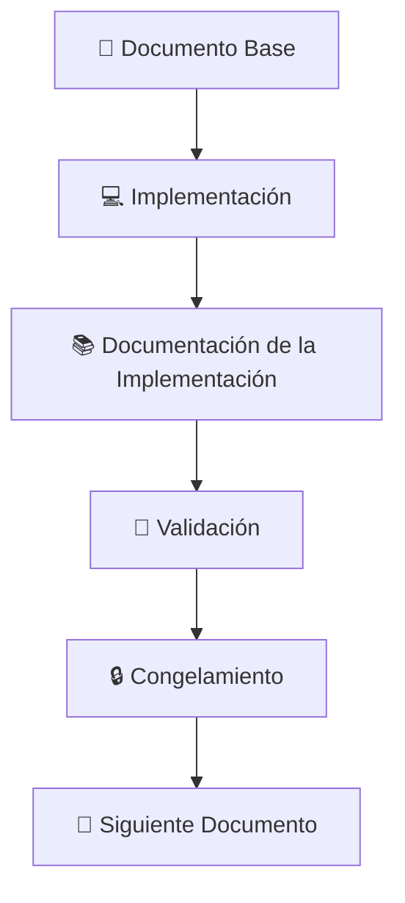
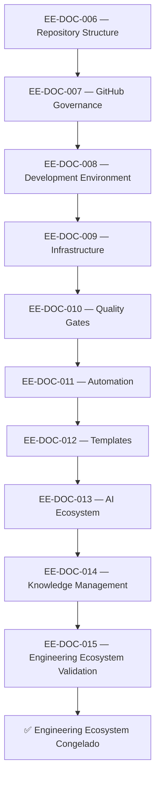
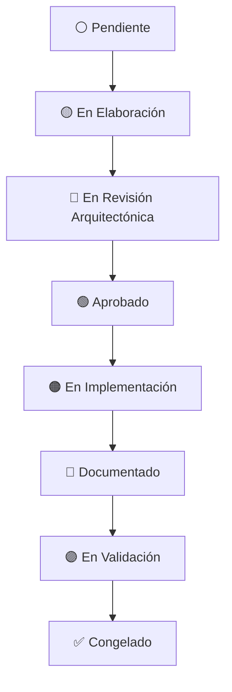
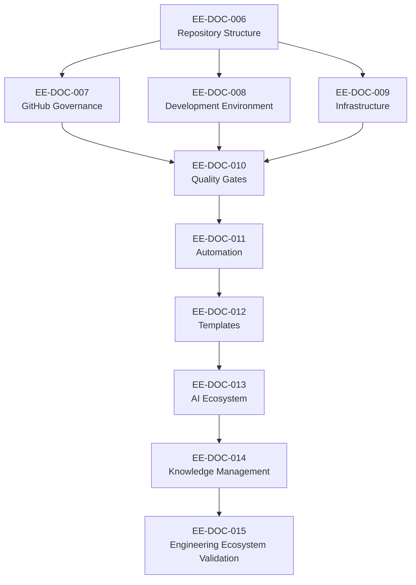

# EE-DOC-001 — Master Documentation Index

Este documento sigue el estándar **EE-DOC-002 — Document Design Template**.

---

## METADATOS

| Campo                 | Valor                                   |
| --------------------- | --------------------------------------- |
| **ID**                | EE-DOC-001                              |
| **Documento**         | Master Documentation Index              |
| **Código corto**      | DOC-001                                 |
| **Tipo**              | Documento Normativo                     |
| **Clasificación**     | Fundacional                             |
| **Nivel**             | Estratégico                             |
| **Normativo**         | Sí                                      |
| **Versión**           | v1.20.0                                 |
| **Estado**            | Congelado                               |
| **Propietario**       | Equipo de Arquitectura                  |
| **Documento padre**   | No aplica                               |
| **Dependencias**      | Ninguna                                 |
| **Aprobado por**      | Equipo de Arquitectura                  |
| **Audiencia**         | Arquitectura, Desarrollo, IA, Dirección |
| **Fecha de creación** | 2026-08-02                              |
| **Última revisión**   | 2026-11-05                              |
| **Próxima revisión**  | No aplica — Documento Congelado         |

---

## 01. Propósito

El **Master Documentation Index** es el mapa único, fuente de verdad, roadmap, planificación, estado documental, estado de implementación y trazabilidad del Engineering Ecosystem. Define qué documentos existen, su código, su propósito, su fase, su estado, qué genera y su orden de implementación.

Este documento garantiza que:

- **No existan documentos huérfanos** (sin propósito definido).
- **No existan componentes sin documentar** (todo componente del ecosistema tiene su documento).
- **La trazabilidad documental sea completa** (cada documento tiene un código, dependencias y artefacto generado).
- **La documentación nunca se desalinee de la implementación.**
- **El estado del ecosistema sea visible en un solo lugar.**

---

## 02. Alcance

Este índice cubre todos los documentos y reglas de la plataforma **EE-LABS** (Engineering Ecosystem). Todo el código fuente, automatización, herramientas y documentación de esta serie se distribuye bajo la **Apache License 2.0**. No cubre la lógica comercial propietaria de los productos o aplicaciones de negocio desarrollados sobre el ecosistema.

**Cubre** (existencia, estado, ubicación canónica y trazabilidad — no el contenido técnico completo):

- Documentos de gobernanza y dominio (`EE-DOC-XXX`)
- Decisiones arquitectónicas (`EE-ADR-XXX`) — §09.1
- Requests for Comments (`EE-RFC-XXX`) — §09.2
- Implementación por fase (`EE-IMP-XXX-PXX`) y documentación técnica consolidada (`EE-TEC-XXX`) — §09.3
- Evidencias de validación y waivers (`EE-VAL-*` / `EE-WAIVE-*`) — §09.4

**No cubre:**

- Documentos específicos de proyectos (EQ-LABS Product Ecosystem y Business Application)
- El **contenido técnico** de IMP/TEC/ADR/RFC/VAL/WAIVE (solo su indexación y estado en este documento)

---

## 03. Filosofía del Engineering Ecosystem

Este documento constituye la autoridad documental del Engineering Ecosystem. Ante cualquier discrepancia entre este índice y otros documentos, prevalece este índice hasta que la modificación correspondiente sea aprobada y sincronizada.

**Principios fundamentales:**

1. **Todo se documenta.** No existe configuración sin documentación.
2. **Una única fuente de verdad.** Nunca hay información duplicada.
3. **Automatizar todo.** Si una tarea puede automatizarse, se automatiza.

---

## 04. Estrategia Oficial de Implementación

La construcción del Engineering Ecosystem sigue la siguiente estrategia:

Este ciclo se aplica a cada documento del ecosistema, garantizando que la documentación y la implementación permanezcan siempre sincronizadas.

---

## 05. Roadmap del Ecosistema

El Engineering Ecosystem se construye en cuatro fases:

| Fase       | Nombre                          | Propósito                                           | Documentos              |
| ---------- | ------------------------------- | --------------------------------------------------- | ----------------------- |
| **Fase 1** | **Fundación (Conceptual)**      | Define el ecosistema, pero no genera código.        | EE-DOC-001 a EE-DOC-005 |
| **Fase 2** | **Foundation (Implementación)** | Crea la base física del Engineering Ecosystem.      | EE-DOC-006 a EE-DOC-008 |
| **Fase 3** | **Core Components**             | Cada documento produce un componente implementable. | EE-DOC-009 a EE-DOC-014 |
| **Fase 4** | **Validation**                  | Validación end-to-end del ecosistema completo.      | EE-DOC-015              |

---

## 06. Estructura Documental

| Fase       | Orden | Código         | Documento                          | Genera                                                                                    | Artefacto                                                                      | Predecesor (orden de implementación) |
| ---------- | ----- | -------------- | ---------------------------------- | ----------------------------------------------------------------------------------------- | ------------------------------------------------------------------------------ | ------------------------------------ |
| **Fase 1** | 1     | **EE-DOC-001** | Master Documentation Index         | Índice maestro, roadmap, trazabilidad y estado del Engineering Ecosystem                  | EE-DOC-001                                                                     | Ninguna                              |
| **Fase 1** | 2     | **EE-DOC-002** | Document Design Template           | Estándar para la estructura, formato y ciclo de vida de la documentación                  | EE-DOC-002                                                                     | EE-DOC-001                           |
| **Fase 1** | 3     | **EE-DOC-003** | Engineering Ecosystem Constitution | Principios, objetivos, gobernanza y reglas del Engineering Ecosystem                      | EE-DOC-003                                                                     | EE-DOC-002                           |
| **Fase 1** | 4     | **EE-DOC-004** | Engineering Architecture           | Arquitectura lógica, componentes, relaciones y flujos del Engineering Ecosystem           | EE-DOC-004                                                                     | EE-DOC-003                           |
| **Fase 1** | 5     | **EE-DOC-005** | Development Workflow               | SDLC, flujo de desarrollo, branching, commits, PRs y releases                             | EE-DOC-005                                                                     | EE-DOC-004                           |
| **Fase 2** | 6     | **EE-DOC-006** | Repository Structure               | Estructura física del repositorio, workspaces y organización del código fuente            | Git Repository                                                                 | EE-DOC-005                           |
| **Fase 2** | 7     | **EE-DOC-007** | GitHub Governance                  | Configuración organizacional de GitHub, repositorios, reglas, permisos y automatizaciones | `.github/`                                                                     | EE-DOC-006                           |
| **Fase 2** | 8     | **EE-DOC-008** | Development Environment            | Configuración estandarizada del entorno local de desarrollo                               | `.vscode/`, `.devcontainer/` (no materializado — P04 diferido, EE-IMP-008-P04) | EE-DOC-007                           |
| **Fase 3** | 9     | **EE-DOC-009** | Infrastructure                     | Infraestructura base, servicios y plataforma de ejecución del Engineering Ecosystem       | `infra/` (`containers/`, `orchestration/`)                                     | EE-DOC-008                           |
| **Fase 3** | 10    | **EE-DOC-010** | Quality Gates                      | Validaciones automáticas de calidad, arquitectura, seguridad y documentación              | CI Pipelines                                                                   | EE-DOC-009                           |
| **Fase 3** | 11    | **EE-DOC-011** | Automation                         | Automatización mediante CLI, scripts, generadores y procesos del ecosistema               | `scripts/`, `apps/cli`                                                         | EE-DOC-010                           |
| **Fase 3** | 12    | **EE-DOC-012** | Templates                          | Plantillas reutilizables para documentos, repositorios, paquetes y flujos de trabajo      | `templates/`                                                                   | EE-DOC-011                           |
| **Fase 3** | 13    | **EE-DOC-013** | AI Ecosystem                       | Integración, gobierno y colaboración de asistentes y herramientas de IA                   | `packages/intelligence/`                                                       | EE-DOC-012                           |
| **Fase 3** | 14    | **EE-DOC-014** | Knowledge Management               | Gestión, organización y sincronización del conocimiento del Engineering Ecosystem         | `packages/knowledge/` (+ `data/`; Obsidian = autoría opcional)                 | EE-DOC-013                           |
| **Fase 4** | 15    | **EE-DOC-015** | Engineering Ecosystem Validation   | Validación funcional, arquitectónica y end-to-end del Engineering Ecosystem               | Validation Report                                                              | EE-DOC-014                           |

> **Definición de columnas:**
>
> - **Genera:** resultado funcional, lógico o documental producido por el documento (capacidad, componente o entregable conceptual).
> - **Artefacto:** implementación física o ubicación donde dicho resultado se materializa dentro del Engineering Ecosystem (repositorio, directorio, paquete, configuración, pipeline, plantilla, etc.).
> - **Predecesor (orden de implementación):** documento que precede a este en el orden de implementación del roadmap (§06/§07). **No** equivale al campo de metadatos `Dependencias` (dependencia de contenido/lectura — EE-DOC-002 §05 / R7).

---

## 07. Implementation Roadmap

> **Nota:** Cada documento del roadmap ejecuta el ciclo completo definido en la Sección 04 (Estrategia Oficial de Implementación) antes de avanzar al siguiente documento.

---

## 08. Estados del Ciclo de Vida Documental

| Icono | Estado                         | Descripción                                                       |
| ----- | ------------------------------ | ----------------------------------------------------------------- |
| ⚪    | **Pendiente**                  | El documento aún no ha comenzado.                                 |
| 🟡    | **En Elaboración**             | El documento está siendo redactado.                               |
| 🔵    | **En Revisión Arquitectónica** | El documento está en revisión por Arquitectura.                   |
| 🟢    | **Aprobado**                   | El documento fue aprobado y puede implementarse.                  |
| 🟠    | **En Implementación**          | Se está implementando lo definido por el documento.               |
| 🔷    | **Documentado**                | La documentación técnica derivada ya fue generada y sincronizada. |
| 🟣    | **En Validación**              | La implementación y documentación está siendo validada.           |
| ✅    | **Congelado**                  | Documento e implementación sincronizados y cerrados.              |

**Flujo del Ciclo de Vida:**

### 08.1. Estados operativos de artefactos derivados (evidencia)

Además de la taxonomía anterior (documentos EE-DOC del índice), los artefactos de **evidencia** pueden usar estados operativos en metadatos. **No sustituyen** la tabla de §08 para EE-DOC normativos.

| Estado operativo                 | Aplicable a                                           | Significado                                                                                                                                          |
| -------------------------------- | ----------------------------------------------------- | ---------------------------------------------------------------------------------------------------------------------------------------------------- |
| **Completado**                   | EE-IMP, EE-TEC (cuando la fase/consolidación terminó) | Unidad de evidencia cerrada en su alcance; no implica Congelado del EE-DOC padre                                                                     |
| **Aprobado** (evidencia)         | EE-IMP, EE-TEC (uso observado en corpus)              | **Equivalente operativo a Completado** para evidencia: la unidad está aceptada en su alcance. No confundir con **Aprobado** de EE-DOC/ADR/RFC en §08 |
| **Implementado (documentación)** | EE-RFC (post-aprobación)                              | Diffs documentales del paquete aplicados; materialización física puede seguir en EE-IMP                                                              |
| **Borrador** / **En Revisión**   | IMP/TEC/VAL en elaboración                            | Equivalente operativo a Pendiente / En Elaboración / En Revisión según contexto                                                                      |
| **WAIVED**                       | EE-WAIVE-\* / registro de gate                        | Gate no PASS por waiver aceptado (campos según EE-DOC-010)                                                                                           |

Calificadores entre paréntesis en TEC (p. ej. “Congelado (as-built…)”) son **anotación de alcance**, no estados distintos del catálogo §08.

Ampliar esta tabla requiere cambio gobernado sobre **EE-DOC-001**.

---

## 09. Matriz de Trazabilidad

| Código         | Documento                          | Naturaleza    | Implementación Aplicable | Estado Documental | Validado | Congelado |
| -------------- | ---------------------------------- | ------------- | ------------------------ | ----------------- | -------- | --------- |
| **EE-DOC-001** | Master Documentation Index         | Fundacional   | N/A                      | Congelado         | N/A      | Sí        |
| **EE-DOC-002** | Document Design Template           | Fundacional   | N/A                      | Congelado         | N/A      | Sí        |
| **EE-DOC-003** | Engineering Ecosystem Constitution | Fundacional   | N/A                      | Congelado         | N/A      | Sí        |
| **EE-DOC-004** | Engineering Architecture           | Fundacional   | N/A                      | Congelado         | N/A      | Sí        |
| **EE-DOC-005** | Development Workflow               | Fundacional   | N/A                      | Congelado         | N/A      | Sí        |
| **EE-DOC-006** | Repository Structure               | Implementable | Sí                       | Congelado         | Sí       | Sí        |
| **EE-DOC-007** | GitHub Governance                  | Implementable | Sí                       | Congelado         | Sí       | Sí        |
| **EE-DOC-008** | Development Environment            | Implementable | Sí                       | Congelado         | Sí       | Sí        |
| **EE-DOC-009** | Infrastructure                     | Implementable | Sí                       | Congelado         | Sí       | Sí        |
| **EE-DOC-010** | Quality Gates                      | Implementable | Sí                       | Congelado         | Sí       | Sí        |
| **EE-DOC-011** | Automation                         | Implementable | Sí                       | Congelado         | Sí       | Sí        |
| **EE-DOC-012** | Templates                          | Implementable | Sí                       | Congelado         | Sí       | Sí        |
| **EE-DOC-013** | AI Ecosystem                       | Implementable | Sí                       | Congelado         | Sí       | Sí        |
| **EE-DOC-014** | Knowledge Management               | Implementable | Sí                       | Congelado         | Sí       | Sí        |
| **EE-DOC-015** | Engineering Ecosystem Validation   | Implementable | Sí                       | Congelado         | Sí       | Sí        |

> **Naturaleza:**
>
> - **Fundacional** (EE-DOC-001 a EE-DOC-005): documentos conceptuales. No generan implementación física directa ni EE-IMP/EE-TEC propios. Excepción formal a R4.
> - **Implementable** (EE-DOC-006 en adelante): generan ciclo completo de implementación, documentación técnica y validación.
> - **Validado / Congelado (documentos implementables):** «Sí» incluye el régimen de **PENDING listado** y dictamen de ecosistema **DEGRADED** admisible definido por EE-DOC-015 (§04.4.2, §04.4.3). No exige PASS total de todos los dominios de validación (p. ej. V-ARCH-LAYERS y V-E2E pueden permanecer PENDING).

### 09.1. Matriz de Decisiones Arquitectónicas (ADRs)

| Código         | Documento                                  | Estado   | Documento padre | Norma(s) relacionada(s) | Impacto Principal                                                                                                                                                       |
| -------------- | ------------------------------------------ | -------- | --------------- | ----------------------- | ----------------------------------------------------------------------------------------------------------------------------------------------------------------------- |
| **EE-ADR-001** | Workspace Task Orchestration Strategy      | Aprobado | EE-DOC-006      | —                       | Establece a Turborepo como orquestador oficial y PNPM como gestor de paquetes.                                                                                          |
| **EE-ADR-002** | Engineering Ecosystem Testing Standard     | Aprobado | EE-DOC-004      | —                       | Establece Vitest (Unit/Integration) y Playwright (E2E) como estándares de testing.                                                                                      |
| **EE-ADR-003** | Node.js Baseline Upgrade to 24 LTS         | Aprobado | EE-DOC-006      | EE-DOC-004              | Adopta Node.js ≥ 24 &lt; 25 (LTS) como baseline de runtime del monorepo; sustituye ≥ 22.19 &lt; 23.                                                                     |
| **EE-ADR-004** | Quality Gates Progressive Adoption         | Aprobado | EE-DOC-005      | —                       | Mandatory ≠ Implemented ≠ Enforced; adopción progresiva de Mandatory Gates.                                                                                             |
| **EE-ADR-005** | AI Provider SPI and Connector Adapters     | Aprobado | EE-DOC-004      | EE-DOC-013              | SPI en Foundation; adapters en connectors; composition root = apps/\* (no SDK); scripts/bootstrap no es composition root; Config tooling; extensión §13.2 (EE-DOC-006). |
| **EE-ADR-006** | Workflow-AI Interaction via Injected Ports | Aprobado | EE-DOC-004      | EE-DOC-013              | Resuelve contradicción 004↔006 sobre aristas `Intelligence↔Execution` y `Knowledge→Intelligence`; puertos inyectados desde composition root.                            |

#### Leyenda de estados (ADRs / RFCs)

| Símbolo / Texto                  | Significado                                                        |
| -------------------------------- | ------------------------------------------------------------------ |
| **Aprobado**                     | Decisión arquitectónica o RFC aprobado; vigente.                   |
| **Propuesto**                    | En elaboración o revisión; aún no vinculante.                      |
| **Rechazado / Superseded**       | No vigente.                                                        |
| **Implementado (documentación)** | RFC aprobado y cambios documentales del paquete aplicados (§08.1). |

> Los iconos ✅ / 🟡 / ⬜ de la matriz documental (§09) no se reutilizan en las matrices de ADR/RFC para evitar ambigüedad de significado.

### 09.2. Matriz de Requests for Comments (RFCs)

| Código         | Documento                           | Estado                                  | Norma/Documento Padre   | Impacto Principal                                                                                                                                                                                                                    |
| -------------- | ----------------------------------- | --------------------------------------- | ----------------------- | ------------------------------------------------------------------------------------------------------------------------------------------------------------------------------------------------------------------------------------ |
| **EE-RFC-001** | Infra Top Level Directory           | Aprobado / Implementado (documentación) | EE-DOC-006 / EE-DOC-009 | Introduce `infra/` (`containers/`, `orchestration/`) en sustitución de `docker/` y `k8s/`.                                                                                                                                           |
| **EE-RFC-002** | Templates Top Level Directory       | Aprobado                                | EE-DOC-006 / EE-DOC-012 | Introduce `templates/` como top-level autorizado y sincroniza EE-DOC-006.                                                                                                                                                            |
| **EE-RFC-003** | Documentation Standards Sync        | Aprobado / Implementado (documentación) | EE-DOC-001 / EE-DOC-002 | Vehículo Tipo D para la sincronización transversal de estándares documentales; alcance de la oleada implementado documentalmente. Los asuntos operativos con criterios propios conservan su seguimiento en el registro de auditoría. |
| **EE-RFC-004** | PR Governance Review Reconciliation | Aprobado                                | EE-DOC-007              | Sustituye prospectivamente EE-RFC-003 §02.8.7; separa decisión, check/workflow y reconciliación de reviews sin rerun de Validate por evento.                                                                                         |

> **Nota EE-RFC-003:** oleada documental cerrada. El alcance aprobado está implementado en los documentos sincronizados; los hallazgos con condiciones operativas independientes mantienen su estado en el registro de auditoría.

### 09.3. Matriz de Evidencia de Implementación (documentos implementables)

| Código         | EE-IMP (fases)         | EE-TEC     | Validación                               | Pendientes residuales admisibles                                 | Estado cierre |
| -------------- | ---------------------- | ---------- | ---------------------------------------- | ---------------------------------------------------------------- | ------------- |
| **EE-DOC-006** | EE-IMP-006-P01…P08     | EE-TEC-001 | Completada                               | Ninguno conocido                                                 | Congelado     |
| **EE-DOC-007** | EE-IMP-007 (histórico) | EE-TEC-002 | Completada                               | Ninguno conocido                                                 | Congelado     |
| **EE-DOC-008** | EE-IMP-008-P01…P06     | EE-TEC-003 | Completada                               | Ninguno conocido                                                 | Congelado     |
| **EE-DOC-009** | EE-IMP-009-P01…P05     | EE-TEC-004 | Completada                               | Ninguno conocido                                                 | Congelado     |
| **EE-DOC-010** | EE-IMP-010-P01…P05     | EE-TEC-005 | Completada                               | Ninguno conocido                                                 | Congelado     |
| **EE-DOC-011** | EE-IMP-011-P01…P05     | EE-TEC-006 | Completada                               | Ninguno conocido                                                 | Congelado     |
| **EE-DOC-012** | EE-IMP-012-P01…P06     | EE-TEC-007 | Completada                               | Ninguno conocido                                                 | Congelado     |
| **EE-DOC-013** | EE-IMP-013-P01…P06     | EE-TEC-008 | Completada                               | Ninguno conocido                                                 | Congelado     |
| **EE-DOC-014** | EE-IMP-014-P01…P06     | EE-TEC-009 | Completada                               | Ninguno conocido                                                 | Congelado     |
| **EE-DOC-015** | EE-IMP-015-P01…P05     | EE-TEC-010 | Completada (dictamen DEGRADED admisible) | V-ARCH-LAYERS, V-E2E (PENDING listado, régimen EE-DOC-015 §04.4) | Congelado     |

> **Ubicación canónica de artefactos** (EE-DOC-006 `docs/`):
>
> - EE-DOC-\* / EE-TEC-001…010: `docs/architecture/`
> - EE-IMP-\* (fases 006…015): `docs/developer/`
> - EE-ADR-\*: `docs/adr/`
> - EE-RFC-\*: `docs/rfc/`
> - Validación de ecosistema (reports, waivers, evidence, **audit/**): `docs/validation/`
>
> «Validación Completada» para EE-DOC-015 incluye el régimen PENDING listado y dictamen DEGRADED admisible (EE-DOC-015 §04.4.2 / §04.4.3). No se exige PASS de V-ARCH-LAYERS ni de V-E2E para el cierre de Fase 4.

### 09.4. Evidencias de validación y waivers (`EE-VAL-_ / EE-WAIVE-_`)

Artefactos de **evidencia** (no EE-DOC del índice §06). Se emiten bajo el régimen de **EE-DOC-015** (validación de ecosistema) y **EE-DOC-010** (Quality Gates / waivers). Plantilla mínima: **EE-DOC-002 §18.6**. Nomenclatura: **EE-DOC-002 §16** (código corto sin `EE`: `VAL-…`, `WAIVE-…`).

| Familia         | Rol                                                        | Padre típico                          | Normativo |
| --------------- | ---------------------------------------------------------- | ------------------------------------- | --------- |
| **EE-VAL-\***   | Reportes / evidencia de validación de ecosistema o dominio | EE-DOC-015 (u otro DOC de validación) | No        |
| **EE-WAIVE-\*** | Waiver de Quality Gate (campos WAIVED según EE-DOC-010)    | EE-DOC-010 / EE-DOC-015               | No        |

> **Gobernanza:** no elevan precedencia sobre EE-DOC normativos (§03.1 de EE-DOC-002). Un waiver documenta excepción aceptada; no autoriza omitir el cambio gobernado cuando R2 lo exige. La existencia de archivos en `docs/validation/` debe reflejarse aquí como familia catalogada; el inventario fino de cada VAL/WAIVE puede vivir en EE-DOC-015 / evidencias as-built.

---

## 10. Reglas de Gobernanza Documental

| Regla   | Descripción                                                                                                                                                                                                                                                                                                                                                                                                                                                                                                                 |
| ------- | --------------------------------------------------------------------------------------------------------------------------------------------------------------------------------------------------------------------------------------------------------------------------------------------------------------------------------------------------------------------------------------------------------------------------------------------------------------------------------------------------------------------------- |
| **R1**  | Ningún documento puede implementarse sin aprobación arquitectónica.                                                                                                                                                                                                                                                                                                                                                                                                                                                         |
| **R2**  | Ningún documento congelado puede modificarse sin el mecanismo de cambio gobernado que corresponda a la **naturaleza** del cambio (EE-DOC-005 §04.2): **Tipo A/B** → actualización del documento + nueva versión + fila en el Historial de Cambios, **sin** RFC ni ADR; **Tipo C** → ADR; **Tipo D** → RFC. Un ADR Tipo C es vehículo válido cuando el cambio es decisión arquitectónica sin alterar necesariamente el árbol de primer nivel.                                                                                |
| **R3**  | Toda implementación debe mantenerse sincronizada con su documento.                                                                                                                                                                                                                                                                                                                                                                                                                                                          |
| **R4**  | Cada documento **implementable** (EE-DOC-006 en adelante) genera su implementación y documentación técnica derivada. Los documentos **fundacionales** (EE-DOC-001 a EE-DOC-005) están exceptuados: no generan EE-IMP ni EE-TEC propios (ver §09 — Naturaleza).                                                                                                                                                                                                                                                              |
| **R5**  | El roadmap documental solo cambia mediante aprobación del Equipo de Arquitectura.                                                                                                                                                                                                                                                                                                                                                                                                                                           |
| **R6**  | Los documentos deben seguir la estructura definida en este índice.                                                                                                                                                                                                                                                                                                                                                                                                                                                          |
| **R7**  | Las dependencias entre documentos deben respetar el orden de implementación del roadmap (§06/§07). El campo **Dependencias** de metadatos (EE-DOC-002 §05) declara **dependencias de contenido/lectura**, no necesariamente aristas del grafo de orden de implementación: citar EE-DOC-005 en el cuerpo o en §Referencias **no** crea dependencia circular respecto de R7 si el orden de implementación en §06 se mantiene (p. ej. 002 depende solo de 001 en metadatos; 005 puede referenciar 002 como estándar de forma). |
| **R8**  | La implementación deberá seguir exactamente el orden establecido por el Implementation Roadmap, salvo excepción aprobada mediante ADR.                                                                                                                                                                                                                                                                                                                                                                                      |
| **R9**  | Un documento solo podrá cambiar a estado **Congelado** cuando: (1) el documento esté aprobado, (2) la implementación esté completada (si aplica), (3) la documentación derivada esté sincronizada (si aplica) y (4) la validación esté completada (si aplica). Para documentos implementables, «validación completada» incluye el régimen de **PENDING listado** y dictamen de ecosistema **DEGRADED** admisible definido por EE-DOC-015 (§04.4); no exige PASS total de todos los dominios.                                |
| **R10** | Cualquier modificación del orden de implementación o del roadmap requiere actualización obligatoria de **EE-DOC-001** antes de modificar cualquier otro documento.                                                                                                                                                                                                                                                                                                                                                          |

---

## 11. Mapa de Dependencias

> **Nota:** El diagrama representa las dependencias arquitectónicas entre los documentos del Engineering Ecosystem y no el orden de implementación. Un documento puede depender de varios documentos previos aunque su implementación se realice siguiendo el orden secuencial definido en el Roadmap del Ecosistema (Sección 06) y detallado en el Implementation Roadmap (Sección 07).

---

## 12. Resumen Estadístico

| Fase                                     | Documentos                  |
| ---------------------------------------- | --------------------------- |
| **Fase 1 — Fundación (Conceptual)**      | 5 (EE-DOC-001 a EE-DOC-005) |
| **Fase 2 — Foundation (Implementación)** | 3 (EE-DOC-006 a EE-DOC-008) |
| **Fase 3 — Core Components**             | 6 (EE-DOC-009 a EE-DOC-014) |
| **Fase 4 — Validation**                  | 1 (EE-DOC-015)              |
| **Total**                                | **15**                      |

---

## 13. Métricas del Ecosistema

| Métrica                                           | Valor                                  | Objetivo           |
| ------------------------------------------------- | -------------------------------------- | ------------------ |
| **Documentos Totales**                            | 15                                     | 15                 |
| **Documentos Congelados**                         | 15 de 15                               | 15                 |
| **Implementaciones Finalizadas**                  | 10 de 10                               | 10                 |
| **Implementaciones Validadas**                    | 10 de 10                               | 10                 |
| **Pendientes residuales admisibles (ecosistema)** | V-ARCH-LAYERS, V-E2E (PENDING listado) | Régimen EE-DOC-015 |

> **Nota — Naturaleza y cómputo:**
>
> - Las implementaciones físicas comienzan a partir de **EE-DOC-006**. Los documentos fundacionales (EE-DOC-001 a EE-DOC-005) no generan implementación directa y no entran en el denominador 10.
> - **Implementación Finalizada / Validada** = ciclo IMP + TEC + Validation Report cerrado. Para EE-DOC-015 incluye el régimen **PENDING listado** y dictamen de ecosistema **DEGRADED** admisible (EE-DOC-015 §04.4.2 / §04.4.3). No se exige PASS de V-ARCH-LAYERS ni de V-E2E para contabilizar el cierre de Fase 4.
> - **Estado actual:** EE-DOC-001 a EE-DOC-015 **Congelados**. Congelados: **15 de 15**. Implementaciones finalizadas **10 de 10**; validadas **10 de 10** (con residuales PENDING listados explícitos en §09.3).

---

## 14. Referencias

| Código         | Documento                                  | Relación                                                                                    |
| -------------- | ------------------------------------------ | ------------------------------------------------------------------------------------------- |
| **EE-DOC-002** | Document Design Template                   | Estándar de estructura, metadatos, plantillas y ciclo de vida documental.                   |
| **EE-DOC-006** | Repository Structure                       | Árbol físico `docs/`, top-levels y ubicación canónica de artefactos (§09.3).                |
| **EE-DOC-005** | Development Workflow                       | Ciclo de vida, cambio gobernado (R2) y clasificación Tipo A/B/C/D.                          |
| **EE-DOC-010** | Quality Gates                              | Régimen de gates y campos de waiver (WAIVED).                                               |
| **EE-DOC-015** | Engineering Ecosystem Validation           | Régimen PENDING listado, dictamen DEGRADED; padre típico de EE-VAL-\*.                      |
| **EE-ADR-001** | Workspace Task Orchestration Strategy      | Orquestador oficial (Turborepo) y gestor de paquetes (pnpm).                                |
| **EE-ADR-002** | Engineering Ecosystem Testing Standard     | Estándar de testing (Vitest + Playwright).                                                  |
| **EE-ADR-003** | Node.js Baseline Upgrade to 24 LTS         | Baseline de runtime Node.js ≥ 24 &lt; 25.                                                   |
| **EE-ADR-004** | Quality Gates Progressive Adoption         | Adopción progresiva de Mandatory Gates.                                                     |
| **EE-ADR-005** | AI Provider SPI and Connector Adapters     | SPI, adapters y composition root.                                                           |
| **EE-ADR-006** | Workflow-AI Interaction via Injected Ports | Resolución de contradicción de matrices; puertos inyectados.                                |
| **EE-RFC-001** | Infra Top Level Directory                  | Top-level `infra/`.                                                                         |
| **EE-RFC-002** | Templates Top Level Directory              | Top-level `templates/`.                                                                     |
| **EE-RFC-003** | Documentation Standards Sync               | Tipo D; sincronización transversal de estándares implementada documentalmente.              |
| **EE-RFC-004** | PR Governance Review Reconciliation        | Tipo D; decisión aprobada para reconciliar reviews PN-017 sin rerun de Validate por evento. |

---

## 15. Historial de Cambios

> **Columna Estado:** refleja el estado del documento **tras** aplicar el cambio de esa fila (estado de la versión resultante), no el estado de las versiones intermedias descritas en el motivo.

| Versión     | Fecha      | Autor                  | Aprobado por           | Motivo                                           | Cambios                                                                                                                                                                             | Estado        |
| ----------- | ---------- | ---------------------- | ---------------------- | ------------------------------------------------ | ----------------------------------------------------------------------------------------------------------------------------------------------------------------------------------- | ------------- |
| **v0.1.0**  | 2026-08-02 | Equipo de Arquitectura | Equipo de Arquitectura | Creación inicial                                 | Versión inicial del Master Documentation Index                                                                                                                                      | **Congelado** |
| **v1.0.0**  | 2026-08-03 | Equipo de Arquitectura | Equipo de Arquitectura | Reestructuración completa                        | Roadmap, fases, implementación, trazabilidad, métricas y reordenamiento                                                                                                             | **Congelado** |
| **v1.1.0**  | 2026-09-16 | Equipo de Arquitectura | Equipo de Arquitectura | Sincronización de Decisiones                     | Registro oficial de EE-ADR-001 y EE-ADR-002; alineación con estructura física real.                                                                                                 | **Congelado** |
| **v1.2.0**  | 2026-09-21 | Equipo de Arquitectura | Equipo de Arquitectura | Sincronización post-cierre EE-DOC-006            | Matriz §09: EE-DOC-006 Congelado/Validado; EE-DOC-007 En Elaboración; nota IMP/TEC; métricas §13 actualizadas (6 congelados, 1 implementación finalizada y validada)                | **Congelado** |
| **v1.3.0**  | 2026-09-22 | Equipo de Arquitectura | Equipo de Arquitectura | Sincronización estado EE-DOC-007                 | Matriz §09 y nota §13: EE-DOC-007 Aprobado (v1.0.0); listo para implementación                                                                                                      | **Congelado** |
| **v1.4.0**  | 2026-09-23 | Equipo de Arquitectura | Equipo de Arquitectura | Registro EE-ADR-003; Cierre EE-DOC-007           | Matriz §09.1: Node.js baseline 24 LTS aprobado; Matriz §09: EE-DOC-007 Congelado/Validado; EE-TEC-002; métricas 7 congelados                                                        | **Congelado** |
| **v1.5.0**  | 2026-09-24 | Equipo de Arquitectura | Equipo de Arquitectura | Aprobación EE-DOC-008; Cierre EE-DOC-008         | Matriz §09: EE-DOC-008 Aprobado v1.0.0; listo para EE-IMP-008; Matriz §09: EE-DOC-008 Congelado/Validado; EE-TEC-003; métricas 8 congelados, 3 implementaciones; próximo EE-DOC-009 | **Congelado** |
| **v1.6.0**  | 2026-09-25 | Equipo de Arquitectura | Equipo de Arquitectura | Consolidated changes for the same date and state | Updates the `infra/` path, DOC-009 status, RFC-001 approval, corpus matrix and metrics.                                                                                             | **Congelado** |
| **v1.7.0**  | 2026-09-26 | Equipo de Arquitectura | Equipo de Arquitectura | Cierre EE-DOC-009                                | Matriz §09: EE-DOC-009 Congelado/Validado v1.1.0; EE-TEC-004; métricas 9 congelados, 4 implementaciones; próximo EE-DOC-010                                                         | Congelado     |
| **v1.8.0**  | 2026-09-29 | Equipo de Arquitectura | Equipo de Arquitectura | Aprobación EE-DOC-010                            | Matriz §09: EE-DOC-010 Aprobado v1.0.0; EE-ADR-004; listo para EE-IMP-010-P01                                                                                                       | **Congelado** |
| **v1.9.0**  | 2026-09-30 | Equipo de Arquitectura | Equipo de Arquitectura | Cierre EE-DOC-010                                | EE-DOC-010 Congelado v1.4.0; EE-IMP-010-P01…P05 + EE-TEC-005 Completados; métricas 10/15 congelados; próximo EE-DOC-011                                                             | **Congelado** |
| **v1.10.0** | 2026-10-01 | Equipo de Arquitectura | Equipo de Arquitectura | Consolidated changes for the same date and state | Syncs RFC-002 and `templates/`; records DOC-012 approval, matrix, metrics and IMP-012 readiness.                                                                                    | **Congelado** |
| **v1.11.0** | 2026-10-02 | Equipo de Arquitectura | Equipo de Arquitectura | Consolidated changes for the same date and state | Closes DOC-012/IMP/TEC; records DOC-013 opening, `packages/intelligence/` evolution and ADR-005.                                                                                    | **Congelado** |
| **v1.12.0** | 2026-10-03 | Equipo de Arquitectura | Equipo de Arquitectura | Consolidated changes for the same date and state | Syncs DOC-006/013 and ADR-005: Connectors, `apps/*` composition root without SDK, DOC-013 approval, matrix and metrics.                                                             | **Congelado** |
| **v1.13.0** | 2026-10-05 | Equipo de Arquitectura | Equipo de Arquitectura | Consolidated changes for the same date and state | Closes DOC-013/IMP/TEC-008; opens and develops DOC-014 with KnowledgePort, layers, stores, data and metrics.                                                                        | **Congelado** |
| **v1.14.0** | 2026-10-06 | Equipo de Arquitectura | Equipo de Arquitectura | Consolidated changes for the same date and state | Closes DOC-014/IMP/TEC-009; records DOC-015 and syncs statuses, metrics, SKIPPED and ecosystem validation.                                                                          | **Congelado** |
| **v1.15.0** | 2026-10-07 | Equipo de Arquitectura | Equipo de Arquitectura | Consolidated changes for the same date and state | Records DOC-015 review, approval and closure with TEC-010; updates matrix and metrics.                                                                                              | **Congelado** |
| **v1.15.1** | 2026-10-08 | Equipo de Arquitectura | Equipo de Arquitectura | Tipo A post-auditoría                            | Plantilla §18.1; §14; detalle en RFC-003                                                                                                                                            | **Congelado** |
| **v1.15.2** | 2026-10-09 | Equipo de Arquitectura | Equipo de Arquitectura | Tipo A post-reauditoría                          | §09.3 rutas; detalle en RFC-003                                                                                                                                                     | **Congelado** |
| **v1.15.3** | 2026-10-10 | Equipo de Arquitectura | Equipo de Arquitectura | Aclaración (Tipo A) numeración §                 | Restaura numeración de secciones a dos dígitos (01…) según EE-DOC-002 §06 (SSOT); corrige desvío de v2.26.2                                                                         | **Congelado** |
| **v1.16.0** | 2026-10-11 | Equipo de Arquitectura | Equipo de Arquitectura | Minor (Y) sync post-auditoría 002                | §08.1 estados operativos Completado/Implementado/WAIVED; §09.4 familias EE-VAL-_/EE-WAIVE-_; R7 aclara Dependencias de contenido vs orden de implementación; §14 +010               | **Congelado** |
| **v1.17.0** | 2026-10-13 | Equipo de Arquitectura | Equipo de Arquitectura | Consolidated changes for the same date and state | Keeps RFC-003 open during audit; records audit 001, document traceability and PC-008 correction.                                                                                    | **Congelado** |
| **v1.18.0** | 2026-10-19 | Equipo de Arquitectura | Equipo de Arquitectura | Tipo A — registro ADR-006                        | §09.1/§14: EE-ADR-006 Aprobado (v1.0.0); sync con 004/006/013.                                                                                                                      | **Congelado** |
| **v1.19.0** | 2026-10-22 | Equipo de Arquitectura | Equipo de Arquitectura | Enmienda propuesta de flujo colaborativo         | §09.2 aclara alcance de EE-RFC-003; §14 sincroniza la referencia al RFC; este historial registra la propuesta de DOC-005 v1.5.0 y DOC-007 v1.2.0 en revisión.                       | **Congelado** |
| **v1.20.0** | 2026-11-05 | Equipo de Arquitectura | Equipo de Arquitectura | Cierre EE-RFC-003                                | §09.2 y §14 registran el RFC como Aprobado / Implementado (documentación); se retira la nota de vehículo abierto.                                                                   | **Congelado** |

---

## FIN DEL DOCUMENTO
