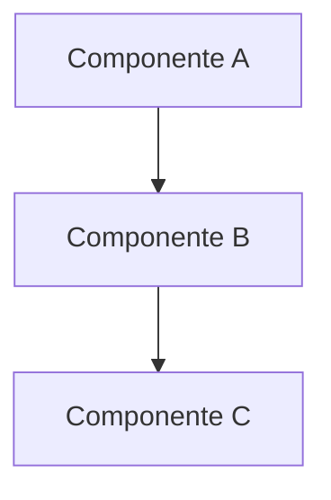
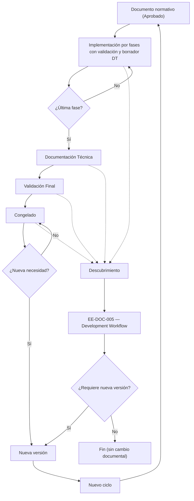
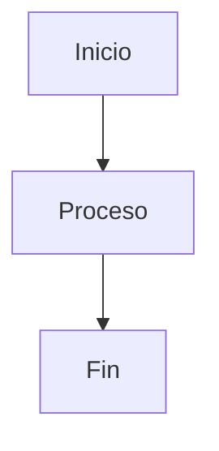
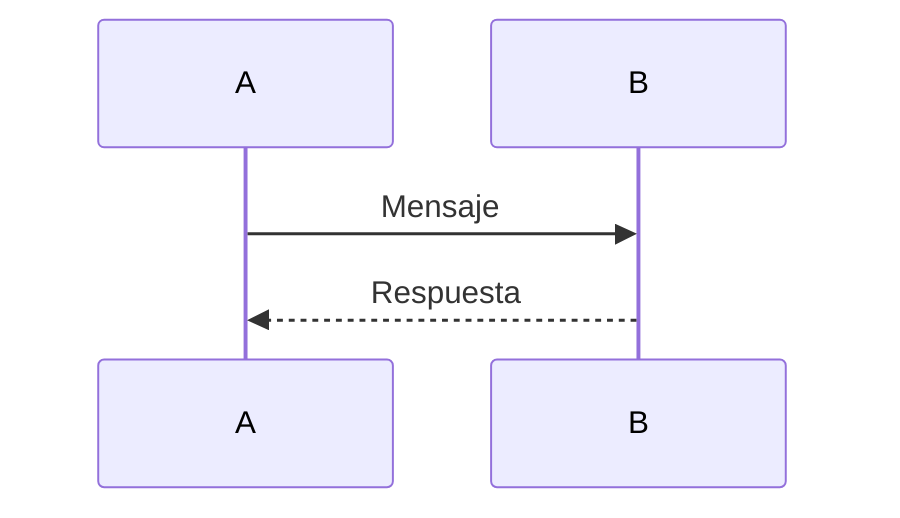

# EE-DOC-002 — Document Design Template

Este documento **es** el estándar **EE-DOC-002 — Document Design Template** (norma de diseño documental del ecosistema).

---

## METADATOS

| Campo                 | Valor                                  |
| --------------------- | -------------------------------------- |
| **ID**                | EE-DOC-002                             |
| **Documento**         | Document Design Template               |
| **Código corto**      | DOC-002                                |
| **Tipo**              | Documento Normativo                    |
| **Clasificación**     | Fundacional                            |
| **Nivel**             | Estratégico                            |
| **Normativo**         | Sí                                     |
| **Versión**           | v1.12.0                                |
| **Estado**            | Congelado                              |
| **Propietario**       | Equipo de Arquitectura                 |
| **Documento padre**   | EE-DOC-001                             |
| **Dependencias**      | padre=EE-DOC-001; contenido=EE-DOC-001 |
| **Aprobado por**      | Equipo de Arquitectura                 |
| **Audiencia**         | Arquitectura, Desarrollo, IA           |
| **Fecha de creación** | 2026-08-02                             |
| **Última revisión**   | 2026-10-23                             |
| **Próxima revisión**  | No aplica — Documento Congelado        |

---

## 01. Propósito

Este documento define el estándar de diseño, estructura y formato para todos los documentos del Engineering Ecosystem. Establece las convenciones que garantizan consistencia, legibilidad, mantenibilidad y alineación con el ciclo de vida documental.

Este documento es la **plantilla oficial** que deben seguir todos los documentos del ecosistema, desde la Constitución hasta los estándares técnicos.

---

## 02. Alcance

Aplica a todos los documentos definidos por **EE-DOC-001 — Master Documentation Index**, independientemente de su clasificación o fase dentro del Engineering Ecosystem.

No aplica a:

- Documentación embebida en código (comentarios, JSDoc, READMEs de paquete) y material no gobernado por EE-DOC-001
- Documentos específicos de proyectos de producto (**EQ-LABS** Product Ecosystem / Business Application, p. ej. EUM), salvo que adopten este estándar

**Sí aplica** a los artefactos de gobernanza del índice, incluidos **EE-IMP-XXX-PXX** y **EE-TEC-XXX** (§18.3 y §18.4): son documentos técnicos de implementación/consolidación del monorepo, no “documentación de código”.

---

## 03. Estructura Base para Documentos Normativos

Todo documento normativo del Engineering Ecosystem debe seguir esta estructura base:

| Orden | Sección                           | Obligatoriedad                                                                                                     |
| ----- | --------------------------------- | ------------------------------------------------------------------------------------------------------------------ |
| 1     | **Metadatos**                     | Obligatorio                                                                                                        |
| 2     | **Propósito**                     | Obligatorio                                                                                                        |
| 3     | **Alcance**                       | Obligatorio                                                                                                        |
| 4     | **Contenido normativo (dominio)** | Obligatorio: una o más secciones de dominio (§18.1: títulos variables; _Contenido Normativo_ no es título literal) |
| 5     | **Referencias**                   | Obligatorio                                                                                                        |
| 6     | **Historial de Cambios**          | Obligatorio                                                                                                        |

> **Nota de Aplicación:** La estructura definida en esta sección representa la **estructura mínima obligatoria**. Cada documento podrá incorporar secciones adicionales cuando la naturaleza del documento lo requiera, manteniendo siempre dicha estructura mínima. Aplica a los **documentos normativos del Engineering Ecosystem (EE)** listados en EE-DOC-001. Los proyectos de producto de **EQ-LABS** (Product Ecosystem / Business Application) **solo** quedan bajo este estándar si lo **adoptan explícitamente** (§02). Toda excepción al estándar requiere cambio gobernado (**EE-DOC-001 R2** / **EE-DOC-005**: RFC y/o ADR), no aprobación informal.

### 03.1. Jerarquía Documental

Los documentos del Engineering Ecosystem se organizan en una jerarquía que establece su orden de precedencia:

| Nivel | Tipo de Documento               | Autoridad                                                                                 |
| ----- | ------------------------------- | ----------------------------------------------------------------------------------------- |
| 1     | **Índice Maestro**              | Define la estructura documental, el roadmap, códigos y taxonomía de estados (EE-DOC-001). |
| 2     | **Estándares Documentales**     | Define cómo se escriben todos los documentos (EE-DOC-002).                                |
| 3     | **Documentos Constitucionales** | Define la gobernanza del ecosistema (EE-DOC-003).                                         |
| 4     | **Documentos Arquitectónicos**  | Define la arquitectura del ecosistema (EE-DOC-004).                                       |
| 5+    | **Documentos Especializados**   | Aplican las reglas superiores en su dominio (EE-DOC-005…015 y demás EE-DOC del índice).   |

**Artefactos derivados (no son un nivel paralelo que empate con 1–5+):**

| Artefacto                       | Rol                                                     | Precedencia                                                                        | Fuente normativa de tipo                                                             |
| ------------------------------- | ------------------------------------------------------- | ---------------------------------------------------------------------------------- | ------------------------------------------------------------------------------------ |
| **EE-ADR-XXX**                  | Decisión arquitectónica vinculante (Tipo C)             | Subordinado a EE-DOC de nivel superior; no puede contradecirlos                    | EE-DOC-005 §04.2; plantilla §18.2; matrices EE-DOC-001 §09.1                         |
| **EE-RFC-XXX**                  | Cambio gobernado transversal (Tipo D)                   | Subordinado; sincroniza el paquete normativo afectado                              | EE-DOC-005 §04.2; plantilla §18.5; EE-DOC-001 R2                                     |
| **EE-IMP-XXX-PXX**              | Evidencia de implementación por fase                    | Subordinado al EE-DOC padre; Normativo = No                                        | EE-DOC-005 (ciclo de fases); plantilla §18.3                                         |
| **EE-TEC-XXX**                  | Consolidación as-built                                  | Subordinado al EE-DOC padre; Normativo = No                                        | EE-DOC-005; plantilla §18.4                                                          |
| **EE-VAL-\*** / **EE-WAIVE-\*** | Evidencia de validación de ecosistema / waivers de gate | Subordinados al DOC padre de validación (p. ej. EE-DOC-015); no elevan precedencia | EE-DOC-010 / EE-DOC-015 (campos y régimen); nomenclatura §16; plantilla mínima §18.6 |

> **Nota:** La jerarquía de **tipos EE-DOC** se define aquí (§03.1). EE-DOC-001 es la fuente de verdad para **códigos**, roadmap y **taxonomía de estados**. ADR/RFC/IMP/TEC no elevan su precedencia por encima del EE-DOC padre.

> **Regla de Precedencia:**
> En caso de conflicto entre dos documentos, prevalece el documento de **nivel jerárquico superior**. Un documento de nivel inferior no puede contradecir lo establecido en un documento de nivel superior, salvo excepción **explícita** en el superior y mecanismo de cambio gobernado (**EE-DOC-001 R2** / **EE-DOC-005**: RFC o ADR según el caso).
>
> Si dos documentos pertenecen al **mismo nivel** y existe conflicto: (1) prevalece la relación de **padre estructural / dependencia explícita** si existe; (2) si no hay relación clara, **escalar a Arquitectura** — **no** se resuelve por sola recencia de aprobación (evita que un EE-DOC más nuevo anule a otro del mismo nivel sin RFC/ADR).

---

## 04. Estructura para Documentos Técnicos

Los documentos técnicos (guías, manuales, estándares de implementación) pueden seguir una estructura más flexible:

| Orden | Sección                  | Obligatoriedad                     |
| ----- | ------------------------ | ---------------------------------- |
| 1     | **Metadatos**            | Obligatorio                        |
| 2     | **Propósito**            | Obligatorio                        |
| 3     | **Alcance**              | Obligatorio                        |
| 4     | **Contenido Técnico**    | Obligatorio (contenido específico) |
| 5     | **Referencias**          | Recomendado                        |
| 6     | **Historial de Cambios** | Obligatorio                        |

---

## 05. Metadatos Estándar

Todos los documentos deben incluir la siguiente tabla de metadatos al inicio:

| Campo                 | Descripción                                                                                                                                                                                                                                                                                                                                                                                                                                             | Obligatoriedad |
| --------------------- | ------------------------------------------------------------------------------------------------------------------------------------------------------------------------------------------------------------------------------------------------------------------------------------------------------------------------------------------------------------------------------------------------------------------------------------------------------- | -------------- |
| **ID**                | Identificador único del documento                                                                                                                                                                                                                                                                                                                                                                                                                       | Obligatorio    |
| **Documento**         | Nombre completo del documento                                                                                                                                                                                                                                                                                                                                                                                                                           | Obligatorio    |
| **Código corto**      | Código sin prefijo `EE` (p. ej. `DOC-002`)                                                                                                                                                                                                                                                                                                                                                                                                              | Obligatorio    |
| **Tipo**              | Tipo de documento                                                                                                                                                                                                                                                                                                                                                                                                                                       | Obligatorio    |
| **Clasificación**     | Clasificación del documento                                                                                                                                                                                                                                                                                                                                                                                                                             | Obligatorio    |
| **Nivel**             | Nivel jerárquico                                                                                                                                                                                                                                                                                                                                                                                                                                        | Obligatorio    |
| **Normativo**         | Indica si es normativo                                                                                                                                                                                                                                                                                                                                                                                                                                  | Obligatorio    |
| **Versión**           | Versión semántica                                                                                                                                                                                                                                                                                                                                                                                                                                       | Obligatorio    |
| **Estado**            | Estado del ciclo de vida                                                                                                                                                                                                                                                                                                                                                                                                                                | Obligatorio    |
| **Propietario**       | Equipo responsable                                                                                                                                                                                                                                                                                                                                                                                                                                      | Obligatorio    |
| **Documento padre**   | ID del documento padre                                                                                                                                                                                                                                                                                                                                                                                                                                  | Opcional       |
| **Dependencias**      | **(AR-2026-020)** Solo lo **necesario** para validez/aplicación. Formato: `padre={ID}` y, si aplica, `contenido={ID},…`. **No** listar citados (van a § Referencias). **Documento padre** (campo) = ID del padre estructural; `padre=` en Dependencias **debe coincidir** con Documento padre cuando ambos se usen. **No** confundir con la columna **Predecesor** de EE-DOC-001 §06 (orden de implementación del roadmap, no dependencia de contenido) | Opcional       |
| **Aprobado por**      | Equipo que aprueba                                                                                                                                                                                                                                                                                                                                                                                                                                      | Opcional       |
| **Audiencia**         | Público objetivo                                                                                                                                                                                                                                                                                                                                                                                                                                        | Obligatorio    |
| **Fecha de creación** | Fecha de creación                                                                                                                                                                                                                                                                                                                                                                                                                                       | Obligatorio    |
| **Última revisión**   | Fecha de última revisión                                                                                                                                                                                                                                                                                                                                                                                                                                | Obligatorio    |
| **Próxima revisión**  | Fecha de próxima revisión                                                                                                                                                                                                                                                                                                                                                                                                                               | Obligatorio\*  |

> **(\*) Próxima revisión — excepción Congelado:** Si el **Estado** del documento es **Congelado**, el valor obligatorio del campo es `No aplica — Documento Congelado` (no se exige una fecha futura de revisión mientras permanezca congelado). Cualquier descongelamiento o nueva versión vuelve a exigir fecha o la misma excepción según el nuevo estado.

> **Campos adicionales por tipo (plantillas §18)** — no son excepciones al **Código corto** (regla general §05/§16: sin prefijo `EE`; p. ej. `DOC-002`, `ADR-001`, `RFC-001`):
>
> | Tipo                  | Campos adicionales / notas                                                                                                                                                                                                                                                                                                                                                                                                                                                                                                                                                                |
> | --------------------- | ----------------------------------------------------------------------------------------------------------------------------------------------------------------------------------------------------------------------------------------------------------------------------------------------------------------------------------------------------------------------------------------------------------------------------------------------------------------------------------------------------------------------------------------------------------------------------------------- |
> | **EE-ADR**            | `Fase`, `Fase de implementación`, `Decisión relacionada`, `Prioridad` (recomendado)                                                                                                                                                                                                                                                                                                                                                                                                                                                                                                       |
> | **EE-RFC**            | Mismos campos obligatorios §05 (**Documento**, **Nivel**, **Normativo**, etc.). **Documento** = nombre canónico del RFC **en inglés (en-US)** (coincide con el H1). Campos adicionales de alcance/trazabilidad: `Solicitante`, `Documentos normativos afectados`, `Documento de dominio` (o `No aplica` si coincide con Documento padre), `ADR asociado`. **Clasificación** = `D — Cambio Significativo / Transversal` (un solo campo; no duplicar como «Clasificación EE-DOC-005»). **Aprobado por** cubre la firma de decisión (en Propuesto puede ser `—`). Plantilla canónica: §18.5. |
> | **EE-IMP / EE-TEC**   | `Fase` (IMP) obligatorio cuando aplique; `Normativo` = No                                                                                                                                                                                                                                                                                                                                                                                                                                                                                                                                 |
> | **EE-VAL / EE-WAIVE** | Ver §18.6; `Normativo` = No                                                                                                                                                                                                                                                                                                                                                                                                                                                                                                                                                               |

> **Regla de Inmutabilidad:** Los campos **ID**, **Código corto** y **Fecha de creación** son inmutables una vez que el documento ha sido aprobado. No pueden modificarse bajo ninguna circunstancia.
>
> **Ubicación de la versión (AR-2026-007):** el número de versión del documento solo es normativo en: (1) metadatos **Versión**, (2) **Historial de Cambios**, (3) citas de trazabilidad a otra versión concreta. No esparcir el número de versión en el cuerpo como texto normativo.

### 05.1. Catálogo cerrado de Tipo, Clasificación y Nivel

Valores permitidos (SSOT de este estándar para metadatos). El **Nivel** de EE-DOC se alinea a §03.1.

| Campo                        | Valores permitidos                                                                                                                               | Notas                                                                                   |
| ---------------------------- | ------------------------------------------------------------------------------------------------------------------------------------------------ | --------------------------------------------------------------------------------------- |
| **Tipo** (EE-DOC)            | `Documento Normativo`                                                                                                                            | Preferido para EE-DOC del índice                                                        |
| **Tipo** (EE-ADR)            | `Architectural Decision Record`                                                                                                                  | —                                                                                       |
| **Tipo** (EE-RFC)            | `Request for Comments (Cambio gobernado)`                                                                                                        | —                                                                                       |
| **Tipo** (EE-IMP)            | `Documento Técnico de Implementación`                                                                                                            | —                                                                                       |
| **Tipo** (EE-TEC)            | `Documentación Técnica Consolidada`                                                                                                              | —                                                                                       |
| **Tipo** (EE-VAL / EE-WAIVE) | `Evidencia de Validación` / `Waiver de Quality Gate`                                                                                             | §18.6                                                                                   |
| **Clasificación** (EE-DOC)   | `Fundacional` \| `Implementable` \| `Especializado`                                                                                              | Fundacional ≈ 001–005; Implementable ≈ 006+ con fases; Especializado según índice       |
| **Clasificación** (otros)    | `Arquitectura / Decisión Arquitectónica` \| `Implementación` \| `Técnico / As-Built` \| `D — Cambio Significativo / Transversal` \| `Validación` | Según tipo de artefacto                                                                 |
| **Nivel** (EE-DOC)           | `Estratégico` \| `Táctico` \| `Operativo`                                                                                                        | Mapear a §03.1: niveles 1–3 suelen Estratégico; 4 Táctico/Estratégico; 5+ según dominio |
| **Nivel** (ADR)              | `Arquitectónico` \| `Estratégico` \| `Táctico`                                                                                                   | —                                                                                       |
| **Nivel** (IMP/TEC)          | `Técnico` \| `Operativo`                                                                                                                         | —                                                                                       |
| **Normativo**                | `Sí` \| `No`                                                                                                                                     | IMP/TEC/VAL/WAIVE = No salvo excepción documentada                                      |

Variantes históricas incoherentes en documentos ya emitidos se corrigen en su próxima edición gobernada (Tipo A).

---

## 06. Convenciones de Numeración

| Elemento                  | Formato                 | Ejemplo                       |
| ------------------------- | ----------------------- | ----------------------------- |
| **Secciones principales** | Número de dos dígitos   | `## 01. Propósito`            |
| **Subsecciones**          | Número + punto          | `### 01.1. Alcance`           |
| **Sub-subsecciones**      | Número + punto + número | `#### 01.1.1. Detalle`        |
| **Tablas**                | Numeración secuencial   | `Tabla 1: Metadatos`          |
| **Figuras**               | Numeración secuencial   | `Figura 1: Diagrama de flujo` |
| **Listas**                | Viñetas o números       | `- Elemento` o `1. Elemento`  |

> **Regla de Renumeración:** La numeración de secciones es **continua**. Si una sección se elimina, el documento debe renumerarse antes de avanzar al estado **Aprobado**. Las referencias a secciones eliminadas deben actualizarse o eliminarse.
>
> **SSOT de numeración de secciones:** Esta sección (§06) es la **única** fuente normativa del formato de numeración de encabezados en documentos EE. No se redefine en EE-DOC-001 ni en otros documentos. Formato obligatorio de secciones principales: **dos dígitos** (`01`, `02`, … `09`, `10`, …).
>
> **Prohibición de índice cero:** No existe subsección numerada `x.0` (p. ej. `### 18.0`, `### 15.0`). La **primera** subsección numerada de un bloque es siempre **`x.1`**.

---

## 07. Convenciones de Títulos

| Nivel de Título          | Formato     | Uso                              | Ejemplo                                |
| ------------------------ | ----------- | -------------------------------- | -------------------------------------- |
| **Título del documento** | `#` (H1)    | Título principal                 | `# Engineering Ecosystem Constitution` |
| **Sección**              | `##` (H2)   | Sección principal                | `## 01. Propósito`                     |
| **Subsección**           | `###` (H3)  | Subsección dentro de una sección | `### 01.1. Alcance`                    |
| **Sub-subsección**       | `####` (H4) | Detalle dentro de una subsección | `#### 01.1.1. Reglas`                  |

---

## 08. Reglas para Tablas

| Regla              | Descripción                                                                                                                    |
| ------------------ | ------------------------------------------------------------------------------------------------------------------------------ |
| **Encabezados**    | Todas las tablas deben tener encabezados claros                                                                                |
| **Alineación**     | Usar alineación consistente (izquierda para texto, derecha para números)                                                       |
| **Formato**        | Encabezados claros; **negrita + Title Case recomendados** (no bloquean si el documento usa `**Campo**` en tablas de metadatos) |
| **Separadores**    | Usar `\|` para columnas y `---` para separadores                                                                               |
| **Simplificación** | Evitar tablas excesivamente complejas                                                                                          |

**Formato estándar:**

| Columna 1 | Columna 2 | Columna 3 |
| --------- | --------- | --------- |
| Dato 1    | Dato 2    | Dato 3    |

---

## 09. Reglas para Diagramas Mermaid

| Regla            | Descripción                                                       |
| :--------------- | :---------------------------------------------------------------- |
| **Tipo**         | Usar el tipo de diagrama más adecuado (flowchart, sequence, etc.) |
| **Sintaxis**     | Validar que la sintaxis sea correcta                              |
| **Título**       | Incluir un título antes del diagrama                              |
| **Nodos**        | Nombres descriptivos y cortos                                     |
| **Dependencias** | Reflejar únicamente dependencias reales                           |

**Formato estándar:**

### Título del Diagrama



---

## 10. Convenciones de Imágenes

| Regla            | Descripción                                        |
| ---------------- | -------------------------------------------------- |
| **Formato**      | Preferir SVG o PNG                                 |
| **Ubicación**    | Almacenar bajo `assets/` (p. ej. `assets/images/`) |
| **Título**       | Incluir un título antes de la imagen               |
| **Tamaño**       | Mantener tamaño razonable                          |
| **Alternativas** | Usar diagramas Mermaid siempre que sea posible     |

---

## 11. Formato del Historial de Cambios

| Columna          | Descripción                             |
| ---------------- | --------------------------------------- |
| **Versión**      | Número de versión                       |
| **Fecha**        | Fecha del cambio                        |
| **Autor**        | Autor del cambio                        |
| **Aprobado por** | Quién aprobó el cambio                  |
| **Motivo**       | Razón del cambio                        |
| **Cambios**      | Descripción de los cambios              |
| **Estado**       | Estado del documento después del cambio |

**Formato estándar:**

| Versión | Fecha      | Autor  | Aprobado por | Motivo   | Cambios         | Estado                    |
| ------- | ---------- | ------ | ------------ | -------- | --------------- | ------------------------- |
| v1.0.0  | YYYY-MM-DD | Equipo | Equipo       | Creación | Versión inicial | Estado documental vigente |

> **Nota:** Cada entrada del historial representa una versión documental identificable. Una versión que haya alcanzado el estado Congelado deberá conservarse como referencia histórica y no podrá ser modificada directamente.

> **Longitud Motivo + Cambios (AR-2026-018):** la **suma** de caracteres de las celdas **Motivo** y **Cambios** no debe superar **230** (texto visible, sin markup de tabla). Detalle extenso → cuerpo del documento o RFC/ADR asociado.

> **Historial de EE-DOC fundacional (AR-2026-006):** las filas del historial de un EE-DOC registran cambios de **EE-DOC / EE-ADR / EE-RFC** (y sync normativo asociado). Los **EE-IMP** se versionan en su **propio** historial, no como filas del historial del DOC padre salvo trazabilidad explícita acordada.

---

## 12. Convenciones de Referencias

| Regla         | Descripción                                                 |
| :------------ | :---------------------------------------------------------- |
| **Formato**   | Código — Nombre del Documento                               |
| **Ejemplo**   | EE-DOC-001 — Master Documentation Index                     |
| **Enlaces**   | Usar enlaces a otros documentos cuando sea posible          |
| **Secciones** | Referenciar secciones específicas cuando sea necesario      |
| **Versiones** | Referenciar versiones específicas solo cuando sea relevante |

---

## 13. Estados Documentales

**SSOT:** La taxonomía de estados, iconografía, transiciones y regímenes residuales (**PENDING listado**, **DEGRADED**, etc.) se definen **exclusivamente** en **EE-DOC-001 §08**; los estados operativos de evidencia (**Completado**, **Implementado (documentación)**, **WAIVED**, etc.) en **EE-DOC-001 §08.1**. Este documento **no redefine** esa taxonomía.

Las plantillas §18 pueden mostrar **etiquetas operativas** en ejemplos de metadatos (p. ej. Propuesto, Borrador, Superseded para ADR/RFC; Borrador/Completado para IMP) cuando coincidan con matrices de EE-DOC-001 (§09.1 ADR/RFC) o con uso as-built de evidencia IMP/TEC; la interpretación normativa del ciclo de vida documental prevalece en EE-DOC-001 §08. Las matrices de estado de **ADR/RFC** (p. ej. Aprobado/Propuesto/Rechazado/Superseded) se gobiernan en **EE-DOC-001 §09.1**; ampliar esa taxonomía es cambio en **001**, no en este estándar.

### 13.1. Integridad normativa durante la implementación

**Regla de Integridad Normativa:**

Un documento normativo no podrá avanzar al estado Congelado mientras exista una desviación conocida entre su contenido normativo vigente y la implementación correspondiente que no haya sido formalmente resuelta, documentada o aceptada mediante el mecanismo de gobernanza aplicable.

**Regla de Implementación Adaptativa:**

Los documentos normativos sujetos a implementación deben permanecer en el estado En Implementación mientras la implementación pueda producir descubrimientos que requieran modificar su contenido normativo.

Cuando un descubrimiento requiera una modificación normativa, el documento deberá continuar bajo el flujo de implementación adaptativa establecido en EE-DOC-005 — Development Workflow hasta que la modificación haya sido evaluada, aprobada, incorporada, validada y documentada.

### 13.2. Naturaleza del estado Congelado

**Congelado no significa inmutable.**

El estado Congelado indica que la versión vigente del documento ha completado su ciclo de implementación, documentación técnica y validación final; y que el contenido normativo y la implementación correspondiente se encuentran sincronizados o que cualquier desviación residual ha sido formalmente resuelta, documentada o aceptada mediante el mecanismo de gobernanza aplicable.

Una versión congelada no puede modificarse directamente. Cualquier modificación posterior deberá ejecutarse mediante el mecanismo de cambio gobernado correspondiente y deberá generar una nueva versión documental.

Por lo tanto:

- Congelado = versión vigente estabilizada y protegida contra modificaciones directas.
- Congelado ≠ documento permanentemente inmutable.

#### Evolución de una versión congelada

**Diagrama — Evolución de una versión congelada.**



---

## 14. Ciclo de Vida Documental

**SSOT del flujo de estados:** el diagrama y las transiciones canónicas residen en **EE-DOC-001 §08**. No se reproduce aquí una taxonomía paralela.

El ciclo de **implementación por fases**, validación y documentación técnica se rige por **EE-DOC-005 — Development Workflow**.

> **Nota sobre evolución posterior:** El estado Congelado representa el cierre de la versión vigente, no el cierre definitivo del documento. Cuando exista una necesidad legítima de modificación posterior, deberá iniciarse el mecanismo de cambio gobernado definido en EE-DOC-005, dando lugar a una nueva versión documental. Ver también §13.2 (Congelado ≠ inmutable).

---

## 15. Reglas de Versionado

| Regla                                | Descripción                                                                                                                                                                                                                                                                                                                                                                                                                                                                                                                                   |
| ------------------------------------ | --------------------------------------------------------------------------------------------------------------------------------------------------------------------------------------------------------------------------------------------------------------------------------------------------------------------------------------------------------------------------------------------------------------------------------------------------------------------------------------------------------------------------------------------- |
| **Formato**                          | `vX.Y.Z` donde X es mayor, Y es menor y Z es parche                                                                                                                                                                                                                                                                                                                                                                                                                                                                                           |
| **Cambio Mayor (X)**                 | Cambios incompatibles en la estructura, alcance o contenido normativo                                                                                                                                                                                                                                                                                                                                                                                                                                                                         |
| **Cambio Menor (Y)**                 | Adiciones o modificaciones compatibles que amplían o ajustan el contenido sin romper su contrato normativo existente                                                                                                                                                                                                                                                                                                                                                                                                                          |
| **Parche (Z)**                       | Correcciones ortográficas, tipográficas, de formato o errores menores que no modifican el significado normativo                                                                                                                                                                                                                                                                                                                                                                                                                               |
| **Nueva versión**                    | Toda modificación posterior a una versión congelada debe generar una nueva versión mediante el mecanismo de cambio gobernado aplicable                                                                                                                                                                                                                                                                                                                                                                                                        |
| **Versión congelada**                | Una versión que ha alcanzado el estado Congelado no puede modificarse directamente                                                                                                                                                                                                                                                                                                                                                                                                                                                            |
| **Evolución documental**             | El documento puede evolucionar mediante nuevas versiones, cada una sometida al ciclo de gobernanza correspondiente                                                                                                                                                                                                                                                                                                                                                                                                                            |
| **Historial**                        | Todo cambio de versión debe registrarse en el historial de cambios del documento.                                                                                                                                                                                                                                                                                                                                                                                                                                                             |
| **Paquete pre-`main` (AR-2026-017)** | Mientras el **paquete de cambios no esté mergeado en `main`**, las correcciones de trabajo **no** exigen una cadena de bumps (`vX.Y.Z`→`Z+1`) por cada arreglo: se consolida en **una versión de trabajo** hasta publicar. Aplica a documentos en **cualquier estado** (En Elaboración, Aprobado, Congelado, etc.): el estado no obliga a bump intermedio si el paquete aún no está en `main`. **Tras** publicación en `main`, toda corrección a esa versión publicada exige **nueva versión** (típicamente parche Z) y fila en el historial. |

> **Regla de Inmutabilidad de Versión:** Una vez que una versión documental alcanza el estado Congelado, su contenido correspondiente a dicha versión no podrá modificarse directamente. Cualquier cambio posterior deberá producir una nueva versión documental y conservar la trazabilidad con respecto a la versión anterior.

> **Nota de regularización v1.6.x:** Las ediciones v1.6.1 y v1.6.2 introdujeron cambios de significado normativo (excepción §05, reescritura §18) etiquetados como parche (Z). A partir de **v1.7.0** se corrige el criterio: ese tipo de cambio se emite como **minor (Y)** según §15. No se reescriben los números de versión ya publicados.

---

## 16. Convenciones de Nomenclatura

| Elemento                         | Formato                                                                                                  | Ejemplo                                                                       |
| -------------------------------- | -------------------------------------------------------------------------------------------------------- | ----------------------------------------------------------------------------- |
| **IDs**                          | `EE-DOC-XXX` / `EE-ADR-XXX` / `EE-IMP-XXX-PXX` / `EE-TEC-XXX` / `EE-RFC-XXX` / `EE-VAL-*` / `EE-WAIVE-*` | `EE-DOC-001`, `EE-IMP-006-P01`, `EE-VAL-…`, `EE-WAIVE-…`                      |
| **Documentos** (título)          | Title Case                                                                                               | `Engineering Ecosystem Constitution`                                          |
| **Código Corto**                 | Sin el prefijo `EE`                                                                                      | `DOC-001`, `ADR-001`, `IMP-006-P01`, `TEC-001`, `RFC-001`, `VAL-…`, `WAIVE-…` |
| **Archivos de documentos EE-\*** | `{ID}_{Nombre}.md` (general); VAL/WAIVE: `{ID}_{Nombre}_{fecha}.md`                                      | `EE-DOC-001_Master_Documentation_Index.md`                                    |
| **Archivos genéricos (código)**  | kebab-case                                                                                               | `knowledge-engine.ts`                                                         |
| **Roles**                        | Title Case                                                                                               | `Arquitecto`                                                                  |
| **Herramientas**                 | Capitalizado                                                                                             | `VSCode`, `Windsurf`                                                          |
| **Paquetes npm**                 | `@eq-labs/<categoría>-<nombre>`                                                                          | `@eq-labs/foundation-kernel`                                                  |
| **Repositorios**                 | kebab-case                                                                                               | `ee-monorepo`                                                                 |
| **Carpetas**                     | kebab-case                                                                                               | `packages/foundation/`                                                        |
| **Variables**                    | camelCase                                                                                                | `knowledgeEngine`                                                             |
| **Tipos**                        | PascalCase                                                                                               | `KnowledgeEngine`                                                             |
| **Interfaces**                   | PascalCase                                                                                               | `IKnowledgeEngine`                                                            |
| **Enums**                        | PascalCase                                                                                               | `KnowledgeStatus`                                                             |
| **Constantes**                   | UPPER_SNAKE_CASE                                                                                         | `MAX_RETRY_COUNT`                                                             |

> **Prefijo `EE-` en archivos (AR-2026-019):** todo documento de **gobernanza y proceso** bajo `docs/` debe tener nombre de archivo con prefijo `EE-` (familias DOC, ADR, RFC, IMP, TEC, VAL, WAIVE, AUDIT). Formato `{ID}_{Nombre}.md` (VAL/WAIVE con fecha). **Excepciones:** (1) `README.md` de carpeta; (2) `docs/validation/evidence/**` (soporte operativo); (3) inventarios brutos (p. ej. `.txt`). Si un evidence se promueve a informe formal → `validation/reports/` como `EE-VAL-*`. Canónicos de auditoría: `EE-AUDIT-Log_Progress_Register.md`, `EE-AUDIT-Criteria_Audited_Definition.md`, `EE-AUDIT-Rules_Emerging.md`. Ante conflicto de árbol físico, **EE-DOC-006** manda sobre paths.

### 16.1. Política de Idioma por Tipo de Artefacto (Normativo)

El ecosistema establece una regla de separación estricta entre el código de ejecución y la documentación de gobernanza.

Esta sección es la **Single Source of Truth** de la política de idioma por tipo de artefacto. Los documentos especializados (p. ej. EE-DOC-006, EE-DOC-007) podrán especializar nomenclatura o aplicar la regla a dominios concretos, pero **no deberán redefinir ni duplicar** esta política.

| Tipo de Artefacto                                                                      | Idioma Obligatorio                                                                                | Justificación                                                                   |
| :------------------------------------------------------------------------------------- | :------------------------------------------------------------------------------------------------ | :------------------------------------------------------------------------------ |
| **Código fuente**                                                                      | Inglés (`en-US`)                                                                                  | Compatibilidad con compiladores, linters y estándares internacionales.          |
| **Comentarios de código y JSDoc**                                                      | Inglés (`en-US`)                                                                                  | Mantenibilidad e inspección por herramientas automatizadas e IA.                |
| **Nombres de variables, funciones y tipos**                                            | Inglés (`en-US`)                                                                                  | Convención de desarrollo de software profesional.                               |
| **Nombres de archivos y directorios**                                                  | Inglés (`en-US`)                                                                                  | Evitar problemas de codificación y caracteres especiales en SO.                 |
| **Archivos package.json y manifiestos**                                                | Inglés (`en-US`)                                                                                  | Estándar de la industria de gestores de paquetes.                               |
| **README técnicos de paquetes (`packages/*/README.md`)**                               | Inglés (`en-US`)                                                                                  | Exposición pública y consumo técnico local.                                     |
| **Ramas Git**                                                                          | Inglés (`en-US`)                                                                                  | Convención de repositorio y compatibilidad con herramientas.                    |
| **Plantillas de Issue / Pull Request**                                                 | Inglés (`en-US`)                                                                                  | Artefactos técnicos de plataforma; consumo por herramientas e integraciones.    |
| **Mensajes y salidas de CI / GitHub Actions / bots de plataforma**                     | Inglés (`en-US`)                                                                                  | Artefactos técnicos de automatización e interfaces de plataforma.               |
| **Nombres de workflows, jobs y steps de CI**                                           | Inglés (`en-US`)                                                                                  | Artefactos técnicos de automatización.                                          |
| **Documentos normativos (`EE-DOC-XXX`)**                                               | Español                                                                                           | Comprensión, precisión legal y gobernanza directa del equipo.                   |
| **Planes de implementación (`EE-IMP-XXX`)**                                            | Español                                                                                           | Alineación con la gobernanza y el ciclo documental.                             |
| **Registros de decisión (`EE-ADR-XXX`)**                                               | Español                                                                                           | Claridad en la deliberación y justificación contextual.                         |
| **Propuestas de cambio (`EE-RFC-XXX`)**                                                | Español                                                                                           | Discusión efectiva y revisión colaborativa de arquitectura.                     |
| **Documentación técnica consolidada (`EE-TEC-XXX`)**                                   | Español                                                                                           | Trazabilidad con la gobernanza del ecosistema.                                  |
| **Documentación arquitectónica y estratégica**                                         | Español                                                                                           | Alineación clara con la dirección de ingeniería y stakeholders.                 |
| **Mensajes y comunicación interna del equipo**                                         | Español                                                                                           | Fluidez operativa de la organización.                                           |
| **EE-VAL-_ / EE-WAIVE-_** (evidencia / waiver)                                         | Español (contenido) + identificadores en inglés                                                   | Gobernanza de validación; IDs en en-US                                          |
| **README de directorios no-paquete** (`templates/`, `data/`, `docs/validation/`, etc.) | Inglés (`en-US`) para nombre de archivo; contenido EN o ES según audiencia técnica del directorio | Alineado a convención de repo; no redefinir en 006                              |
| **Mensajes de commit**                                                                 | Inglés (`en-US`) Conventional Commits                                                             | Convención de desarrollo                                                        |
| **Título de EE-RFC (campo Documento / H1 en-US)**                                      | Inglés (`en-US`)                                                                                  | Identificador internacional del cambio; cuerpo del RFC en español de gobernanza |

> **Regla de Oro:** _Código e interfaces en Inglés; Gobernanza y Arquitectura en Español._
>
> **Evolución del catálogo:** Cualquier ampliación o modificación de esta tabla deberá realizarse únicamente en esta sección (EE-DOC-002 §16.1), mediante el mecanismo de cambio gobernado aplicable. Los documentos especializados actualizarán sus referencias, no la norma.

---

## 17. Norma de Diagramas para Documentos Especializados

A partir de EE-DOC-004, los documentos especializados del Engineering Ecosystem deben incluir los siguientes tipos de diagramas cuando correspondan:

| Tipo de Diagrama                             | Aplicación                                              |
| -------------------------------------------- | ------------------------------------------------------- |
| **Diagrama de Arquitectura (Alto Nivel)**    | Documentos que definan arquitectura.                    |
| **Diagrama de Componentes**                  | Documentos que definan componentes o módulos.           |
| **Diagrama de Dependencias**                 | Documentos que definan relaciones entre componentes.    |
| **Diagrama de Flujo**                        | Documentos que definan procesos o workflows.            |
| **Diagrama de Secuencia**                    | Documentos que definan interacciones entre componentes. |
| **Diagrama de Despliegue / Infraestructura** | Documentos que definan infraestructura o despliegue.    |

> **Nota:** Los diagramas deben ser creados en **Mermaid** para garantizar consistencia y renderizado en plataformas compatibles.

---

## 18. Plantillas Base

Todos los documentos que se elaboren en el **Engineering Ecosystem** deben utilizar obligatoriamente la plantilla correspondiente a su tipo de artefacto. Cada plantilla integra de manera inseparable su **Tabla de Metadatos** al inicio y la **Estructura del Cuerpo** en formato Markdown.

> **Precedencia plantilla → corpus (AR-2026-022):** la plantilla de §18.x es la **fuente de verdad** de metadatos y estructura mínima de su tipo. Ante divergencia entre un documento existente y su plantilla, **prevalece la plantilla**. El corpus se **alinea después** (al auditar o editar cada documento; backlog `PC-*` / `PN-*`), **no** se adapta la plantilla al as-built del corpus salvo cambio gobernado de este estándar.

| Subsección | Tipo de artefacto                                            |
| ---------- | ------------------------------------------------------------ |
| **§18.1**  | EE-DOC-XXX (normativos)                                      |
| **§18.2**  | EE-ADR-XXX (decisiones arquitectónicas)                      |
| **§18.3**  | EE-IMP-XXX-PXX (implementación por fase)                     |
| **§18.4**  | EE-TEC-XXX (documentación técnica consolidada)               |
| **§18.5**  | EE-RFC-XXX (cambio gobernado Tipo D)                         |
| **§18.6**  | `EE-VAL-_ / EE-WAIVE-_` (validación de ecosistema / waivers) |

**Ciclo de implementación (referencia):** el flujo **Implementación → Validación → Documentación Técnica**, la unificación, validación final y congelación se rigen por **EE-DOC-005 — Development Workflow**. No se duplica aquí el workflow de 005.

**Diagrama — Ciclo (referencia a EE-DOC-005).**


> **Reglas de plantilla (AR-2026-003 / 004 / 005):**
>
> | ID              | Regla                                                                                                                                                                                                             |
> | --------------- | ----------------------------------------------------------------------------------------------------------------------------------------------------------------------------------------------------------------- |
> | **AR-2026-003** | Notas de **Aplicabilidad** de cada plantilla §18.x van **solo en tablas** (`Ámbito` / `¿Aplica?` / `Regla` o equivalente), no en párrafos sueltos mezclados con la tabla.                                         |
> | **AR-2026-004** | Guía **común** a varias plantillas (p. ej. ciclo Implementación → Validación → DT vía EE-DOC-005) vive en el **preámbulo de §18**, no como subsección `18.0` ni solo embebida en una plantilla si es transversal. |
> | **AR-2026-005** | Contenido de aplicabilidad / norma de uso va **fuera** del bloque fence `markdown` de la plantilla copiable; dentro del fence solo estructura, placeholders y tablas-guía a rellenar.                             |

### 18.1. Tabla de Metadatos para Documentos Normativos (EE-DOC-XXX)

> **Nota de aplicación — as-built EE-DOC:** Estructura y aplicabilidad de la plantilla normativa EE-DOC (§18.1).

**Estructura obligatoria (plantilla).**

| Bloque                                     | ¿Fijo? | Regla                                                                                       |
| ------------------------------------------ | :----: | ------------------------------------------------------------------------------------------- |
| Frase de cumplimiento EE-DOC-002 (bajo H1) |   Sí   | Obligatorio                                                                                 |
| `## METADATOS`                             |   Sí   | Tabla de campos del ejemplo (§05 + tipo)                                                    |
| `## 01. Propósito`                         |   Sí   | Título fijo                                                                                 |
| `## 02. Alcance`                           |   Sí   | Título fijo                                                                                 |
| `## 03` … hasta antes del cierre           | **No** | **Títulos de dominio variables**. _«Contenido Normativo»_ es placeholder, no título literal |
| Letras XX–CC en el esqueleto               |   —    | Nombran el **rol** de sección; numeración real continua en dos dígitos (§06)                |
| Numeración                                 |   Sí   | **§06** — dos dígitos (`01`, `02`, …)                                                       |

**Aplicabilidad.**

| Ámbito                                             |   ¿Aplica?   | Regla                                                                                                                                                                       |
| -------------------------------------------------- | :----------: | --------------------------------------------------------------------------------------------------------------------------------------------------------------------------- |
| Cuerpo EE-DOC (todos los del índice)               |      Sí      | Frase EE-DOC-002 bajo H1; metadatos §05; numeración §06                                                                                                                     |
| Cierre fundacional (001–005)                       |  Sí (roles)  | `Referencias` + `Historial de Cambios` (+ `FIN DEL DOCUMENTO`). Sin Plan de Implementación ni Cierre Documental si no hay implementación física                             |
| Cierre implementable (006+)                        |  Sí (roles)  | `Plan de Implementación y Fases` → `Evolución` → `Cumplimiento` → `Referencias` → `Historial de Cambios` → `Cierre Documental`                                              |
| Plan de Implementación y Fases / Cierre Documental | Condicional  | Obligatorio si el documento genera implementación física (006+). No aplica a EE-DOC-001…005 sin implementación física. Detalle del ciclo → el preámbulo de §18 y EE-DOC-005 |
| Contenido de Plan de Fases (XX)                    | Guía externa | No duplicar EE-DOC-005; cada fase traza a EE-IMP-XXX-PXX (el preámbulo de §18)                                                                                              |

```markdown
# EE-DOC-XXX — {Nombre del Documento}

Este documento sigue el estándar **EE-DOC-002 — Document Design Template**.

---

## METADATOS

| Campo                 | Valor                                        |
| --------------------- | -------------------------------------------- |
| **ID**                | EE-DOC-XXX                                   |
| **Documento**         | Nombre del Documento                         |
| **Código corto**      | DOC-XXX                                      |
| **Tipo**              | Documento Normativo                          |
| **Clasificación**     | Fundacional / Implementable / Especializado  |
| **Nivel**             | Estratégico / Táctico / Operativo            |
| **Normativo**         | Sí                                           |
| **Versión**           | v1.0.0                                       |
| **Estado**            | En Elaboración                               |
| **Propietario**       | Equipo de Arquitectura                       |
| **Documento padre**   | EE-DOC-XXX / No aplica                       |
| **Dependencias**      | padre=EE-DOC-XXX; contenido=EE-DOC-XXX       |
| **Aprobado por**      | Equipo de Arquitectura                       |
| **Audiencia**         | Arquitectura, Desarrollo, IA                 |
| **Fecha de creación** | YYYY-MM-DD                                   |
| **Última revisión**   | YYYY-MM-DD                                   |
| **Próxima revisión**  | YYYY-MM-DD / No aplica — Documento Congelado |

---

## 01. Propósito

[Una línea clara y concisa que define por qué existe este documento.]

---

## 02. Alcance

[El ámbito de aplicación del documento, lo que cubre y lo que explícitamente no cubre.]

---

## 03. {Título de dominio 1}

[Primera sección de contenido normativo propio del documento.]

### 03.1. {Subsección}

[Detalle normativo.]

---

## 04. {Título de dominio 2}

[Siguiente sección de dominio — títulos variables.]

---

## [Secciones variables numeradas: 05 a XX-1]

[Más secciones de dominio según el documento.]

---

## XX. Plan de Implementación y Fases (Normativo)

[Introducción breve del plan de fases de este documento.]

### XX.1. Catálogo Oficial de Fases

| Fase       | Identificador  | Propósito Técnico              | Entregable Principal / Artefacto          |
| ---------- | -------------- | ------------------------------ | ----------------------------------------- |
| **Fase N** | [Nombre corto] | [Propósito técnico de la fase] | [Artefacto físico o entregable principal] |

### XX.2. Especificaciones Técnicas por Unidad de Implementación

| Fase | Propósito | Artefactos físicos | EE-IMP-XXX-PXX | Restricciones |
| ---- | --------- | ------------------ | -------------- | ------------- |
|      |           |                    |                |               |

---

## YY. Evolución

[Principios y mecanismos de evolución de lo normado por este documento. Todo cambio significativo deberá seguir el mecanismo de cambio gobernado de EE-DOC-005 (Aclaración, Especialización Técnica, ADR o RFC según corresponda).]

---

## ZZ. Cumplimiento

[Mecanismos de validación y reglas de cumplimiento de lo establecido por este documento. Debe indicar cómo se verifica la conformidad y qué constituye una desviación no autorizada.]

---

## AA. Referencias

| Código         | Documento                  | Descripción                                       |
| -------------- | -------------------------- | ------------------------------------------------- |
| **EE-DOC-001** | Master Documentation Index | Índice maestro del ecosistema                     |
| **EE-DOC-005** | Development Workflow       | Ciclo de implementación, validación y congelación |

---

## BB. Historial de Cambios

| Versión    | Fecha      | Autor                  | Aprobado por           | Motivo           | Cambios                       | Estado         |
| ---------- | ---------- | ---------------------- | ---------------------- | ---------------- | ----------------------------- | -------------- |
| **v1.0.0** | YYYY-MM-DD | Equipo de Arquitectura | Equipo de Arquitectura | Creación inicial | Versión inicial del documento | En Elaboración |

---

## CC. Cierre Documental

### CC.1. Validación Final

[Fecha de validación final, evidencias utilizadas (EE-IMP-XXX-PXX, EE-TEC-XXX, resultados de Quality Gates).]

### CC.2. Resultado de Quality Gates

| Validación | Resultado |
| ---------- | :-------: |
| [Gate]     |  ✅ / ❌  |

### CC.3. Dictamen de Cierre

[Dictamen de conformidad respecto al alcance del documento y a la documentación técnica consolidada.]

### CC.4. Estado Final

[Estado documental final conforme a EE-DOC-005, p. ej. **Congelado**, con la versión normativa aprobada y validada.]

---

## FIN DEL DOCUMENTO
```

---

### 18.2. Tabla de Metadatos para Registros de Decisión Arquitectónica (EE-ADR-XXX)

> **Nota de aplicación — as-built ADR:** Estructura y aplicabilidad de la plantilla EE-ADR (§18.2).

**Estructura obligatoria (plantilla).**

| Bloque                                               |   ¿Fijo?   | Regla                                                                                             |
| ---------------------------------------------------- | :--------: | ------------------------------------------------------------------------------------------------- |
| Frase / intro EE-DOC-002 (bajo H1)                   |     Sí     | Obligatorio                                                                                       |
| `## METADATOS`                                       |     Sí     | Juego §05 + metadatos ADR                                                                         |
| `01. Propósito` … `06. Justificación Arquitectónica` |     Sí     | Títulos fijos (`05. Alcance` con Incluye / No incluye)                                            |
| `07` … antes de Consecuencias                        |   **No**   | Secciones de desarrollo de la decisión (variables)                                                |
| Cierre                                               | Sí (roles) | `Consecuencias` → `Referencias` → `Historial de Cambios` (opcional: estado de la decisión)        |
| Metadatos adicionales                                |     Sí     | `Código corto` = `ADR-XXX`, `Fase`, `Fase de implementación`, `Decisión relacionada`, `Prioridad` |
| Letras XX–ZZ en el esqueleto                         |     —      | Roles; numeración real §06                                                                        |
| Numeración                                           |     Sí     | **§06** — dos dígitos                                                                             |

**Aplicabilidad.**

| Ámbito                                      | ¿Aplica? | Regla                                                                                    |
| ------------------------------------------- | :------: | ---------------------------------------------------------------------------------------- |
| EE-ADR (decisión arquitectónica vinculante) |    Sí    | Vehículo típico Tipo C (**EE-DOC-005 §04.2**, **EE-DOC-001 R2**)                         |
| Relación con EE-DOC padre                   |    Sí    | No sustituye el contenido normativo del padre: lo especializa o fija una elección        |
| Estados típicos                             |    Sí    | Propuesto → Aprobado / Rechazado / Superseded (matrices **EE-DOC-001 §09.1**)            |
| Metadatos de fase                           |    Sí    | Documento padre, fase y fase de implementación si aplica; decisión relacionada si existe |

```markdown
# EE-ADR-XXX — {Nombre de la Decisión Arquitectónica}

Este documento registra la decisión arquitectónica correspondiente para el Engineering Ecosystem conforme a los estándares **EE-DOC-002** y **EE-DOC-005**.

---

## METADATOS

| Campo                      | Valor                                          |
| -------------------------- | ---------------------------------------------- |
| **ID**                     | EE-ADR-XXX                                     |
| **Documento**              | Nombre de la Decisión Arquitectónica           |
| **Código corto**           | ADR-XXX                                        |
| **Tipo**                   | Architectural Decision Record                  |
| **Clasificación**          | Arquitectura / Decisión Arquitectónica         |
| **Nivel**                  | Estratégico / Táctico / Operativo              |
| **Normativo**              | Sí                                             |
| **Versión**                | v1.0.0                                         |
| **Estado**                 | Propuesto                                      |
| **Propietario**            | Equipo de Arquitectura                         |
| **Documento padre**        | EE-DOC-XXX                                     |
| **Dependencias**           | padre=EE-DOC-XXX; contenido=EE-DOC-XXX         |
| **Fase**                   | Fase X — Nombre                                |
| **Fase de implementación** | Fase Y — Nombre (Implementación de EE-DOC-XXX) |
| **Decisión relacionada**   | EE-ADR-XXX / No aplica                         |
| **Prioridad**              | Alta / Media / Baja                            |
| **Aprobado por**           | Equipo de Arquitectura                         |
| **Audiencia**              | Arquitectura, Desarrollo                       |
| **Fecha de creación**      | YYYY-MM-DD                                     |
| **Última revisión**        | YYYY-MM-DD                                     |
| **Próxima revisión**       | YYYY-MM-DD / No aplica — Documento Congelado   |

---

## 01. Propósito

[Una línea clara y concisa que define por qué existe esta decisión arquitectónica.]

---

## 02. Contexto

[Contexto técnico, tecnológico u operativo que motiva la necesidad de tomar una decisión.]

---

## 03. Problema Arquitectónico

[Descripción detallada del problema, las ambigüedades o riesgos que deben resolverse.]

---

## 04. Decisión

[Declaración explícita e ineludible de la decisión adoptada y los componentes involucrados.]

---

## 05. Alcance

### 05.1. Incluye

- [Lo que comprende la decisión.]

### 05.2. No incluye

- [Lo que queda excluido de la decisión.]

---

## 06. Justificación Arquitectónica

[Sustento técnico, principios constitucionales evaluados y ventajas sobre otras opciones.]

---

## [Secciones variables específicas del ADR: 07 a XX-1]

[Taxonomías, matrices de responsabilidades, modelos de ejecución, etc.]

---

## XX. Consecuencias

### XX.1. Positivas

- [Beneficios de la decisión.]

### XX.2. Negativas / Riesgos

- [Compromisos, complejidad añadida o riesgos a mitigar.]

---

## YY. Referencias

| Código         | Documento                  | Descripción                               |
| -------------- | -------------------------- | ----------------------------------------- |
| **EE-DOC-001** | Master Documentation Index | Índice maestro del ecosistema             |
| **EE-DOC-005** | Development Workflow       | Workflow de desarrollo y cambio gobernado |

---

## ZZ. Historial de Cambios

| Versión    | Fecha      | Autor                  | Aprobado por           | Motivo           | Cambios                              | Estado                     |
| ---------- | ---------- | ---------------------- | ---------------------- | ---------------- | ------------------------------------ | -------------------------- |
| **v1.0.0** | YYYY-MM-DD | Equipo de Arquitectura | Equipo de Arquitectura | Creación inicial | Propuesta de decisión arquitectónica | En Revisión Arquitectónica |

---

## FIN DEL DOCUMENTO
```

---

### 18.3. Tabla de Metadatos para Documentos Técnicos de Implementación (EE-IMP-XXX-PXX)

> **Nota de aplicación — as-built IMP:** Estructura y aplicabilidad de la plantilla EE-IMP (§18.3).

**Estructura obligatoria (plantilla).**

| Bloque                                     |         ¿Fijo?         | Regla                                                                               |
| ------------------------------------------ | :--------------------: | ----------------------------------------------------------------------------------- |
| Frase EE-DOC-002 (bajo H1)                 |           Sí           | Obligatorio                                                                         |
| `## METADATOS`                             |           Sí           | Juego §05 + campo **Fase**                                                          |
| `01. Objetivo`                             |           Sí           | Título fijo                                                                         |
| `02. Alcance Implementado`                 |           Sí           | Preferido                                                                           |
| `03. Estructura Física Implementada`       | Sí (si hay artefactos) | Omitible solo si la fase es puramente procedimental y se justifica                  |
| `04. Modelo de Orquestación…`              |      Condicional       | Si no toca runtime/orquestación: omitir y renumerar                                 |
| `05. Especificación Técnica de Artefactos` | Sí (si hay artefactos) | Matriz de archivos/unidades                                                         |
| Medio (`06` …)                             |         **No**         | Procedimiento, criterios, descubrimientos, evidencia                                |
| Cierre                                     |       Sí (roles)       | `Validaciones Ejecutadas` → `Trazabilidad` → `Referencias` → `Historial de Cambios` |
| Metadatos adicionales                      |           Sí           | **`Fase`** obligatorio (`Fase X — Nombre de Fase`)                                  |
| Numeración                                 |           Sí           | **§06** dos dígitos (legacy a un dígito: migrar en próxima edición)                 |

**Aplicabilidad.**

| Ámbito           |  ¿Aplica?   | Regla                                                                          |
| ---------------- | :---------: | ------------------------------------------------------------------------------ |
| EE-IMP por fase  |     Sí      | Un **EE-IMP-XXX-PXX** por fase del catálogo del DOC padre implementable (006+) |
| Carácter         |     Sí      | Evidencia de implementación; **Normativo = No**; el padre EE-DOC es la norma   |
| Ciclo de fase    |     Sí      | Según el preámbulo de §18 y EE-DOC-005                                         |
| §04 Orquestación | Condicional | Solo si la fase afecta runtime/orquestación                                    |

```markdown
# EE-IMP-XXX-PXX — {Nombre del Entregable Técnico}

Este documento sigue el estándar **EE-DOC-002 — Document Design Template**.

---

## METADATOS

| Campo                 | Valor                                  |
| --------------------- | -------------------------------------- |
| **ID**                | EE-IMP-XXX-PXX                         |
| **Documento**         | Nombre de la fase de implementación    |
| **Código corto**      | IMP-XXX-PXX                            |
| **Tipo**              | Implementación                         |
| **Clasificación**     | Implementación                         |
| **Nivel**             | Táctico / Operativo                    |
| **Normativo**         | No                                     |
| **Versión**           | v0.1.0                                 |
| **Estado**            | En Elaboración                         |
| **Propietario**       | Equipo de Arquitectura                 |
| **Documento padre**   | EE-DOC-XXX                             |
| **Dependencias**      | padre=EE-DOC-XXX; contenido=EE-DOC-XXX |
| **Fase**              | Fase X — Nombre de Fase                |
| **Aprobado por**      | Equipo de Arquitectura                 |
| **Audiencia**         | Arquitectura, Desarrollo               |
| **Fecha de creación** | YYYY-MM-DD                             |
| **Última revisión**   | YYYY-MM-DD                             |
| **Próxima revisión**  | YYYY-MM-DD / No aplica                 |

---

## 01. Objetivo

[Una línea clara y concisa del objetivo técnico concreto alcanzado en la fase de implementación.]

---

## 02. Alcance Implementado

- [Componentes físicos, configuraciones, carpetas y artefactos creados durante la fase.]

---

## 03. Estructura Física Implementada

[Árbol de directorios y archivos físicos reales creados bajo el repositorio.]

---

## 04. Modelo de Orquestación y Arquitectura de Ejecución

[Descripción de la arquitectura de ejecución, componentes involucrados y flujo de orquestación.]

### 04.1. Repartición de Responsabilidades

| Componente         | Responsabilidad                  |
| ------------------ | -------------------------------- |
| **[Componente 1]** | [Descripción de responsabilidad] |
| **[Componente 2]** | [Descripción de responsabilidad] |

---

## 05. Especificación Técnica de Artefactos

| Artefacto / Comando | Ruta Física / CLI  | Descripción                | Mecanismo Principal  |
| ------------------- | ------------------ | -------------------------- | -------------------- |
| **[Comando 1]**     | `[scripts/o_ruta]` | [Propósito del componente] | [Herramienta/Engine] |
| **[Comando 2]**     | `[scripts/o_ruta]` | [Propósito del componente] | [Herramienta/Engine] |

---

## [Secciones variables de detalle técnico: 06 a XX-1]

[Especificaciones técnicas, fragmentos de configuración, package.json, scripts y archivos construidos.]

---

## XX. Validaciones Ejecutadas

| Comando / Pruebas | Resultado  | Detalle / Tiempo                   |
| ----------------- | ---------- | ---------------------------------- |
| `pnpm install`    | ✅ Exitoso | Proyectos instalados               |
| `pnpm -r build`   | ✅ Exitoso | Compilación / Typecheck verificado |

### XX.1. Resultado de la Implementación y Estado de la Fase

[Resumen del estado de la fase y componentes entregados.]

### XX.2. Correcciones / Warnings Observados (Opcional)

[Registro de incidencias, warnings de dependencias o ajustes realizados durante la ejecución.]

---

## YY. Trazabilidad

| Elemento                      | Referencia                        |
| ----------------------------- | --------------------------------- |
| **Documento normativo padre** | EE-DOC-006 — Repository Structure |
| **Fase**                      | Fase X — Nombre de Fase           |
| **Implementación**            | EE-IMP-XXX-PXX                    |
| **Artefactos físicos**        | [Rutas bajo el repositorio]       |

### YY.1 Conformidad

[Declaración de conformidad con el documento padre y estado del ciclo de vida documental conforme a EE-DOC-005.]

---

## ZZ. Referencias

| Código         | Documento            | Descripción                                      |
| -------------- | -------------------- | ------------------------------------------------ |
| **EE-DOC-006** | Repository Structure | Documento normativo de estructura de repositorio |

---

## AA. Historial de Cambios

| Versión    | Fecha      | Autor                  | Aprobado por | Motivo                  | Cambios                                 | Estado   |
| ---------- | ---------- | ---------------------- | ------------ | ----------------------- | --------------------------------------- | -------- |
| **v0.1.0** | YYYY-MM-DD | Equipo de Arquitectura | —            | Creación del DT de Fase | Registro de evidencia de implementación | Borrador |

---

## FIN DEL DOCUMENTO
```

---

### 18.4. Tabla de Metadatos para Documentación Técnica Consolidada (EE-TEC-XXX)

> **Nota de aplicación — as-built TEC:** Estructura y aplicabilidad de la plantilla EE-TEC (§18.4).

**Estructura obligatoria (plantilla).**

| Bloque                                      |   ¿Fijo?   | Regla                                                                                        |
| ------------------------------------------- | :--------: | -------------------------------------------------------------------------------------------- |
| Frase EE-DOC-002 (bajo H1)                  |     Sí     | Obligatorio                                                                                  |
| `## METADATOS`                              |     Sí     | Juego §05; padre = EE-DOC consolidado                                                        |
| `01. Propósito`                             |     Sí     | Título fijo                                                                                  |
| `02. Alcance` (Cubierto / No cubierto)      |     Sí     | Título fijo + subsecciones                                                                   |
| `03. Resumen Ejecutivo del Estado As-Built` |     Sí     | Título fijo                                                                                  |
| `04. Estructura Física Consolidada`         |     Sí     | Título fijo                                                                                  |
| Medio (`05` …)                              |   **No**   | Detalle por fase/dominio                                                                     |
| Cierre                                      | Sí (roles) | Decisiones técnicas → Alineación / Descubrimientos → Quality Gates → Referencias → Historial |
| Numeración                                  |     Sí     | **§06** dos dígitos                                                                          |

**Aplicabilidad.**

| Ámbito              | ¿Aplica? | Regla                                                                                                                  |
| ------------------- | :------: | ---------------------------------------------------------------------------------------------------------------------- |
| EE-TEC              |    Sí    | Consolidar as-built de un EE-DOC implementable tras sus EE-IMP (una TEC por DOC padre, p. ej. EE-TEC-001 - EE-DOC-006) |
| Carácter            |    Sí    | **Normativo = No**; no reemplaza al DOC padre                                                                          |
| Alineación as-built |    Sí    | Diferencias padre vs físico: clasificar según **EE-DOC-005**; sin desviaciones silenciosas                             |
| Ciclo               |    Sí    | Según el preámbulo de §18 y EE-DOC-005                                                                                 |

```markdown
# EE-TEC-XXX — {Nombre de la Documentación Técnica Consolidada}

Este documento sigue el estándar **EE-DOC-002 — Document Design Template**.

---

## METADATOS

| Campo                 | Valor                                        |
| --------------------- | -------------------------------------------- |
| **ID**                | EE-TEC-XXX                                   |
| **Documento**         | Documentación Técnica Consolidada EE-DOC-XXX |
| **Código corto**      | TEC-XXX                                      |
| **Tipo**              | Documentación Técnica Consolidada            |
| **Clasificación**     | Técnico / As-Built                           |
| **Nivel**             | Táctico / Operativo                          |
| **Normativo**         | No                                           |
| **Versión**           | v1.0.0                                       |
| **Estado**            | Borrador / En Revisión / Completado          |
| **Propietario**       | Equipo de Arquitectura                       |
| **Documento padre**   | EE-DOC-XXX                                   |
| **Dependencias**      | padre=EE-DOC-XXX; contenido=EE-IMP-XXX-PXX   |
| **Aprobado por**      | Equipo de Arquitectura                       |
| **Audiencia**         | Arquitectura, Desarrollo                     |
| **Fecha de creación** | YYYY-MM-DD                                   |
| **Última revisión**   | YYYY-MM-DD                                   |
| **Próxima revisión**  | YYYY-MM-DD / No aplica                       |

---

## 01. Propósito

[Una línea clara y concisa: consolidar el estado as-built de la implementación del documento normativo padre, integrando las evidencias de las fases EE-IMP correspondientes.]

---

## 02. Alcance

### 02.1. Cubierto

- [Fases de implementación incluidas en la consolidación.]
- [Artefactos físicos, configuraciones, workspaces y scripts consolidados.]
- [Decisiones técnicas adoptadas durante la implementación.]
- [Estado de alineación con el documento normativo padre.]

### 02.2. No cubierto

- [Aspectos explícitamente fuera del alcance: lógica de negocio pendiente, documentos de gobernanza posteriores, etc.]

---

## 03. Resumen Ejecutivo del Estado As-Built

| Aspecto     | Estado       | Evidencia principal |
| ----------- | ------------ | ------------------- |
| [Aspecto 1] | ✅ / 🟡 / ❌ | EE-IMP-XXX-PXX      |
| [Aspecto 2] | ✅ / 🟡 / ❌ | EE-IMP-XXX-PXX      |

[Tabla o resumen de identidad del repositorio / sistema implementado cuando aplique.]

---

## 04. Estructura Física Consolidada

[Árbol de directorios y archivos físicos resultantes de la implementación completa, o referencia a la estructura canónica implementada.]

[Diferencias frente al DOC padre, si existen — clasificar según EE-DOC-005.]

---

## [Secciones variables de detalle técnico consolidado por fase / dominio: 05 a XX-1]

[Secciones numeradas que consolidan el contenido técnico relevante de cada fase EE-IMP-XXX-PXX o de cada dominio estructural. Cada sección debe mantener trazabilidad hacia el EE-IMP-XXX-PXX de origen.]

**Ejemplo de estructura de sección de fase:**

### 05.1. Objetivo de la fase (resumen)

### 05.2. Artefactos implementados

### 05.3. Decisiones técnicas relevantes

### 05.4. Validaciones ejecutadas

---

## XX. Decisiones Técnicas Consolidadas

| ID   | Decisión   | Justificación   | Origen         |
| ---- | ---------- | --------------- | -------------- |
| D-01 | [Decisión] | [Justificación] | EE-IMP-XXX-PXX |

---

## YY. Alineación con el Documento Normativo Padre y Descubrimientos

| Elemento normativo | Estado as-built                                | Clasificación           |
| ------------------ | ---------------------------------------------- | ----------------------- |
| [Elemento]         | ✅ Cumple / 🟡 Especialización / ❌ Desviación | — / Tipo A / Tipo B / … |

[Declaración de que no existen desviaciones silenciosas. Toda diferencia debe estar documentada y clasificada.]

---

## ZZ. Quality Gates y Validación Aplicables

[Comandos o mecanismos de validación que demuestran la integridad del estado as-built.]

---

## AA. Referencias

| Código             | Documento                | Descripción                                        |
| ------------------ | ------------------------ | -------------------------------------------------- |
| **EE-DOC-XXX**     | [Nombre]                 | Documento normativo padre                          |
| **EE-IMP-XXX-P01** | [Nombre]                 | Fase 1 de implementación                           |
| **EE-IMP-XXX-PNN** | [Nombre]                 | Última fase de implementación                      |
| **EE-ADR-XXX**     | [Nombre]                 | Decisiones arquitectónicas aplicables (si existen) |
| **EE-DOC-002**     | Document Design Template | Estándar de diseño documental                      |
| **EE-DOC-005**     | Development Workflow     | Ciclo de vida y cambio gobernado                   |

---

## BB. Historial de Cambios

| Versión    | Fecha      | Autor                  | Aprobado por | Motivo                                           | Cambios                               | Estado   |
| ---------- | ---------- | ---------------------- | ------------ | ------------------------------------------------ | ------------------------------------- | -------- |
| **v1.0.0** | YYYY-MM-DD | Equipo de Arquitectura | —            | Creación de la documentación técnica consolidada | Consolidación de EE-IMP-XXX-P01 … PNN | Borrador |

---

## FIN DEL DOCUMENTO
```

---

### 18.5. Tabla de Metadatos y Estructura para Requests for Comments (EE-RFC-XXX)

> **Nota de aplicación — as-built RFC:** Estructura y aplicabilidad de la plantilla EE-RFC (§18.5).

**Estructura obligatoria (plantilla).**

| Bloque                             | ¿Fijo? | Regla                                                                                                                |
| ---------------------------------- | :----: | -------------------------------------------------------------------------------------------------------------------- |
| Frase EE-DOC-002 (bajo H1)         |   Sí   | Obligatorio                                                                                                          |
| `## METADATOS`                     |   Sí   | §05 aplicables + metadatos RFC                                                                                       |
| `01` … `12` (Resumen → Historial)  |   Sí   | Cuerpo canónico con tablas-guía                                                                                      |
| `02. Motivación` / `03. Propuesta` |   Sí   | Subsecciones modelo completo; RFC corto puede condensar redacción, no eliminar roles mínimos                         |
| Metadatos adicionales              |   Sí   | Además de §05: `Solicitante`, `Documentos normativos afectados`, `Documento de dominio` (si ≠ padre), `ADR asociado` |
| Numeración                         |   Sí   | **§06** dos dígitos                                                                                                  |

**Aplicabilidad.**

| Ámbito                        |  ¿Aplica?   | Regla                                                                                                         |
| ----------------------------- | :---------: | ------------------------------------------------------------------------------------------------------------- |
| EE-RFC                        |     Sí      | Cambio gobernado **Tipo D / transversal** (**EE-DOC-005 §04.2**) que afecte documentos normativos o el índice |
| vs ADR                        |     Sí      | No sustituye ADR (Tipo C) si la decisión es puramente arquitectónica; §06 del RFC declara si se requiere ADR  |
| Criterios de aceptación       |     Sí      | Checks **documentales**                                                                                       |
| Materialización física en git | Condicional | No es criterio del RFC salvo declaración explícita; suele ser **EE-IMP-XXX**                                  |

```markdown
# EE-RFC-XXX — {Title in English (normative document name)}

Este documento sigue el estándar **EE-DOC-002 — Document Design Template**.

---

## METADATOS

| Campo                               | Valor                                                  |
| ----------------------------------- | ------------------------------------------------------ |
| **ID**                              | EE-RFC-XXX                                             |
| **Documento**                       | {Document name in English (en-US)}                     |
| **Código corto**                    | RFC-XXX                                                |
| **Tipo**                            | Request for Comments (Cambio gobernado)                |
| **Clasificación**                   | D — Cambio Significativo / Transversal                 |
| **Nivel**                           | Estratégico / Táctico                                  |
| **Normativo**                       | Sí                                                     |
| **Versión**                         | v0.1.0                                                 |
| **Estado**                          | Propuesto                                              |
| **Propietario**                     | Equipo de Arquitectura                                 |
| **Documento padre**                 | EE-DOC-XXX                                             |
| **Dependencias**                    | padre=EE-DOC-XXX; contenido=EE-DOC-XXX                 |
| **Solicitante**                     | {EE-DOC-XXX u origen del descubrimiento}               |
| **Documentos normativos afectados** | {paquete documental que el RFC modifica}               |
| **Documento de dominio**            | {EE-DOC-XXX si distinto del padre; si no, No aplica}   |
| **ADR asociado**                    | {EE-ADR-XXX / No requerido (justificar en cuerpo §06)} |
| **Aprobado por**                    | Equipo de Arquitectura                                 |
| **Audiencia**                       | Arquitectura, Desarrollo, IA                           |
| **Fecha de creación**               | YYYY-MM-DD                                             |
| **Última revisión**                 | YYYY-MM-DD                                             |
| **Próxima revisión**                | YYYY-MM-DD / No aplica                                 |

---

## 01. Resumen ejecutivo

[Qué se propone, en qué documentos, y qué queda prohibido hasta la aprobación y sincronización.]

---

## 02. Motivación

### 02.1. Descubrimiento

[Contexto y origen del hallazgo.]

### 02.2. Conflicto normativo actual

| Fuente | Estado |
| ------ | ------ |
|        |        |

### 02.3. Interpretación del cambio

[Qué significa y qué **no** significa este RFC.]

### 02.4. Límite de autoridad

| Documento | Qué autoriza / norma este RFC |
| --------- | ----------------------------- |
|           |                               |

### 02.5. Delimitación frente a alternativas de ubicación o alcance

| Elemento | Rol | Relación con la propuesta |
| -------- | --- | ------------------------- |
|          |     |                           |

---

## 03. Propuesta

### 03.1. Superficie A — {documento / artefacto principal}

| Sección afectada | Cambio |
| ---------------- | ------ |
|                  |        |

### 03.2. Superficie B — {p.ej. EE-DOC-001 u otro del mismo paquete}

| Ítem | Cambio |
| ---- | ------ |
|      |        |

### 03.3. Lo que este RFC **no** cambia

| Ítem | Tratamiento |
| ---- | ----------- |
|      |             |

### 03.4. Efectos técnicos de la materialización (si aplica; detalle en IMP)

| Efecto | Acción |
| ------ | ------ |
|        |        |

---

## 04. Alternativas consideradas

| ID    | Alternativa              | Dictamen                   | Motivo |
| ----- | ------------------------ | -------------------------- | ------ |
| **A** | {propuesta seleccionada} | **Propuesta seleccionada** |        |
| **B** |                          | **Rechazada**              |        |

---

## 05. Impacto

| Ámbito                    | Impacto                             |
| ------------------------- | ----------------------------------- |
| **Documentos normativos** |                                     |
| **Monorepo físico**       | Ninguno hasta post-aprobación / IMP |
| **CI / Quality Gates**    |                                     |
| **Otros**                 |                                     |

---

## 06. ADR

| Pregunta                             | Respuesta   |
| ------------------------------------ | ----------- |
| ¿Se requiere ADR además de este RFC? | **Sí / No** |
| Justificación                        |             |

---

## 07. Criterios de aceptación

| #   | Check medible |
| --- | ------------- |
| 1   |               |
| 2   |               |

---

## 08. Plan de aplicación (post-aprobación)

| Orden | Acción                                                                       | Responsable            |
| :---: | ---------------------------------------------------------------------------- | ---------------------- |
|   1   | Aprobar EE-RFC-XXX                                                           | Equipo de Arquitectura |
|   2   | Parche normativo de documentos afectados                                     | Arquitectura           |
|   3   | Sincronización de EE-DOC-001 (si aplica) — preferible **última** del paquete | Arquitectura           |
|   4   | Implementación física / IMP (si aplica)                                      | Implementación         |

---

## 09. Riesgos y mitigaciones

| Riesgo | Mitigación |
| ------ | ---------- |
|        |            |

---

## 10. Referencias

| Código         | Rol                                     |
| -------------- | --------------------------------------- |
| **EE-DOC-005** | Tipo D; no desviación unilateral        |
| **EE-DOC-001** | SSOT del índice                         |
| **EE-RFC-001** | Precedente de procedimiento (si aplica) |

---

## 11. Resolución

| Campo                            | Valor                                                     |
| -------------------------------- | --------------------------------------------------------- |
| **Estado**                       | Propuesto                                                 |
| **Responsable de decisión**      | Equipo de Arquitectura                                    |
| **Condición de materialización** | {RFC Aprobado + documentos del paquete sincronizados + …} |

---

## 12. Historial de Cambios

| Versión    | Fecha      | Autor                  | Aprobado por | Motivo           | Cambios           | Estado    |
| ---------- | ---------- | ---------------------- | ------------ | ---------------- | ----------------- | --------- |
| **v0.1.0** | YYYY-MM-DD | Equipo de Arquitectura | —            | Creación inicial | Propuesta inicial | Propuesto |

---

## FIN DEL DOCUMENTO
```

---

### 18.6. Plantilla mínima — `EE-VAL-_ / EE-WAIVE-_`

> **Nota de aplicación — as-built VAL/WAIVE:** evidencia de validación de ecosistema o waiver de Quality Gate. **Normativo = No.** Archivo: `{ID}_{Nombre}_{fecha}.md`. Campos WAIVED: EE-DOC-010 §04.6.1. Catalogación: EE-DOC-001 §09.4.

**Estructura obligatoria (plantilla).**

| Bloque                                 | ¿Fijo? | Regla                                         |
| -------------------------------------- | :----: | --------------------------------------------- |
| Frase EE-DOC-002 (bajo H1)             |   Sí   | Obligatorio                                   |
| `## METADATOS`                         |   Sí   | §05 + tipo VAL/WAIVE; código corto sin `EE`   |
| `01. Propósito`                        |   Sí   | Qué gate/evidencia cubre                      |
| `02. Alcance`                          |   Sí   | Qué incluye / excluye                         |
| Cuerpo                                 | **No** | Evidencia, resultados, condiciones del waiver |
| `Referencias` + `Historial de Cambios` |   Sí   | Historial con 7 columnas §11                  |

**Aplicabilidad.**

| Ámbito                        | ¿Aplica? | Regla                                                                                                                                                                    |
| ----------------------------- | :------: | ------------------------------------------------------------------------------------------------------------------------------------------------------------------------ |
| EE-VAL-\*                     |    Sí    | Reportes y evidencias de validación; la sección 03 registra la evidencia, resultados y limitaciones pertinentes.                                                         |
| EE-WAIVE-\*                   |    Sí    | Waivers de gate; campos WAIVED según EE-DOC-010 §04.6.1. La sección 04 registra la resolución del waiver.                                                                |
| Resolución del waiver         |    Sí    | La sección 04 aplica solo a EE-WAIVE-\* y se completa cuando el waiver alcanza RESOLVED. Si sigue activo o pendiente, los campos de resolución permanecen sin completar. |
| Evidencia de resolución       |    Sí    | El cierre debe respaldarse con evidencia verificable. La retirada de un advisory no demuestra por sí sola que el paquete haya sido corregido.                            |
| Estados                       |    Sí    | METADATOS.Estado representa el estado documental según EE-DOC-001 §08.1; el campo status de la sección 04 representa la resolución del waiver.                           |
| Precedencia                   |    Sí    | No anulan EE-DOC normativos; solo documentan una excepción aceptada.                                                                                                     |
| Detalle operativo gate/waiver |    Sí    | gate_id, result, authority, reason, scope, vigencia y plan de normalización → cuerpo, no METADATOS.                                                                      |

```markdown
# EE-VAL-XXX — {Nombre} # o EE-WAIVE-XXX — {Nombre}

Este documento sigue el estándar **EE-DOC-002 — Document Design Template**.

## METADATOS

| Campo                 | Valor                                  |
| --------------------- | -------------------------------------- |
| **ID**                | EE-VAL-XXX / EE-WAIVE-XXX              |
| **Documento**         | {Nombre de la evidencia}               |
| **Código corto**      | VAL-XXX / WAIVE-XXX                    |
| **Tipo**              | Evidencia de Validación / Waiver       |
| **Clasificación**     | Validación                             |
| **Nivel**             | Operativo                              |
| **Normativo**         | No                                     |
| **Versión**           | v1.0.0                                 |
| **Estado**            | {según EE-DOC-001 §08.1}               |
| **Propietario**       | Equipo de Arquitectura                 |
| **Documento padre**   | EE-DOC-015 / EE-DOC-010                |
| **Dependencias**      | padre=EE-DOC-015; contenido=EE-DOC-010 |
| **Aprobado por**      | Equipo de Arquitectura                 |
| **Audiencia**         | Arquitectura, QA, DevOps               |
| **Fecha de creación** | YYYY-MM-DD                             |
| **Última revisión**   | YYYY-MM-DD                             |
| **Próxima revisión**  | No aplica                              |

---

## 01. Propósito

[Qué evidencia o waiver documenta.]

---

## 02. Alcance

[Incluye / no incluye.]

---

## 03. Evidencia / Condiciones del waiver

[ Campos obligatorios si Result = **WAIVED** (**EE-DOC-010 §04.6.1**) ]

| Campo                         | Valor                                   |
| ----------------------------- | --------------------------------------- |
| **Gate id**                   | Identificador del quality gate afectado |
| **Package**                   | Nombre del paquete afectado             |
| **Advisory**                  | ID GHSA de la vulnerabilidad            |
| **Result**                    | WAIVED                                  |
| **Authority**                 | Arquitectura (según EE-DOC-005)         |
| **Reason**                    | Motivo verificable del waiver           |
| **Scope**                     | Alcance autorizado de la excepción      |
| **Effective from**            | YYYY-MM-DD                              |
| **Expires at**                | YYYY-MM-DD (máx. 7 días salvo ADR/RFC)  |
| **Normalization Plan**        | Plan para eliminar la excepción         |
| **Justificación / Evidencia** | Evidencia que respalda la solicitud     |

---

## 04. Resolución

[ Esta sección aplica únicamente a documentos `EE-WAIVE-*`. ]

| Campo                 | Valor                                |
| :-------------------- | :----------------------------------- |
| **status**            | RESOLVED                             |
| **resolved at**       | YYYY-MM-DD                           |
| **resolution reason** | Motivo verificable de la resolución  |
| **evidence**          | Evidencia que justifica el cierre    |
| **validation scope**  | Gate o ámbito de validación afectado |

---

## 05. Referencias

[ Registrar los documentos normativos, ADR/RFC, quality gates y otras fuentes que fundamenten el contenido, cuando correspondan. ]

| Código | Documento | Relación |
| ------ | --------- | -------- |
|        |           |          |

---

## 06. Historial de Cambios

[ Registrar los cambios del documento conforme a las reglas de versionado y al formato de historial establecido en EE-DOC-002 §11. ]

| Versión    | Fecha      | Autor | Aprobado por | Motivo | Cambios | Estado |
| ---------- | ---------- | ----- | ------------ | ------ | ------- | ------ |
| **vX.Y.Z** | YYYY-MM-DD | …     | …            | …      | …       | …      |

---

## FIN DEL DOCUMENTO
```

---

## 19. Checklist de Validación Documental

Lista de verificación antes de aprobar un documento:

**Obligatorios de alta frecuencia (incumplimientos recurrentes):**

- [ ] **Código corto** sin prefijo `EE` (p. ej. `DOC-002`, `IMP-006-P01`) y coherente con el **ID**
- [ ] **Numeración de secciones** en dos dígitos (`## 01.`, `### 01.1.`) — sin `x.0`
- [ ] **Próxima revisión** = `No aplica — Documento Congelado` si Estado = Congelado
- [ ] **Nombre de archivo** EE-\* según §16 / EE-DOC-006 §07.1 (`{ID}_{Nombre}.md`, inglés en el nombre de archivo)
- [ ] **Historial de Cambios** con las **7 columnas** de §11 (Versión, Fecha, Autor, Aprobado por, Motivo, Cambios, Estado)
- [ ] **Motivo + Cambios ≤ 230 caracteres** sumados (AR-2026-018)
- [ ] **Nombre de archivo** con prefijo `EE-` y excepciones §16 (AR-2026-019)
- [ ] **Dependencias** solo `padre=` / `contenido=`; citas en § Referencias (AR-2026-020)
- [ ] **Versión** solo en metadatos, historial y citas explícitas (AR-2026-007)

**Estructura y Formato:**

- [ ] **Cumple el estándar definido en EE-DOC-002**
- [ ] **Estructura base cumplida** (según tipo de documento)
- [ ] **Metadatos completos y correctos** (ID, código, tipo, versión, estado, etc.)
- [ ] **Propósito definido** (una línea clara)
- [ ] **Alcance definido** (qué cubre y qué no)

**Contenido:**

- [ ] **Sin errores ortográficos o gramaticales**
- [ ] **Nomenclatura consistente** (títulos, códigos, nombres)
- [ ] **No contradice un documento de mayor jerarquía** (según la jerarquía documental definida en la Sección 03.1)
- [ ] **El documento no duplica información definida en otro documento de mayor jerarquía**
- [ ] **El documento mantiene coherencia con el roadmap, dependencias y estrategia definidos en EE-DOC-001**.

**Elementos Gráficos:**

- [ ] **Diagramas correctos** (sintaxis Mermaid válida)
- [ ] **Tablas con formato correcto** (encabezados, alineación)

**Referencias y Enlaces:**

- [ ] **Referencias válidas y existentes** (todos los enlaces funcionan)
- [ ] **Enlaces funcionales** (a otros documentos, secciones, etc.)

**Control de Versiones y Estado:**

- [ ] **Versión correcta** (semántica)
- [ ] **Estado documental correcto** (según ciclo de vida)
- [ ] **Historial de cambios actualizado** (versión, fecha, cambios)

**Validación de Implementación (cuando aplique):**

- [ ] **No existen desviaciones conocidas entre el contenido normativo vigente y la implementación correspondiente sin resolución, documentación o aceptación formal.**
- [ ] **Si el documento está sujeto a implementación, no se encuentra en estado Congelado mientras puedan existir descubrimientos pendientes que requieran modificar su contenido normativo.**
- [ ] **Si el documento está en estado Congelado, la versión correspondiente no ha sido modificada directamente.**
- [ ] **Toda modificación posterior a una versión congelada genera una nueva versión documental.**

---

## 20. Apéndices

### 20.1. Plantilla en Blanco

[Ver Sección 18 — Plantillas Base]

### 20.2. Tabla de Iconos e Integridad de Ciclo de Vida

En cumplimiento del principio SSOT, la taxonomía de estados, iconografía y reglas de transición del ecosistema se definen exclusivamente en EE-DOC-001 (Sección 08), quedando prohibida su redefinición local.

### 20.3. Guía Rápida de Mermaid

#### Tipos de Diagramas

**Flow chart:**

**Diagrama — Flowchart básico.**



**Sequence Diagram:**

**Diagrama — Sequence básico.**



---

## 21. Cumplimiento del Estándar

Todo documento nuevo deberá cumplir este estándar.

**Reglas de Cumplimiento:**

| Regla  | Descripción                                                                                                                                                                                                                              |
| ------ | ---------------------------------------------------------------------------------------------------------------------------------------------------------------------------------------------------------------------------------------- |
| **R1** | Todo documento nuevo debe seguir la estructura definida en este estándar.                                                                                                                                                                |
| **R2** | Toda excepción a este estándar requiere cambio gobernado según **EE-DOC-001 R2** y **EE-DOC-005 §04.2**: **Tipo A/B** = actualizar el documento (historial + versión); **Tipo C** = ADR; **Tipo D** = RFC. No basta aprobación informal. |
| **R3** | Los documentos que no cumplan este estándar no podrán avanzar al estado **Aprobado**.                                                                                                                                                    |
| **R4** | Los documentos existentes deberán migrar al nuevo estándar en la próxima edición o revisión gobernada del artefacto afectado.                                                                                                            |

> **Responsable:** La verificación del cumplimiento corresponde al **Equipo de Arquitectura** durante la revisión arquitectónica previa a la aprobación del documento.

---

## 22. Referencias

| Código         | Documento                          | Descripción                                                                 |
| -------------- | ---------------------------------- | --------------------------------------------------------------------------- |
| **EE-DOC-001** | Master Documentation Index         | Índice, estados §08/§08.1, matrices, R2/R7, §09.4 VAL/WAIVE                 |
| **EE-DOC-002** | Document Design Template           | Este estándar                                                               |
| **EE-DOC-003** | Engineering Ecosystem Constitution | Gobernanza constitucional; capas EQ-LABS                                    |
| **EE-DOC-004** | Engineering Architecture           | Arquitectura del ecosistema (§17)                                           |
| **EE-DOC-005** | Development Workflow               | Ciclo, Descubrimiento, Tipo A/B/C/D                                         |
| **EE-DOC-006** | Repository Structure               | Árbol físico; nomenclatura archivos EE-\*                                   |
| **EE-DOC-010** | Quality Gates                      | Result WAIVED y campos §04.6.1                                              |
| **EE-DOC-015** | Engineering Ecosystem Validation   | Validación de ecosistema; padre típico EE-VAL-\*                            |
| **EE-RFC-003** | Documentation Standards Sync       | Tipo D (Propuesto/vehículo abierto); alcance 002 v1.7.0–v1.10.0+ y sync 001 |

---

## 23. Historial de Cambios

| Versión     | Fecha      | Autor                  | Aprobado por           | Motivo                                                    | Cambios                                                                                                                                                                   | Estado        |
| :---------- | :--------- | :--------------------- | :--------------------- | :-------------------------------------------------------- | :------------------------------------------------------------------------------------------------------------------------------------------------------------------------ | :------------ |
| **v1.0.0**  | 2026-08-02 | Equipo de Arquitectura | Equipo de Arquitectura | Creación inicial                                          | Versión inicial del estándar documental                                                                                                                                   | **Congelado** |
| **v1.1.0**  | 2026-08-13 | Equipo de Arquitectura | Equipo de Arquitectura | Descubrimiento durante implementación de EE-DOC-006       | Ajustes derivados de la implementación, incluyendo integridad normativa, naturaleza de Congelado y evolución de versiones                                                 | **Congelado** |
| **v1.2.0**  | 2026-09-16 | Equipo de Arquitectura | Equipo de Arquitectura | Sincronización y Estandarización de Metadatos             | Inclusión de plantillas de metadatos para EE-ADR y EE-IMP; precisión del estándar SSOT                                                                                    | **Congelado** |
| **v1.3.0**  | 2026-09-20 | Equipo de Arquitectura | Equipo de Arquitectura | Sincronización y Estandarización de Metadatos             | Incorporación de 18.4 — Plantilla para Documentación Técnica Consolidada (EE-TEC-XXX)                                                                                     | **Congelado** |
| **v1.4.0**  | 2026-09-21 | Equipo de Arquitectura | Equipo de Arquitectura | Alineación plantilla EE-DOC con documentos implementables | Ampliación de §18.1: cola fija XX Plan de Implementación y Fases, YY Evolución, ZZ Cumplimiento, AA Referencias, BB Historial, CC Cierre Documental                       | **Congelado** |
| **v1.5.0**  | 2026-09-21 | Equipo de Arquitectura | Equipo de Arquitectura | SSOT política de idioma                                   | §16.1 ampliada (plantillas Issue/PR, CI/Actions, workflows, EE-IMP, EE-TEC); declaración explícita de Single Source of Truth; evolución del catálogo solo en esta sección | **Congelado** |
| **v1.6.0**  | 2026-10-01 | Equipo de Arquitectura | Equipo de Arquitectura | Plantilla EE-RFC                                          | §18.5 Request for Comments (EE-RFC-XXX); derivada de EE-RFC-001/002                                                                                                       | **Congelado** |
| **v1.6.1**  | 2026-10-10 | Equipo de Arquitectura | Equipo de Arquitectura | Aclaración (Tipo A) post-auditoría                        | §20.1 → §18 Plantillas Base; §05 excepción Próxima revisión en Congelado; §02 alcance sin redundancia; §13 tilde «documentación»; frase H1 de identidad del estándar      | **Congelado** |
| **v1.6.2**  | 2026-10-10 | Equipo de Arquitectura | Equipo de Arquitectura | Tipo A — §18 as-built                                     | Plantillas §18 alineadas a corpus; SSOT §06                                                                                                                               | **Congelado** |
| **v1.7.0**  | 2026-10-11 | Equipo de Arquitectura | Equipo de Arquitectura | Minor post-auditoría                                      | Estados SSOT→001; §03.1 derivados; detalle RFC-003                                                                                                                        | **Congelado** |
| **v1.8.0**  | 2026-10-11 | Equipo de Arquitectura | Equipo de Arquitectura | Minor post-auditoría                                      | Prohíbe x.0; precedencia §03.1; detalle RFC-003                                                                                                                           | **Congelado** |
| **v1.9.0**  | 2026-10-11 | Equipo de Arquitectura | Equipo de Arquitectura | Tipo D — EE-RFC-003                                       | C-01 gobernado; §18.4 Tipo; catálogo §05.1                                                                                                                                | **Congelado** |
| **v1.9.1**  | 2026-10-11 | Equipo de Arquitectura | Equipo de Arquitectura | Tipo A — aclaración metadatos                             | §05: Código corto sin EE es regla general (no excepción ADR); Title RFC siempre en-US; campos adicionales por tipo                                                        | **Congelado** |
| **v1.10.0** | 2026-10-13 | Equipo de Arquitectura | Equipo de Arquitectura | Tipo A/B — volcar AR auditoría                            | AR-001 ya en §06; AR-003/004/005 §18; AR-006/018 §11; AR-007 §05; AR-017 §15; AR-019 §16; AR-020 §05 Dependencias                                                         | **Congelado** |
| **v1.11.0** | 2026-10-14 | Equipo de Arquitectura | Equipo de Arquitectura | Tipo A — §18 meta + AR-017/022                            | Meta §18.1–18.6; nota §05 RFC=18.5; plantilla→corpus; pre-main                                                                                                            | **Congelado** |
| v1.12.0     | 2026-10-23 | Equipo de Arquitectura | Equipo de Arquitectura | Ampliación de aplicabilidad VAL/WAIVE                     | Incorpora la resolución del waiver, exige evidencia de cierre, distingue el estado documental de la resolución y renumera las secciones posteriores.                      | **Congelado** |

---

## FIN DEL DOCUMENTO
