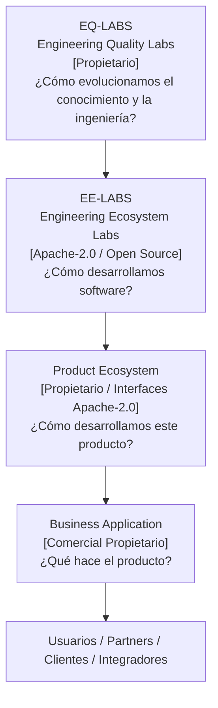
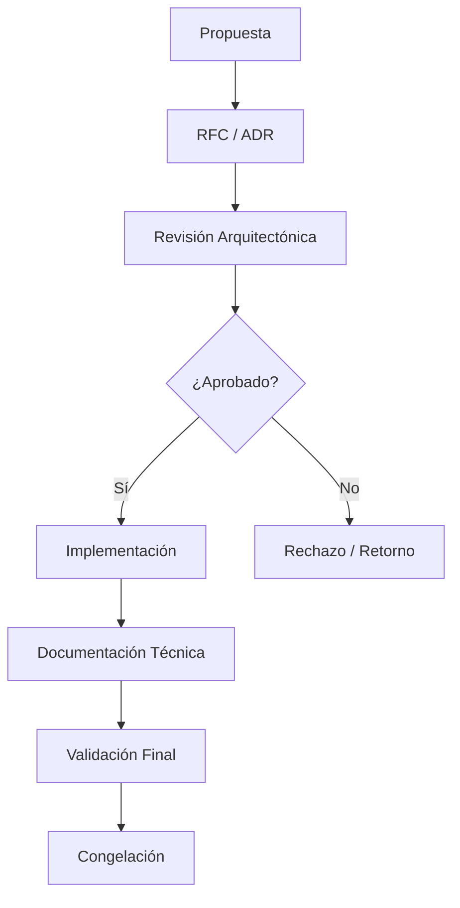
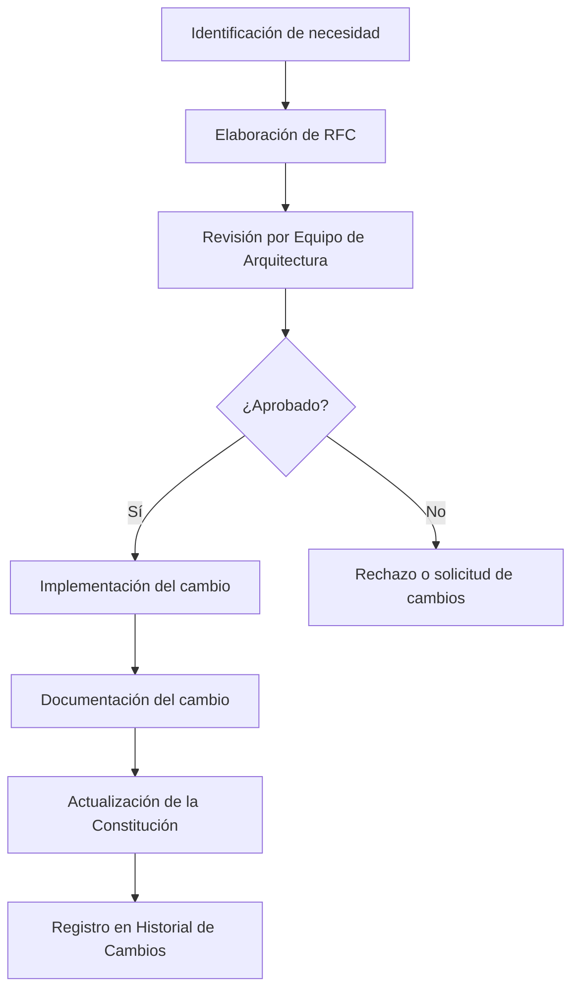

# EE-DOC-003 — Engineering Ecosystem Constitution

Este documento sigue el estándar **EE-DOC-002 — Document Design Template**.

---

## METADATOS

| Campo                 | Valor                                              |
| --------------------- | -------------------------------------------------- |
| **ID**                | EE-DOC-003                                         |
| **Documento**         | Engineering Ecosystem Constitution                 |
| **Código corto**      | DOC-003                                            |
| **Tipo**              | Documento Normativo                                |
| **Clasificación**     | Fundacional                                        |
| **Nivel**             | Estratégico                                        |
| **Normativo**         | Sí                                                 |
| **Versión**           | v1.2.0                                             |
| **Estado**            | Congelado                                          |
| **Propietario**       | Equipo de Arquitectura                             |
| **Documento padre**   | EE-DOC-001                                         |
| **Dependencias**      | padre=EE-DOC-001; contenido=EE-DOC-001, EE-DOC-002 |
| **Aprobado por**      | Equipo de Arquitectura                             |
| **Audiencia**         | Arquitectura, Desarrollo, IA, Dirección            |
| **Fecha de creación** | 2026-08-02                                         |
| **Última revisión**   | 2026-10-14                                         |
| **Próxima revisión**  | No aplica — Documento Congelado                    |

---

## 01. Propósito

La **Engineering Ecosystem Constitution** es el documento fundacional que establece la misión, visión, valores, principios, gobernanza y normas del Engineering Ecosystem. Define las reglas permanentes que gobiernan cómo se construye, mantiene y evoluciona el ecosistema de ingeniería.

Todo documento, herramienta, proceso o decisión dentro del ecosistema debe alinearse con esta constitución.

---

## 02. Alcance

Esta constitución cubre:

- La misión, visión, valores y objetivos estratégicos del Engineering Ecosystem.
- El marco conceptual organizacional de cuatro capas (EQ-LABS, EE-LABS, Product Ecosystem y Business Application).
- Los principios fundamentales que nunca cambian.
- La política constitucional de licenciamiento y propiedad intelectual de EE-LABS.
- El modelo de gobernanza y la organización del ecosistema.
- Los roles, responsabilidades y autoridades.
- El ciclo de vida del ecosistema y la política de idioma por artefacto.
- Las normas generales de cumplimiento.
- La gestión del cambio y las disposiciones finales.

Esta constitución **no cubre**:

- Detalles de implementación de herramientas específicas (cubiertos en documentos especializados del Engineering Ecosystem).
- Procedimientos operativos detallados (cubiertos en documentos específicos).
- Decisiones arquitectónicas de proyectos concretos (cubiertas en sus respectivos ADRs).

---

## 03. Misión

Proporcionar un ecosistema de ingeniería moderno, automatizado, reproducible y gobernado que permita desarrollar productos de software de alta calidad mediante procesos estandarizados, automatización e inteligencia artificial.

## 04. Marco Conceptual Organizacional (4 Capas)

El Engineering Ecosystem se fundamenta en un modelo conceptual corporativo de cuatro (4) capas que responde a la secuencia de creación de valor desde la estrategia hasta el usuario final:

| Capa                                          | Pregunta Guía                                        | Naturaleza y Responsabilidad                                                                                                | Licenciamiento / IP                                                                                         |
| :-------------------------------------------- | :--------------------------------------------------- | :-------------------------------------------------------------------------------------------------------------------------- | :---------------------------------------------------------------------------------------------------------- |
| **1. EQ-LABS** _(Engineering Quality Labs)_   | ¿Cómo evolucionamos el conocimiento y la ingeniería? | Cerebro y nivel estratégico corporativo. Responsable de la investigación, innovación y estrategia tecnológica.              | **All Rights Reserved**. Marca e IP corporativa protegida.                                                  |
| **2. EE-LABS** _(Engineering Ecosystem Labs)_ | ¿Cómo desarrollamos software?                        | Plataforma tecnológica corporativa que define estándares, herramientas, automatización, gobernanza y SDLC.                  | **Apache License 2.0**. Ecosistema Open Source abierto.                                                     |
| **3. Product Ecosystem**                      | ¿Cómo desarrollamos este producto?                   | Especialización del ecosistema al contexto de un producto (ej. EUM). Define arquitectura técnica, DevOps e infraestructura. | **Licencia Propietaria** (núcleo técnico). **Apache License 2.0** (interfaces públicas: APIs/SDKs/Schemas). |
| **4. Business Application**                   | ¿Qué hace el producto?                               | Implementación de la lógica funcional de negocio (ej. EUM ERP) que aporta valor directo al cliente.                         | **Licencia Comercial Propietaria (Cerrada)**. Producto comercial.                                           |

**Diagrama — Marco conceptual de 4 capas (EQ-LABS → EE-LABS → Product → Business Application).**

---

## 05. Visión

Ser el estándar de referencia para ecosistemas de ingeniería en organizaciones que buscan maximizar la calidad, consistencia y velocidad de desarrollo mediante la automatización, la gobernanza y la integración nativa de inteligencia artificial.

---

## 06. Valores

| Valor                    | Descripción                                                              |
| ------------------------ | ------------------------------------------------------------------------ |
| **Excelencia Técnica**   | Buscamos la máxima calidad en todo lo que hacemos.                       |
| **Colaboración**         | Construimos juntos, compartimos conocimiento y aprendemos unos de otros. |
| **Transparencia**        | Todo es visible, trazable y auditable.                                   |
| **Responsabilidad**      | Asumimos la propiedad de nuestras decisiones y acciones.                 |
| **Aprendizaje Continuo** | Evolucionamos mediante la mejora constante y la adaptación al cambio.    |

---

## 07. Objetivos Estratégicos

| #   | Objetivo                           | Descripción                                                            |
| --- | ---------------------------------- | ---------------------------------------------------------------------- |
| 1   | **Estandarizar el desarrollo**     | Definir procesos y herramientas consistentes para todos los proyectos. |
| 2   | **Automatizar tareas repetitivas** | Eliminar trabajo manual mediante scripts, CI/CD y herramientas.        |
| 3   | **Centralizar el conocimiento**    | Mantener una única fuente de verdad para documentación y decisiones.   |
| 4   | **Garantizar trazabilidad**        | Todo cambio, decisión y artefacto debe ser trazable.                   |
| 5   | **Integrar IA de forma gobernada** | La IA es una herramienta, no un reemplazo del criterio humano.         |
| 6   | **Garantizar calidad por defecto** | La calidad no es opcional; está incorporada en cada etapa.             |

---

## 08. Principios Fundamentales

> **Regla Introductoria:** Los principios fundamentales tienen carácter permanente y prevalecen sobre cualquier documento inferior. No pueden ser modificados sin un RFC aprobado por el Equipo de Arquitectura.

| #   | Principio                     | Descripción                                                                     |
| --- | ----------------------------- | ------------------------------------------------------------------------------- |
| 1   | **Documentation First**       | No existe configuración, decisión o herramienta sin documentación.              |
| 2   | **Architecture First**        | Toda implementación se basa en una arquitectura documentada y aprobada.         |
| 3   | **Automation First**          | Si una tarea puede automatizarse, debe automatizarse.                           |
| 4   | **AI Assisted Engineering**   | La IA asiste, pero no reemplaza el juicio humano.                               |
| 5   | **Security by Design**        | La seguridad se incorpora desde el diseño, no como un añadido.                  |
| 6   | **Quality by Default**        | La calidad es un requisito, no una opción.                                      |
| 7   | **Configuration over Code**   | La configuración debe ser externa al código siempre que sea posible.            |
| 8   | **Single Source of Truth**    | No existe información duplicada. Cada decisión tiene un único lugar donde vive. |
| 9   | **Reproducibility**           | Cualquier entorno, build o despliegue debe poder reproducirse.                  |
| 10  | **Continuous Validation**     | La validación es continua, no un evento puntual.                                |
| 11  | **Vendor Agnostic**           | El ecosistema no depende de un proveedor específico.                            |
| 12  | **Evolution over Revolution** | Los cambios se introducen de forma evolutiva y controlada.                      |

---

## 09. Modelo de Gobernanza

### 09.1. Autoridad Constitucional

La máxima autoridad normativa del Engineering Ecosystem es el **Equipo de Arquitectura**, responsable de:

- Interpretar la Constitución.
- Aprobar modificaciones a la Constitución.
- Resolver conflictos de jerarquía normativa.
- Garantizar el cumplimiento de la Constitución en todo el ecosistema.

El Equipo de Arquitectura delega en los Arquitectos la revisión y aprobación de ADRs y RFCs, pero la autoridad última sobre la Constitución reside en el equipo colegiado.

### 09.2. Estructura de Gobernanza

| Nivel                      | Responsabilidad                                                | Autoridad                                                                       |
| -------------------------- | -------------------------------------------------------------- | ------------------------------------------------------------------------------- |
| **Equipo de Arquitectura** | Define la visión, principios y evolución del ecosistema.       | Aprobación de cambios estructurales y constitucionales.                         |
| **Arquitectos**            | Diseñan y validan la arquitectura del ecosistema.              | Revisión y aprobación de ADRs y RFCs por delegación del Equipo de Arquitectura. |
| **Desarrolladores**        | Implementan y mantienen los componentes del ecosistema.        | Propuesta de cambios y mejoras.                                                 |
| **IA Asistente**           | Asiste en la generación de documentación, código y revisiones. | Propuesta de cambios (sin autoridad de aprobación).                             |

### 09.3. Mecanismos de Decisión

| Mecanismo       | Descripción                                                                                      | Aplicación                                                                    | Obligatorio cuando                                                            |
| --------------- | ------------------------------------------------------------------------------------------------ | ----------------------------------------------------------------------------- | ----------------------------------------------------------------------------- |
| **RFC**         | Request for Comments. Documento que propone un cambio significativo.                             | Cambios arquitectónicos, nuevos estándares, modificaciones a la Constitución. | El cambio afecta a múltiples proyectos o modifica la Constitución.            |
| **ADR**         | Architectural Decision Record. Documento que registra una decisión arquitectónica.               | Decisiones de diseño, selección de tecnologías, patrones arquitectónicos.     | La decisión es irreversible o tiene impacto significativo en la arquitectura. |
| **Aprobación**  | Decisión formal del Equipo de Arquitectura.                                                      | Cambios que afectan la Constitución o la arquitectura del ecosistema.         | El cambio modifica la Constitución o la arquitectura principal.               |
| **Congelación** | Estado de cierre de una **versión** (no implica inmutabilidad permanente; ver EE-DOC-002 §13.2). | Versión documental/implementación sincronizada y validada.                    | Tras validación; cambios posteriores = nueva versión vía cambio gobernado.    |

### 09.4. Flujo de Aprobación

**Diagrama — Flujo de aprobación.**

> **Nota:** Este flujo es un resumen de alto nivel. El ciclo detallado de implementación por fases, el mecanismo de **Descubrimiento** y la clasificación de cambios **Tipo A/B/C/D** se definen en **EE-DOC-005 — Development Workflow** (§04 y §04.2). **Congelado ≠ inmutable** (EE-DOC-002 §13.2).

---

## 10. Organización del Ecosistema

El Engineering Ecosystem se organiza en componentes cuyo **orden de implementación, códigos y artefactos** están definidos como SSOT en **EE-DOC-001 — Master Documentation Index** (§05 Roadmap, §06 Estructura Documental, §07 Implementation Roadmap).

Esta Constitución **no duplica** la tabla de roadmap. Cualquier modificación del orden o del catálogo de documentos debe reflejarse **primero** en EE-DOC-001 y, solo si afecta principios o gobernanza constitucional, sincronizarse aquí mediante cambio gobernado.

> **Regla:** Mantener sincronización con EE-DOC-001. No redefinir aquí el catálogo EE-DOC-001…015.

---

## 11. Roles, Responsabilidades y Autoridades

| Rol                        | Responsabilidad                                                                                                            | Autoridad                                                             |
| :------------------------- | :------------------------------------------------------------------------------------------------------------------------- | :-------------------------------------------------------------------- |
| **Equipo de Arquitectura** | Definir la visión y evolución del ecosistema. Asegurar la consistencia y calidad arquitectónica.                           | Aprobar cambios a la Constitución y a la arquitectura del ecosistema. |
| **Arquitecto**             | Diseñar y validar la arquitectura del ecosistema. Revisar y aprobar ADRs y RFCs por delegación del Equipo de Arquitectura. | Aprobar decisiones arquitectónicas dentro del ámbito delegado.        |
| **Desarrollador**          | Implementar y mantener los componentes del ecosistema. Proponer mejoras y cambios.                                         | Proponer cambios (sin autoridad de aprobación).                       |
| **Revisor**                | Revisar código, documentación y propuestas de cambio.                                                                      | Aprobar revisiones técnicas.                                          |
| **Maintainer**             | Mantener la estabilidad y calidad de los componentes. Gestionar versiones y releases.                                      | Aprobar releases y cambios en componentes mantenidos.                 |
| **DevOps**                 | Gestionar la infraestructura, CI/CD y despliegues.                                                                         | Aprobar cambios en infraestructura y pipelines.                       |
| **Security**               | Validar la seguridad de los componentes y procesos.                                                                        | Rechazar cambios que no cumplan con los estándares de seguridad.      |
| **IA Asistente**           | Asistir en la generación de documentación, código y revisiones.                                                            | Proponer cambios (sin autoridad de aprobación).                       |

> **Regla de Multiplicidad:** Un mismo individuo puede desempeñar múltiples roles, pero las autoridades permanecen separadas. La **aprobación** de cambios (PR / merge) la ejerce el rol **Maintainer** (u otro revisor con autoridad de aprobación distinta del autor del cambio), conforme a la gobernanza de GitHub del monorepo (CODEOWNERS / team Maintainers) y a EE-DOC-005 / EE-DOC-007.
>
> Un Arquitecto **no** auto-aprueba en solitario el merge de sus propios cambios cuando existe Maintainer u otro revisor habilitado: la separación autor ≠ aprobador es la regla operativa vigente.

---

## 12. Ciclo de Vida del Ecosistema

El ciclo de vida documental y la **taxonomía de estados** del Engineering Ecosystem tienen un único SSOT:

| Aspecto                                                               | Fuente normativa (SSOT)                                                               |
| --------------------------------------------------------------------- | ------------------------------------------------------------------------------------- |
| Taxonomía de estados e iconografía                                    | **EE-DOC-001** §08 — Estados del Ciclo de Vida Documental                             |
| Elaboración documental, plantillas y uso del ciclo                    | **EE-DOC-002** — Document Design Template (§13, §14, §15; §20.2 delega estados a 001) |
| Implementación por fases y Descubrimiento                             | **EE-DOC-005** — Development Workflow (§04)                                           |
| Estados operativos de evidencia (Completado, Implementado, WAIVED, …) | **EE-DOC-001** §08.1                                                                  |

Esta sección **no redefine** estados ni versionado. Cualquier diagrama o resumen local es solo ilustrativo y debe interpretarse conforme a las fuentes anteriores.

**Congelado** no significa inmutable: una versión congelada no se modifica in situ; todo cambio genera nueva versión mediante el mecanismo de gobernanza aplicable (EE-DOC-002 §13.2; EE-DOC-001 R2 / EE-DOC-005 §04.2).

---

## 13. Normas del Ecosistema

Las normas siguientes **aplican** los principios fundamentales de §08 (no los sustituyen). Incluyen de forma explícita **AI Assisted Engineering** y **Continuous Validation**.

| #   | Norma                               | Principio(s) de §08                     | Descripción operativa                                                                                                                          |
| --- | ----------------------------------- | --------------------------------------- | ---------------------------------------------------------------------------------------------------------------------------------------------- |
| 1   | **Documentar antes de implementar** | Documentation First, Architecture First | No se implementa sin documentación normativa o decisión aprobada cuando aplique.                                                               |
| 2   | **Automatizar lo repetible**        | Automation First                        | Tareas repetitivas se automatizan; la excepción debe justificarse.                                                                             |
| 3   | **Una sola fuente de verdad**       | Single Source of Truth                  | Prohibida la duplicación normativa; los índices y matrices remiten al SSOT.                                                                    |
| 4   | **IA asistida, no sustitutiva**     | AI Assisted Engineering                 | La IA asiste; el juicio humano y la aprobación arquitectónica prevalecen.                                                                      |
| 5   | **Seguridad desde el diseño**       | Security by Design                      | Controles y amenazas se consideran en diseño, no solo en cierre.                                                                               |
| 6   | **Calidad por defecto**             | Quality by Default                      | Quality Gates y estándares aplican por defecto según EE-DOC-010.                                                                               |
| 7   | **Configuración sobre código**      | Configuration over Code                 | Preferir configuración externa y compartida (SSOT de config del monorepo) frente a valores hardcodeados; el árbol físico lo define EE-DOC-006. |
| 8   | **Reproducibilidad**                | Reproducibility                         | Entornos y builds deben poder reproducirse de forma documentada.                                                                               |
| 9   | **Vendor agnostic**                 | Vendor Agnostic                         | Evitar acoplamiento irreversible a un proveedor sin ADR/RFC.                                                                                   |
| 10  | **Evolución gobernada**             | Evolution over Revolution               | Cambios estructurales vía ADR/RFC y sincronización con EE-DOC-001.                                                                             |
| 11  | **Validación continua**             | Continuous Validation                   | La validación no es un evento único de cierre; el régimen de ecosistema lo define EE-DOC-015.                                                  |
| 12  | **Cumplimiento verificable**        | (transversal)                           | El incumplimiento se gestiona según §15; no se interpreta como aprobación tácita.                                                              |

### 13.1. Política de Licenciamiento y Propiedad Intelectual

1. **Titularidad de Activos:** EQ-LABS es el único propietario de la propiedad intelectual, marcas y productos desarrollados en la organización.
2. **Ecosistema Abierto (EE-LABS):** La plataforma EE-LABS se distribuye como software libre bajo la Apache License 2.0 para fomentar la adopción, reutilización y colaboración de la comunidad.
3. **Aislamiento de Productos y Lógica Comercial:** La arquitectura interna de los Product Ecosystems y la lógica de negocio de las Business Applications permanecen bajo licencias propietarias y comerciales cerradas.
4. **Interfaces Públicas Abiertas:** Todas las APIs públicas, SDKs públicos (Public SDKs), especificaciones OpenAPI, contratos de eventos AsyncAPI y esquemas JSON Schemas se publican bajo Apache License 2.0 para facilitar la integración de terceros sin comprometer el núcleo comercial.
5. **Apertura Controlada:** La apertura de la plataforma de ingeniería no implica la apertura del código ni del know-how comercial de las aplicaciones de negocio.

### 13.2. Ventajas Estratégicas del Modelo de Licenciamiento

- **Comunidad de Ingenieros:** EE-LABS genera adopción masiva mediante su modelo Open Source.
- **Ecosistema de Integradores:** Las interfaces públicas bajo Apache License 2.0 permiten a partners extender la plataforma sin fricción legal.
- **Protección del Know-How y del Producto:** La ventaja competitiva permanece protegida bajo licencias cerradas.

---

## 14. Gestión del Cambio

### 14.1. Modificaciones a la Constitución

Los cambios a esta Constitución se clasifican además según el régimen de **EE-DOC-005 §04.2** (Tipo A/B/C/D) y **EE-DOC-001 R2** (RFC o ADR cuando aplique). La tabla siguiente detalla el impacto constitucional y el incremento de versión semántica de **este** documento.

| Tipo de Cambio            | Proceso                                          | Aprobación                                      | Incremento de Versión   |
| ------------------------- | ------------------------------------------------ | ----------------------------------------------- | ----------------------- |
| **Correcciones menores**  | Errores ortográficos, gramaticales o de formato. | Equipo de Arquitectura                          | Z (ej. v1.0.0 → v1.0.1) |
| **Adiciones**             | Nuevas secciones, valores, principios o normas.  | RFC + Equipo de Arquitectura                    | Y (ej. v1.0.0 → v1.1.0) |
| **Modificaciones**        | Cambios en secciones existentes.                 | RFC + Equipo de Arquitectura                    | Y (ej. v1.0.0 → v1.1.0) |
| **Eliminaciones**         | Eliminación de secciones completas.              | RFC + Equipo de Arquitectura                    | X (ej. v1.0.0 → v2.0.0) |
| **Cambios estructurales** | Reorganización de la Constitución.               | RFC + Equipo de Arquitectura + Revisión externa | X (ej. v1.0.0 → v2.0.0) |

### 14.2. Proceso de Modificación

**Diagrama — Proceso de modificación de la Constitución.**

---

## 15. Cumplimiento

### 15.1. Mecanismos de Verificación

| Mecanismo                                          | Descripción                                                                                                                                                    | Frecuencia                    | Responsable             |
| -------------------------------------------------- | -------------------------------------------------------------------------------------------------------------------------------------------------------------- | ----------------------------- | ----------------------- |
| **Revisiones Arquitectónicas**                     | Verificación de alineación con la Constitución.                                                                                                                | Por cambio significativo.     | Equipo de Arquitectura  |
| **Auditorías**                                     | Revisión periódica del cumplimiento de normas.                                                                                                                 | Trimestral.                   | Equipo de Arquitectura  |
| **Validación Automática de estándares EE-DOC-002** | **PENDING** (régimen EE-DOC-005 §10.4): QG-DOC actuales no validan estructura EE-DOC-002 completa (ver EE-DOC-012 §19.4). No declarar enforcement inexistente. | Continua (cuando exista gate) | Automatización / DevOps |

### 15.2. Consecuencias del Incumplimiento

| Nivel        | Consecuencia                                 |
| :----------- | :------------------------------------------- |
| **Leve**     | Notificación y solicitud de corrección.      |
| **Moderado** | Bloqueo de cambios hasta la corrección.      |
| **Grave**    | Rechazo del cambio o componente.             |
| **Crítico**  | Revisión del componente o proyecto completo. |

---

## 16. Disposiciones Finales

### 16.1. Vigencia

Esta Constitución entra en vigencia a partir de su **congelación y publicación oficial** en el repositorio canónico.

Los proyectos y componentes del Engineering Ecosystem deben **alinearse** a ella. La evidencia de alineación se registra mediante el mecanismo de validación aplicable (p. ej. EE-DOC-015 / evidencias en `docs/validation/`) o declaración explícita en el documento de implementación correspondiente — **sin** plazo fijo de “90 días” no verificable.

### 16.2. Jerarquía Normativa

La **jerarquía por tipo de documento**, la precedencia en conflicto (incluido desempate a **mismo nivel**: padre estructural o escalar a Arquitectura; **sin** sola recencia) y el rol de artefactos derivados (**ADR, RFC, IMP, TEC, VAL, WAIVE**) se definen en **EE-DOC-002 §03.1**. El **índice, códigos, roadmap y taxonomía de estados** se definen en **EE-DOC-001**.

Esta Constitución ocupa el **nivel 3 — Documentos Constitucionales** y **no redefine** la taxonomía de 002 ni el catálogo de 001.

### 16.3. Excepciones

Toda excepción a esta Constitución debe solicitarse mediante **RFC aprobado** por el Equipo de Arquitectura (EE-DOC-001 R2 / EE-DOC-005), documentarse y revisarse periódicamente.

La existencia de **Maintainer** (team Maintainers / CODEOWNERS) que aprueba cambios **no** constituye excepción: es el mecanismo ordinario de separación autor ≠ aprobador (§11).

### 16.4. Interpretación

La interpretación de esta Constitución corresponde al Equipo de Arquitectura. En caso de ambigüedad, prevalece el espíritu de la Constitución sobre la letra.

---

## 17. Referencias

| Código                          | Documento                             | Descripción                                                                                      |
| ------------------------------- | ------------------------------------- | ------------------------------------------------------------------------------------------------ |
| **EE-DOC-001**                  | Master Documentation Index            | Índice, roadmap, códigos; SSOT estados §08 / §08.1; R2/R7; §09.4 familias VAL/WAIVE              |
| **EE-DOC-002**                  | Document Design Template              | Plantilla §18; jerarquía y derivados §03.1; estados delegados (§13, §20.2); código corto §05/§16 |
| **EE-DOC-004**                  | Engineering Architecture              | Documento arquitectónico (nivel 4)                                                               |
| **EE-DOC-005**                  | Development Workflow                  | Ciclo de implementación, Descubrimiento, Tipo A/B/C/D (§04); régimen PENDING §10.4               |
| **EE-DOC-006**                  | Repository Structure                  | Árbol físico del monorepo; nomenclatura de archivos EE-\*                                        |
| **EE-DOC-010**                  | Quality Gates                         | Calidad por defecto; Result WAIVED §04.6.1                                                       |
| **EE-DOC-012**                  | Templates                             | QG-DOC y límites de validación documental automática (§19.4)                                     |
| **EE-DOC-015**                  | Engineering Ecosystem Validation      | Validación continua de ecosistema; padre típico de EE-VAL-\*                                     |
| **EE-ADR-\***                   | Architectural Decision Records        | Decisiones arquitectónicas subordinadas (002 §18.2; 001 §09.1)                                   |
| **EE-RFC-\***                   | Requests for Comments                 | Cambio gobernado Tipo D / transversal (002 §18.5)                                                |
| **EE-IMP-\***                   | Documentos técnicos de implementación | Evidencia por fase; subordinados al DOC padre (002 §18.3)                                        |
| **EE-TEC-\***                   | Documentación técnica consolidada     | As-built consolidado; subordinados al DOC padre (002 §18.4)                                      |
| **EE-VAL-\*** / **EE-WAIVE-\*** | Evidencia de validación / waivers     | 001 §09.4; plantilla 002 §18.6; no normativos                                                    |

## 18. Historial de Cambios

| Versión    | Fecha      | Autor                  | Aprobado por           | Motivo                        | Cambios                                                                                        | Estado        |
| :--------- | :--------- | :--------------------- | :--------------------- | :---------------------------- | :--------------------------------------------------------------------------------------------- | :------------ |
| **v1.0.0** | 2026-08-02 | Equipo de Arquitectura | Equipo de Arquitectura | Creación inicial              | Versión inicial de la Constitución                                                             | **Congelado** |
| **v1.0.1** | 2026-10-10 | Equipo de Arquitectura | Equipo de Arquitectura | Tipo A post-auditoría         | SSOT estados→001; jerarquía→002 §03.1; sin duplicar roadmap; punteros 002/005; detalle RFC-003 | **Congelado** |
| **v1.1.0** | 2026-10-11 | Equipo de Arquitectura | Equipo de Arquitectura | Minor Y + regularización C-01 | Consolida Tipo A vs 001/002; punteros §14–§15; bootstrap; vigencia; 001 §08.1; detalle RFC-003 | **Congelado** |
| **v1.1.1** | 2026-10-11 | Equipo de Arquitectura | Equipo de Arquitectura | Tipo A — referencias          | Completa §17 (001/002/006/012, IMP/TEC/VAL/WAIVE); quita fila EE-DOC-001b errónea              | **Congelado** |
| **v1.2.0** | 2026-10-14 | Equipo de Arquitectura | Equipo de Arquitectura | Tipo A — auditoría 001/002    | §04 renumerado; Maintainer; deps padre=/contenido=; hist≤230; ref 005; AR-018/020              | **Congelado** |

---

## FIN DEL DOCUMENTO
