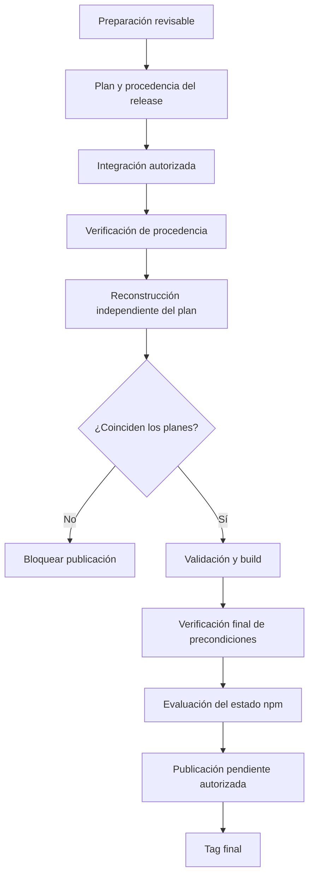

# EE-TEC-006 — Consolidated Technical Documentation of EE-DOC-011

Este documento registra la documentación técnica consolidada (estado **as-built**) correspondiente a la implementación de **EE-DOC-011 — Automation**, conforme a los estándares **EE-DOC-002 §18.4** y **EE-DOC-005**.

**No es normativo:** no modifica ni sustituye EE-DOC-011; consolida evidencia de **EE-IMP-011-P01…P05**.

---

## METADATOS

| Campo                 | Valor                                                                                                  |
| :-------------------- | :----------------------------------------------------------------------------------------------------- |
| **ID**                | EE-TEC-006                                                                                             |
| **Documento**         | Consolidated Technical Documentation of EE-DOC-011                                                     |
| **Código corto**      | EE-TEC-006                                                                                             |
| **Tipo**              | Documento Técnico                                                                                      |
| **Clasificación**     | Implementación                                                                                         |
| **Nivel**             | Técnico                                                                                                |
| **Normativo**         | No                                                                                                     |
| **Versión**           | v1.1.0                                                                                                 |
| **Estado**            | Completado                                                                                             |
| **Propietario**       | Equipo de Arquitectura                                                                                 |
| **Documento padre**   | EE-DOC-011 — Automation (v1.0.0 Aprobado)                                                              |
| **Dependencias**      | EE-DOC-005, EE-DOC-006, EE-DOC-007, EE-DOC-010, EE-DOC-011, EE-IMP-011-P01…P05, EE-ADR-001, EE-ADR-003 |
| **Aprobado por**      | Equipo de Arquitectura                                                                                 |
| **Audiencia**         | Arquitectura, Desarrollo, DevOps, IA                                                                   |
| **Fecha de creación** | 2026-09-30                                                                                             |
| **Última revisión**   | 2026-10-01                                                                                             |
| **Próxima revisión**  | 2026-12-30                                                                                             |

---

## 01. Propósito

Consolidar el estado **as-built** de la automatización del monorepo `ee-monorepo` tras el ciclo **EE-IMP-011-P01…P05**, como entrada a la **Validación Final** y posible **congelación** de EE-DOC-011.

---

## 02. Alcance

### 02.1. Cubierto

- Contrato de comandos root y `scripts/` (P01).
- Hardening de scripts de gate y política de shell (P02).
- Superficie DX `@eq-labs/cli` (P03).
- Audit A-GEN / A-REL: `generate` y `release` (P04).
- Validación integral y cierre del ciclo IMP (P05).
- Decisiones técnicas, alineación normativa y evidencia de QG.

### 02.2. No cubierto

- Catálogo o umbrales de **EE-DOC-010** (SSOT de gates).
- Workflows/rulesets de plataforma (**EE-DOC-007**), salvo consumo de invocaciones canónicas.
- Templates de scaffolding (**EE-DOC-012**).
- Publish npm / release end-to-end en producción.
- Hardening residual de scripts **no-gate** (backlog D-P04-005) y `eol=lf` en scripts (D-P04-006).

---

## 03. Resumen ejecutivo del estado as-built

| Aspecto                        | Estado                     | Evidencia principal   |
| :----------------------------- | :------------------------- | :-------------------- |
| Comandos root §04.2            | ✅ 14/14                   | EE-IMP-011-P01        |
| `scripts/README.md`            | ✅ Alineado                | P01 `aab8dba`         |
| Hardening gates + QG-ID        | ✅                         | P02 `b4712f8`         |
| CLI fachada DX                 | ✅                         | P03 `e8c273a`         |
| Generate (pending 012)         | ✅ Contrato conservado     | P04 `bd80a70`         |
| Release + validate pre-publish | ✅                         | P04 `bd80a70`         |
| Validación integral P05        | ✅                         | EE-IMP-011-P05 v1.1.0 |
| Descubrimientos Adoptados      | ✅ Cerrados                | §09                   |
| Diferidos legítimos            | 🟡 012 + backlog shell/eol | §09                   |
| CI `Validate` (muestra ciclo)  | ✅                         | Runs P02–P04 (§08)    |

| Elemento                  | Valor                                         |
| :------------------------ | :-------------------------------------------- |
| Fases IMP                 | P01–P05 **Completado**                        |
| Runtime                   | Node 24 (EE-ADR-003)                          |
| Orquestación              | Turbo + pnpm (EE-ADR-001)                     |
| Required check plataforma | `Validate` (EE-DOC-007)                       |
| TEC de esta norma         | **EE-TEC-006** (serie TEC-001…; no “TEC-011”) |

---

## 04. Estructura física consolidada

```text
ee-monorepo/
├── scripts/
│   ├── bootstrap, build, dev, test, lint, format
│   ├── typecheck          # QG-TYPE-001
│   ├── validate           # agregador EE-DOC-010
│   ├── doctor
│   ├── generate           # A-GEN — pending plopfile (EE-DOC-012)
│   ├── release            # A-REL — validate antes de publish
│   ├── clean
│   ├── configure-lint.mjs # auxiliar (no §04.2)
│   └── README.md          # documentación operativa derivada
├── package.json           # 14 scripts + changeset + version-packages
├── .changeset/config.json
└── apps/cli/              # @eq-labs/cli — fachada DX (bin: ee)
```

> **Alineación EE-DOC-006:** sin raíces top-level no autorizadas; `infra/` permanece dominio de EE-DOC-009 (no de 011).

---

## 05. Consolidación P01 — Inventory and Command Contract

### 05.1. Objetivo

Verificar 14/14 comandos de EE-DOC-011 §04.2 y sincronizar `scripts/README.md`.

### 05.2. Artefactos

| Artefacto                    | Rol                            | Status |
| :--------------------------- | :----------------------------- | :----: |
| `package.json` scripts       | Contrato de invocación         |   ✅   |
| `scripts/*` (12 entrypoints) | Materialización A-ROOT/GEN/REL |   ✅   |
| `scripts/README.md`          | Operativa derivada de §04.2    |   ✅   |

### 05.3. Decisiones

- Canónico = `pnpm run <cmd>`.
- `changeset` / `version-packages` sin archivo en `scripts/`.
- `configure-lint.mjs` fuera de §04.2.

### 05.4. Validaciones / commits

| Evidencia                      | Resultado               |
| :----------------------------- | :---------------------- |
| Inventario 14/14               | ✅                      |
| README sync                    | ✅ `aab8dba`            |
| Mitigación SEC brace-expansion | ✅ `169c298`, `8840076` |

---

## 06. Consolidación P02 — Scripts Hardening

### 06.1. Objetivo

Exit codes contractuales, mensajes QG-ID en gates, `shell` win32-only en scripts de gate.

### 06.2. Artefactos

| Artefacto           | Cambio                              | Status |
| :------------------ | :---------------------------------- | :----: |
| `scripts/lint`      | QG-LINT-001                         |   ✅   |
| `scripts/typecheck` | QG-TYPE-001                         |   ✅   |
| `scripts/build`     | QG-BUILD-001                        |   ✅   |
| `scripts/test`      | QG-TEST-001 + SKIPPED 0 tasks       |   ✅   |
| `scripts/validate`  | `shell` win32-only en `execCommand` |   ✅   |

### 06.3. Decisiones

- `shell: process.platform === "win32"` en **scripts de gate** y, en P04, generate/release.
- Scripts **no-gate** pueden conservar `shell: true` residual (**D-P04-005**, backlog) — **no** se afirma hardening universal de todos los scripts.
- `validate` no redefine umbrales de EE-DOC-010.

### 06.4. Validaciones / commits

| Evidencia                           | Resultado                        |
| :---------------------------------- | :------------------------------- |
| lint/typecheck/build PASS con QG-ID | ✅                               |
| test SKIPPED (0 tasks)              | ✅                               |
| CI                                  | ✅ `b4712f8` / run `36790490802` |

---

## 07. Consolidación P03 — CLI Surface

### 07.1. Objetivo

Alinear `@eq-labs/cli` a EE-DOC-011 §06 (fachada DX).

### 07.2. Artefactos

| Artefacto               | Rol                               | Status |
| :---------------------- | :-------------------------------- | :----: |
| `apps/cli/src/index.ts` | `help` + `run <cmd>` → `pnpm run` |   ✅   |
| `bin: ee`               | Entrypoint post-build             |   ✅   |
| `@types/node`           | Tipado Node                       |   ✅   |
| README CLI              | §06                               |   ✅   |

### 07.3. Decisiones

- CLI no reimplementa gates ni umbrales.
- Alineación del scaffold existente; sin ADR/RFC de modelo nuevo.

### 07.4. Validaciones / commits

| Evidencia           | Resultado                        |
| :------------------ | :------------------------------- |
| build/typecheck CLI | ✅                               |
| `run doctor` delega | ✅                               |
| CI                  | ✅ `e8c273a` / run `36794262329` |

---

## 08. Consolidación P04 — Generators and Release

### 08.1. Objetivo

Auditar A-GEN/A-REL; corregir defectos; sin publish real.

### 08.2. Artefactos

| Artefacto          | Estado | Nota                                                    |
| :----------------- | :----: | :------------------------------------------------------ |
| `scripts/generate` |   ✅   | pending `plopfile.js` → EE-DOC-012                      |
| `scripts/release`  |   ✅   | `cls;` eliminado; validate → `pnpm run build` → publish |
| Changesets config  |   ✅   | `baseBranch: main`                                      |

### 08.3. Decisiones

- Templates diferidos a **EE-DOC-012**.
- Release **debe** invocar `pnpm validate` antes de publish.
- Build de release vía invocación canónica `pnpm run build`.

### 08.4. Validaciones / commits

| Evidencia                                | Resultado                        |
| :--------------------------------------- | :------------------------------- |
| `node --check` generate/release          | ✅                               |
| `pnpm run generate` exit 0 + mensaje 012 | ✅                               |
| CI                                       | ✅ `bd80a70` / run `36797169325` |
| IMP cierre arquitectónico                | ✅ EE-IMP-011-P04 **v1.2.0**     |

---

## 09. Consolidación P05 — Validation and Closure

### 09.1. Objetivo

Validación integral, matriz de conformidad §04–§12, cierre del ciclo IMP.

### 09.2. Validaciones

| Validación                     |          Resultado           |
| :----------------------------- | :--------------------------: |
| P01–P04 Completado             |              ✅              |
| `pnpm run validate`            |              ✅              |
| QG-TEST-001 SKIPPED si 0 tasks |              ✅              |
| Matriz EE-DOC-011              |              ✅              |
| IMP cierre                     | ✅ EE-IMP-011-P05 **v1.1.0** |

### 09.3. Descubrimientos consolidados

| ID        | Descripción                     | Tipo | Estado                       |
| :-------- | :------------------------------ | :--- | :--------------------------- |
| D-P01-001 | README incompleto vs §04.2      | A    | ✅ Cerrado                   |
| D-P01-002 | `configure-lint.mjs` auxiliar   | —    | ✅ Aceptado                  |
| D-P01-003 | brace-expansion                 | B    | ✅ Cerrado                   |
| D-P02-001 | Mensajes sin QG-ID              | B    | ✅ Cerrado                   |
| D-P02-002 | shell en scripts de gate        | B    | ✅ Cerrado                   |
| D-P03-001 | CLI stub vs §06                 | B    | ✅ Cerrado                   |
| D-P04-001 | `cls;` en release               | B    | ✅ Cerrado                   |
| D-P04-002 | Sin plopfile                    | —    | 🟡 Diferido → **EE-DOC-012** |
| D-P04-004 | Buffer sin encoding en generate | B    | ✅ Cerrado                   |
| D-P04-005 | shell en scripts no-gate        | B    | 🟡 Backlog                   |
| D-P04-006 | LF/CRLF warnings scripts        | B    | 🟡 Backlog                   |

> **No hay descubrimientos Adoptados abiertos** en el alcance de automatización de EE-DOC-011. Los diferidos no bloquean la evidencia TEC ni el cierre IMP.

---

## 10. Decisiones técnicas consolidadas

| ID      | Decisión                                           | Justificación                        | Origen       |
| :------ | :------------------------------------------------- | :----------------------------------- | :----------- |
| DEC-001 | Canónico = `pnpm run <cmd>`                        | Single Source of Invocation          | P01 / §05.5  |
| DEC-002 | QG-ID en mensajes de gates                         | Trazabilidad logs/CI                 | P02          |
| DEC-003 | `shell` win32-only en **gates + generate/release** | DEP0190; shims Windows               | P02/P04      |
| DEC-004 | CLI = fachada DX                                   | No duplicar gates                    | P03 / §06    |
| DEC-005 | generate sin templates hasta 012                   | Scope                                | P04 / §07    |
| DEC-006 | release invoca validate antes de publish           | §08 + No False Pass                  | P04          |
| DEC-007 | No redefinir catálogo EE-DOC-010                   | SSOT de validación                   | P02/P05      |
| DEC-008 | TEC de DOC-011 = **EE-TEC-006**                    | Serie TEC correlativa (no “TEC-011”) | P04 R2 / P05 |

---

## 11. Alineación con EE-DOC-011

La siguiente matriz recoge la conformidad documentada durante el cierre original del ciclo P01–P05. Sus resultados corresponden al alcance y a las evidencias disponibles en aquel momento. La evolución posterior de A-REL asociada a **PN-021** se describe separadamente en §13.3 y requiere su propia verificación frente al contrato normativo actualizado.

| Elemento normativo         | Estado as-built                    | Clasificación                  |
| :------------------------- | :--------------------------------- | :----------------------------- |
| §04.2 Comandos root        | 14/14 presentes                    | ✅ Cumple                      |
| §05 Scripts / determinismo | Exit codes + README                | ✅ Cumple                      |
| §05.4 Mapeo gates          | QG-ID + validate                   | ✅ Cumple                      |
| §05.5 Invocación canónica  | CI y scripts                       | ✅ Cumple                      |
| §06 CLI                    | Fachada + delegación               | ✅ Cumple                      |
| §07 Generators             | Pending 012 documentado            | ✅ Cumple (diferido explícito) |
| §08 Release                | validate pre-publish               | ✅ Cumple                      |
| §09 CI / QG                | 007 consume; 010 intacto           | ✅ Cumple                      |
| §10 Seguridad              | SEC-001 limpio; SEC-002 plataforma | ✅ Cumple                      |
| §11 Prohibiciones          | Sin violaciones registradas        | ✅ Cumple                      |
| §12 Plan P01–P05           | Completado + este TEC              | ✅ Cumple                      |

**Declaración:** no existen desviaciones silenciosas. Toda diferencia está clasificada en §09.

---

## 12. Quality Gates y validación aplicables

| Gate / mecanismo                    | Invocación canónica        | Resultado observado   |
| :---------------------------------- | :------------------------- | :-------------------- |
| QG-TYPE-001                         | `pnpm run typecheck`       | PASS                  |
| QG-LINT-001                         | `pnpm run lint`            | PASS                  |
| QG-FMT-001                          | check dentro de `validate` | PASS                  |
| QG-TEST-001                         | `pnpm run test`            | **SKIPPED** (0 tasks) |
| QG-BUILD-001                        | `pnpm run build`           | PASS                  |
| QG-ARCH-001 / DOC / INFRA / SEC-001 | subpasos `validate`        | PASS                  |
| QG-SEC-002                          | CI / plataforma (007)      | PASS (ciclo IMP)      |
| Agregador                           | `pnpm run validate`        | PASS                  |

---

## 13. Dictamen de revisión arquitectónica (cierre TEC)

### 13.1. Observaciones resueltas en v1.1.0

| #   | Observación                                              | Resolución                              |
| :-- | :------------------------------------------------------- | :-------------------------------------- |
| R1  | «7/7 resueltos» y «ningún diferido» contradecía P04/P05  | Tabla §09 con diferidos 012 y backlog   |
| R2  | DEC-003 «all scripts» shell win32-only                   | Limitado a gates + generate/release     |
| R3  | Encabezados `# 05` vs `## 05`                            | Normalizados a `##`                     |
| R4  | Descubrimientos inventados/incompletos (p.ej. D-P05-002) | Alineados a IMP-P04 v1.2.0 / P05 v1.1.0 |
| R5  | Falta anclas de commit/CI                                | Añadidas por fase                       |
| R6  | Falta dictamen formal de cierre TEC                      | Este §13                                |
| R7  | Confusión TEC-011 vs TEC-006                             | DEC-008 + metadatos                     |

### 13.2. Dictamen

> **EE-TEC-006 se declara Cerrado (Completado) v1.1.0.**  
> La evidencia as-built de automatización (P01–P05) es **completa y coherente** con EE-DOC-011, EE-DOC-010 y EE-DOC-006.  
> Este TEC es **apto como entrada a la Validación Final** de EE-DOC-011.  
> Pendientes legítimos (no bloquean el TEC): **EE-DOC-012**, D-P04-005, D-P04-006.

### 13.3. Evolución as-built posterior — PN-021: Integridad del release

La evolución asociada al pendiente de auditoría **PN-021** introduce una frontera de integridad entre la preparación del release y su finalización post-merge. El objetivo arquitectónico es impedir que una ejecución de publicación dependa exclusivamente de información declarada durante la preparación, sin poder verificar su correspondencia con el estado autorizado. Los controles de ejecución y permisos de GitHub asociados se relacionan con **PN-030** y pertenecen a EE-DOC-007.

#### 13.3.1. Componentes y responsabilidades

| Componente lógico          | Responsabilidad                                                                                                     |
| :------------------------- | :------------------------------------------------------------------------------------------------------------------ |
| Preparación del release    | Producir cambios de versionado revisables y registrar la procedencia del plan                                       |
| Contrato de procedencia    | Asociar el plan de release con la versión objetivo, el estado de origen y los Changesets correspondientes           |
| Verificación independiente | Reconstruir el plan esperado a partir de su origen y comprobar que coincide con el plan declarado                   |
| Evaluación de publicación  | Limitar las operaciones npm a las versiones públicas comprendidas en el plan autorizado y pendientes en el registro |
| Finalización del release   | Verificar las condiciones exigidas antes de publicar y establecer el tag final                                      |
| Recuperación               | Reconciliar el estado remoto sin repetir publicaciones ni sustituir tags inconsistentes                             |

#### 13.3.2. Flujo de integridad



La reconstrucción independiente utiliza el estado histórico correspondiente al origen del release y debe aislar sus operaciones del árbol de trabajo que será publicado. La comprobación se realiza antes de autorizar efectos remotos.

#### 13.3.3. Invariantes arquitectónicas

1. El plan de publicación debe proceder de una preparación identificable y autorizada.
2. La declaración de procedencia no es suficiente sin una comprobación independiente de integridad.
3. La publicación no puede incluir versiones públicas ajenas al plan autorizado.
4. La existencia previa de una versión npm debe tratarse como estado remoto que requiere reconciliación, no como autorización para modificarla.
5. Las operaciones de validación que puedan alterar el árbol de trabajo exigen verificar nuevamente las precondiciones de limpieza antes de publicar.
6. El tag no puede sustituirse ni moverse silenciosamente.
7. Los estados ambiguos o inconsistentes deben bloquear la finalización automática.

#### 13.3.4. Límites de conformidad

La arquitectura as-built incorpora controles de procedencia e integridad, pero su conformidad transversal permanece sujeta a la resolución de **PN-021** y a la verificación de los criterios aplicables. En particular, debe reconciliarse el tratamiento de releases sin paquetes públicos planificados con el contrato normativo de EE-DOC-011 §08.2. Este apartado no establece por sí mismo una nueva política de publicación.

La configuración efectiva de permisos, credenciales y protección de tags pertenece a GitHub Governance y debe documentarse en su superficie técnica correspondiente. La existencia de un diseño de publicación no constituye evidencia de publicación real ni de configuración OIDC activa.

El dictamen histórico de §13.2 permanece referido a la consolidación original de EE-DOC-011. Esta evolución posterior requiere su propia trazabilidad y verificación, sin reabrir ficticiamente las validaciones de octubre de 2026.

---

## 14. Referencias

| Código                  | Documento                                      |
| :---------------------- | :--------------------------------------------- |
| EE-DOC-002              | Document Design Template (§18.4)               |
| EE-DOC-005              | Development Workflow                           |
| EE-DOC-006              | Repository Structure                           |
| EE-DOC-007              | GitHub Governance                              |
| EE-DOC-010              | Quality Gates                                  |
| EE-DOC-011              | Automation (padre)                             |
| EE-IMP-011-P01…P05      | Fases de implementación                        |
| EE-ADR-001              | Workspace Task Orchestration                   |
| EE-ADR-003              | Node 24 LTS                                    |
| EE-AUDIT-Rules_Emerging | Backlog canónico de auditoría; PN-021 y PN-030 |

---

## 15. Historial de Cambios

| Versión    | Fecha      | Autor                  | Aprobado por           | Motivo                  | Cambios                                                                                 | Estado         |
| :--------- | :--------- | :--------------------- | :--------------------- | :---------------------- | :-------------------------------------------------------------------------------------- | :------------- |
| **v1.0.0** | 2026-09-30 | Equipo de Arquitectura | Equipo de Arquitectura | Consolidación inicial   | Integración P01–P05                                                                     | Completado     |
| **v1.1.0** | 2026-10-01 | Equipo de Arquitectura | Equipo de Arquitectura | Revisión arquitectónica | Diferidos reales; DEC-003 acotado; commits/CI; dictamen §13; encabezados; IMP versiones | **Completado** |

---

## FIN DEL DOCUMENTO
