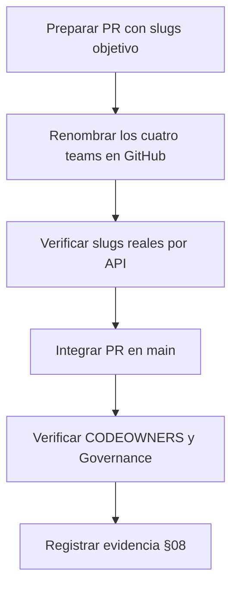

# EE-IMP-007-P04 — CODEOWNERS and Ownership

Este documento registra la evidencia técnica de la implementación física y validación correspondiente a la Unidad P04 conforme a **EE-DOC-005 — Development Workflow** y **EE-DOC-007 — GitHub Governance** (§08).

---

## METADATOS

| Campo                 | Valor                                            |
| :-------------------- | :----------------------------------------------- |
| **ID**                | EE-IMP-007-P04                                   |
| **Documento**         | CODEOWNERS and Ownership                         |
| **Código corto**      | IMP-007-P04                                      |
| **Fase**              | Fase 4 — CODEOWNERS and Ownership                |
| **Tipo**              | Documento Técnico de Implementación              |
| **Clasificación**     | Implementación                                   |
| **Nivel**             | Técnico                                          |
| **Normativo**         | No                                               |
| **Versión**           | v0.6.0                                           |
| **Estado**            | En Elaboración                                   |
| **Propietario**       | Equipo de Arquitectura                           |
| **Documento padre**   | EE-DOC-007 — GitHub Governance                   |
| **Dependencias**      | contenido=EE-DOC-006, EE-DOC-007, EE-IMP-007-P01 |
| **Aprobado por**      | Equipo de Arquitectura                           |
| **Audiencia**         | Arquitectura, Desarrollo, DevOps                 |
| **Fecha de creación** | 2026-09-22                                       |
| **Última revisión**   | 2026-11-05                                       |
| **Próxima revisión**  | 2026-11-09                                       |

---

## 01. Objetivo

Materializar el archivo **`.github/CODEOWNERS`** con ownership real por áreas del monorepo, usando los **teams** creados en P02, sin anticipar workflows (P05) ni Quality Gates (P06).

---

## 02. Prerrequisitos

| Prerrequisito                            | Estado                         | Referencia     |
| :--------------------------------------- | :----------------------------- | :------------- |
| `.github/CODEOWNERS` existe como archivo | Completado (bootstrap)         | EE-IMP-007-P01 |
| Teams en org                             | Completado                     | EE-IMP-007-P02 |
| Ruleset `Protect main`                   | Completado                     | EE-IMP-007-P03 |
| Org / repo                               | `EQ-LABS-TECH` / `ee-monorepo` | P01–P02        |

### 02.1. Teams objetivo de la migración

| Nombre objetivo          | Slug objetivo              | Handle CODEOWNERS                        | Uso en ownership                                         |
| :----------------------- | :------------------------- | :--------------------------------------- | :------------------------------------------------------- |
| EE-Labs Architecture     | `ee-labs-architecture`     | `@EQ-LABS-TECH/ee-labs-architecture`     | Gobernanza, norma, config crítica, docs normativos       |
| EE-Labs Repository Admin | `ee-labs-repository-admin` | `@EQ-LABS-TECH/ee-labs-repository-admin` | Equipo disponible; no asignado como owner en el mapa P04 |
| EE-Labs Maintainers      | `ee-labs-maintainers`      | `@EQ-LABS-TECH/ee-labs-maintainers`      | Código del ecosistema (packages, apps, connectors)       |
| EE-Labs Contributors     | `ee-labs-contributors`     | `@EQ-LABS-TECH/ee-labs-contributors`     | **No** como owner obligatorio en P04                     |

> **Estado de migración:** estos son los slugs objetivo del PR. Los teams existentes todavía deben renombrarse en GitHub. No integrar el PR hasta comprobar que los cuatro slugs reales coinciden exactamente con esta tabla.

---

## 03. Alcance

### 03.1. Incluye

- Contenido operativo de `.github/CODEOWNERS` (sustituye el placeholder de P01).
- Mapa ruta → team alineado con EE-DOC-007 §08.5–§08.10 y EE-DOC-006.
- Opcional: activar **Require review from Code Owners** en el ruleset `Protect main`.
- Evidencia de verificación.

### 03.2. No incluye

| Tema                                  | Unidad                            |
| :------------------------------------ | :-------------------------------- |
| Workflows / Actions                   | P05                               |
| Required status checks / QG           | P06                               |
| Ownership por paquete individual fino | Evolución posterior si hace falta |
| Usuarios individuales como owners     | Evitar; team-first                |

---

## 04. Modelo de ownership (P04)

### 04.1. Principios aplicados

1. **Team-first** — solo handles de teams de la org.
2. **Domain ownership** — por área de primer nivel, no un único owner global sin criterio.
3. **Ownership único por patrón** — cada ruta explícita tiene un solo equipo responsable. Architecture es responsable de gobernanza, orquestación, configuración compartida, infraestructura, plantillas y componentes PN-017 que materializan políticas; Maintainers es responsable del código general de paquetes y automatización, incluido `packages/knowledge/`.
4. **Single-operator** — el operador `edus194` ya está en Architecture, Repository Admin y Maintainers; las menciones de team lo cubren.
5. **Última coincidencia gana** — en CODEOWNERS de GitHub, el último patrón que coincida tiene prioridad; ordenar de general → específico.

### 04.2. Mapa ruta → team

| Ruta / patrón                                                                           | Owner(s)                             | Justificación                                |
| :-------------------------------------------------------------------------------------- | :----------------------------------- | :------------------------------------------- |
| `*` (default)                                                                           | `@EQ-LABS-TECH/ee-labs-maintainers`  | Fallback del código del ecosistema           |
| `.github/`                                                                              | `@EQ-LABS-TECH/ee-labs-architecture` | Gobernanza de plataforma                     |
| `package.json`, `pnpm-workspace.yaml`, `pnpm-lock.yaml`, `turbo.json`                   | `@EQ-LABS-TECH/ee-labs-architecture` | Orquestación del monorepo                    |
| `.nvmrc`, `.npmrc`, `.editorconfig`, `.gitattributes`, `.gitignore`                     | `@EQ-LABS-TECH/ee-labs-architecture` | Config de repo / runtime base                |
| `packages/config/`                                                                      | `@EQ-LABS-TECH/ee-labs-architecture` | SSOT de configuración compartida             |
| `packages/`                                                                             | `@EQ-LABS-TECH/ee-labs-maintainers`  | Núcleo de paquetes                           |
| `packages/knowledge/`                                                                   | `@EQ-LABS-TECH/ee-labs-maintainers`  | Implementación del dominio knowledge         |
| `apps/`                                                                                 | `@EQ-LABS-TECH/ee-labs-maintainers`  | Aplicaciones                                 |
| `connectors/`                                                                           | `@EQ-LABS-TECH/ee-labs-maintainers`  | Conectores                                   |
| `scripts/`                                                                              | `@EQ-LABS-TECH/ee-labs-maintainers`  | Automatización del repositorio               |
| `scripts/lib/pr-governance.*`, `scripts/tests/*pr-governance*`                          | `@EQ-LABS-TECH/ee-labs-architecture` | Implementación y pruebas de políticas PN-017 |
| `scripts/commands/enforce`, `scripts/commands/reconcile`, `scripts/commands/governance` | `@EQ-LABS-TECH/ee-labs-architecture` | Comandos que aplican políticas PN-017        |
| `docs/`                                                                                 | `@EQ-LABS-TECH/ee-labs-maintainers`  | Documentación ordinaria                      |
| `docs/architecture/`, `docs/adr/`, `docs/rfc/`                                          | `@EQ-LABS-TECH/ee-labs-architecture` | Normativa y arquitectura                     |
| `docs/validation/audit/EE-AUD-*`                                                        | `@EQ-LABS-TECH/ee-labs-architecture` | Auditoría normativa                          |
| `docs/developer/`, `docs/validation/`                                                   | `@EQ-LABS-TECH/ee-labs-maintainers`  | Implementación y evidencia                   |
| `assets/`, `data/`, `examples/`, `marketplace/`                                         | `@EQ-LABS-TECH/ee-labs-maintainers`  | Soporte / extensibilidad                     |
| `infra/`                                                                                | `@EQ-LABS-TECH/ee-labs-architecture` | Infraestructura de plataforma                |
| `templates/`                                                                            | `@EQ-LABS-TECH/ee-labs-architecture` | Plantillas gobernadas                        |
| `LICENSE`, `NOTICE`, `CHANGELOG.md`, `README.md`                                        | `@EQ-LABS-TECH/ee-labs-architecture` | Artefactos de gobierno del repo              |

---

## 05. Contenido objetivo de `.github/CODEOWNERS`

Archivo a escribir en el monorepo (UTF-8). Comentarios en inglés (artefacto técnico / plataforma).

```text
# CODEOWNERS — EE-DOC-007 §08 / EE-IMP-007-P04
# Organization: EQ-LABS-TECH
# Teams: ee-labs-architecture, ee-labs-repository-admin, ee-labs-maintainers, ee-labs-contributors
# Last matching pattern takes precedence.
#
# Operational ownership for ee-monorepo.
# Do not list individual users; use org teams only.

# Default — ecosystem code
*       @EQ-LABS-TECH/ee-labs-maintainers

# Repository root governance & orchestration
LICENSE                         @EQ-LABS-TECH/ee-labs-architecture
NOTICE                          @EQ-LABS-TECH/ee-labs-architecture
CHANGELOG.md                    @EQ-LABS-TECH/ee-labs-architecture
README.md                       @EQ-LABS-TECH/ee-labs-architecture
package.json                    @EQ-LABS-TECH/ee-labs-architecture
pnpm-workspace.yaml             @EQ-LABS-TECH/ee-labs-architecture
pnpm-lock.yaml                  @EQ-LABS-TECH/ee-labs-architecture
turbo.json                      @EQ-LABS-TECH/ee-labs-architecture
.nvmrc                          @EQ-LABS-TECH/ee-labs-architecture
.npmrc                          @EQ-LABS-TECH/ee-labs-architecture
.editorconfig                   @EQ-LABS-TECH/ee-labs-architecture
.gitattributes                  @EQ-LABS-TECH/ee-labs-architecture
.gitignore                      @EQ-LABS-TECH/ee-labs-architecture

# GitHub Governance (high impact)
.github/                        @EQ-LABS-TECH/ee-labs-architecture

# Ecosystem packages & applications (general first)
packages/                       @EQ-LABS-TECH/ee-labs-maintainers
apps/                           @EQ-LABS-TECH/ee-labs-maintainers
connectors/                     @EQ-LABS-TECH/ee-labs-maintainers

# Shared config (SSOT) — after packages/ so it wins
packages/config/                @EQ-LABS-TECH/ee-labs-architecture

# Knowledge Layer (EE-DOC-014 / KS-06) — after packages/
packages/knowledge/             @EQ-LABS-TECH/ee-labs-maintainers
packages/foundation/src/contracts/knowledge*.ts @EQ-LABS-TECH/ee-labs-architecture

# AI Provider SPI contracts (EE-DOC-013 §11 #12)
packages/foundation/src/contracts/provider.ts    @EQ-LABS-TECH/ee-labs-architecture
packages/foundation/src/contracts/inference.ts   @EQ-LABS-TECH/ee-labs-architecture
packages/foundation/src/contracts/generation.ts  @EQ-LABS-TECH/ee-labs-architecture
packages/foundation/src/contracts/error.ts       @EQ-LABS-TECH/ee-labs-architecture

# Automation scripts
scripts/                        @EQ-LABS-TECH/ee-labs-maintainers

# Security and governance policy implementation — after scripts/ so it wins
scripts/lib/pr-governance.*     @EQ-LABS-TECH/ee-labs-architecture
scripts/commands/enforce       @EQ-LABS-TECH/ee-labs-architecture
scripts/commands/reconcile     @EQ-LABS-TECH/ee-labs-architecture
scripts/commands/governance    @EQ-LABS-TECH/ee-labs-architecture
scripts/tests/*pr-governance*  @EQ-LABS-TECH/ee-labs-architecture

# Documentation: Maintainers own routine material; Architecture owns normative domains.
docs/                           @EQ-LABS-TECH/ee-labs-maintainers
docs/architecture/              @EQ-LABS-TECH/ee-labs-architecture
docs/adr/                       @EQ-LABS-TECH/ee-labs-architecture
docs/rfc/                       @EQ-LABS-TECH/ee-labs-architecture
docs/developer/                 @EQ-LABS-TECH/ee-labs-maintainers
docs/validation/                @EQ-LABS-TECH/ee-labs-maintainers
docs/validation/audit/EE-AUD-* @EQ-LABS-TECH/ee-labs-architecture

# Support / extensibility
assets/                         @EQ-LABS-TECH/ee-labs-maintainers
data/                           @EQ-LABS-TECH/ee-labs-maintainers
examples/                       @EQ-LABS-TECH/ee-labs-maintainers
marketplace/                    @EQ-LABS-TECH/ee-labs-maintainers

# Platform infrastructure (EE-DOC-009)
infra/                          @EQ-LABS-TECH/ee-labs-architecture

# Platform templates (EE-DOC-012)
templates/                      @EQ-LABS-TECH/ee-labs-architecture
```

---

## 06. Plan de ejecución



### 06.1. Verificar slugs de teams

```powershell
gh api orgs/EQ-LABS-TECH/teams --jq ".[] | {name:.name, slug:.slug}"
```

Después del renombrado y antes del merge, confirmar que GitHub devuelve exactamente `ee-labs-architecture`, `ee-labs-repository-admin`, `ee-labs-maintainers` y `ee-labs-contributors`. Si algún slug difiere, corregir el PR antes de integrarlo.

### 06.2. Escribir el archivo (local)

Desde la raíz del monorepo, reemplazar el placeholder de P01 con el contenido de §05.

### 06.3. Integración en `main`

Con ruleset activo: **Pull Request** + approval (o bypass bootstrap documentado). Preferible un PR `docs/codeowners-p04` o `chore/codeowners-p04` → squash a `main`.

### 06.4. Require review from Code Owners (opcional en P04)

En ruleset **Protect main** → editar → activar **Require review from Code Owners**.

| Momento                        | Recomendación                                                                                               |
| :----------------------------- | :---------------------------------------------------------------------------------------------------------- |
| Tras CODEOWNERS en `main`      | **Activar** para materializar §07.16 + §08                                                                  |
| Si aún no hay segundo reviewer | Puede convivir con bypass de `edus194` (W-P03-001); al quitar bypass, Code Owners + 1 approval se refuerzan |

---

## 07. Especificación de artefactos

| Artefacto                      | Ruta / ubicación     | Estado P04                                                                      |
| :----------------------------- | :------------------- | :------------------------------------------------------------------------------ |
| CODEOWNERS operativo           | `.github/CODEOWNERS` | Diseño aprobado en este documento; revisión y validación remota pendientes      |
| Require Code Owners en ruleset | Ruleset `23861402`   | **Opcional / pendiente**                                                        |
| Mapa ownership                 | Este IMP §04         | Define el mapa de ownership; el diseño aprobado lo amplía para la documentación |

---

## 08. Evidencia As-Built

Evidencia capturada 2026-09-23.

Los valores de tamaño, slugs y validaciones de esta sección son una captura histórica de 2026-09-23, anterior a la migración. El diseño aprobado asigna el ownership rutinario de `docs/` a Maintainers, con reglas más específicas de Architecture para `docs/architecture/`, `docs/adr/`, `docs/rfc/` y `docs/validation/audit/EE-AUD-*`. La evaluación efectiva de CODEOWNERS y de teams requiere una ejecución de PR y comprobación remota; no se afirma completada localmente.

### 08.1. Teams (slugs reales)

| Name             | Slug               | Handle usado                     |
| :--------------- | :----------------- | :------------------------------- |
| Architecture     | `architecture`     | `@EQ-LABS-TECH/architecture`     |
| Repository Admin | `repository-admin` | `@EQ-LABS-TECH/repository-admin` |
| Maintainers      | `maintainers`      | `@EQ-LABS-TECH/maintainers`      |
| Contributors     | `contributors`     | No usado como owner obligatorio  |

### 08.2. CODEOWNERS

| Campo        | Valor as-built                                               |
| :----------- | :----------------------------------------------------------- |
| Ruta         | `.github/CODEOWNERS`                                         |
| Tamaño local | 2185 bytes (2026-09-23 01:13:39)                             |
| Encoding     | UTF-8                                                        |
| Contenido    | Conforme a §05; `marketplace/` → `@EQ-LABS-TECH/maintainers` |

### 08.3. Specialization Type B — Tooling (CODEOWNERS vs Markdown)

| ID            | Descripción                                                                    | Resolución                                                                |
| :------------ | :----------------------------------------------------------------------------- | :------------------------------------------------------------------------ |
| **B-P04-001** | VS Code / markdownlint trataban comentarios `#` de CODEOWNERS como headings MD | `.vscode/settings.json` + `.prettierignore` excluyen `.github/CODEOWNERS` |

### 08.4. Anomalía A-P04-001 (corrección obligatoria)

| Campo                 | Valor                                                   |
| :-------------------- | :------------------------------------------------------ |
| **Línea final**       | `marketplace/ @EQ-LABS-TECH/maintainers`                |
| **Problema original** | Apareció `@EQ-LABS-TECH/marketplace` (team inexistente) |
| **Corrección**        | Aplicada 2026-09-23 → `@EQ-LABS-TECH/maintainers`       |
| **Estado**            | **Resuelta**                                            |

### 08.5. Prueba de asignación

| Prueba                                        | Resultado                     |
| :-------------------------------------------- | :---------------------------- |
| PR que toca `.github/` → Architecture         | Pendiente de PR de validación |
| PR que toca `scripts/` → Maintainers          | Pendiente de PR de validación |
| PR que toca componentes PN-017 → Architecture | Pendiente de PR de validación |
| PR que toca `packages/` → Maintainers         | Pendiente de PR de validación |

---

## 09. Validaciones

| Prueba                                   | Resultado          | Evidencia                                                 |
| :--------------------------------------- | :----------------- | :-------------------------------------------------------- |
| `gh api orgs/EQ-LABS-TECH/teams` (slugs) | **OK**             | architecture, repository-admin, maintainers, contributors |
| Archivo local `.github/CODEOWNERS`       | **OK**             | 2185 bytes, UTF-8                                         |
| Sin owners individuales                  | **OK**             | Solo teams de org                                         |
| Contributors como owner obligatorio      | **OK**             | No usado                                                  |
| Team `marketplace` inexistente           | **OK (corregido)** | A-P04-001 resuelta → maintainers                          |
| Tooling ignore CODEOWNERS                | **OK**             | B-P04-001 (Type B)                                        |
| Require Code Owners en ruleset           | Pendiente          | Opcional P04                                              |

### 09.1. Criterio de conformidad

- [x] `.github/CODEOWNERS` materializado con patrones de dominio.
- [x] Solo handles `@EQ-LABS-TECH/<team>` (sin usuarios sueltos).
- [x] `.github/` bajo Architecture.
- [x] `scripts/` bajo Maintainers, con excepción Architecture para los componentes PN-017 indicados.
- [x] `infra/` bajo Architecture.
- [x] `package.json`, `pnpm-workspace.yaml`, `pnpm-lock.yaml` y `turbo.json` bajo Architecture.
- [x] `packages/config/` bajo Architecture y `packages/knowledge/` bajo Maintainers.
- [x] `templates/` bajo Architecture.
- [x] `packages/`, `apps/`, `connectors/` bajo Maintainers.
- [x] Contributors no usado como owner obligatorio.
- [x] **Sin ownership hacia teams inexistentes** (A-P04-001 resuelta).
- [x] Exclusiones de tooling documentadas (B-P04-001).

**Dictamen:** **Conforme**. Unidad **Completada**.

---

## 10. Reglas de implementación

1. No listar logins individuales en CODEOWNERS.
2. No asignar `@EQ-LABS-TECH/ee-labs-contributors` como owner requerido mientras el team esté vacío.
3. No activar Require Code Owners hasta que el archivo esté en la rama por defecto (o en el mismo cambio coordinado).
4. Cambios posteriores de ownership = especialización técnica o ADR según EE-DOC-007 §15.11.
5. Mantener comentarios y rutas en inglés.

---

## 11. Correcciones / Warnings

| ID            | Severidad   | Descripción                                                              | Tratamiento                                                                                                                                                                      |
| :------------ | :---------- | :----------------------------------------------------------------------- | :------------------------------------------------------------------------------------------------------------------------------------------------------------------------------- |
| **W-P04-001** | Informativo | Single-operator: teams con un miembro                                    | CODEOWNERS por team sigue siendo válido; escala al crecer                                                                                                                        |
| **W-P04-002** | Informativo | Require Code Owners + bypass bootstrap                                   | Compatible temporalmente; al quitar bypass, Code Owners exige review del team                                                                                                    |
| **B-P04-001** | Tipo B      | markdownlint/Prettier sobre CODEOWNERS                                   | Exclusiones en `.vscode/settings.json` y `.prettierignore`                                                                                                                       |
| **B-P04-002** | Tipo B      | Patrones CODEOWNERS con equipos alternativos                             | Un único equipo responsable por patrón: Architecture para `.github/`, orquestación, configuración, `infra/` y `templates/`; Maintainers para `scripts/` y `packages/knowledge/`. |
| **B-P04-003** | Tipo B      | Revisión arquitectónica explícita de PN-017 y regla Knowledge redundante | Architecture revisa los componentes PN-017 indicados; `knowledge*.ts` cubre `knowledge.ts`, por lo que se conserva una sola regla.                                               |
| **A-P04-001** | Mayor       | `marketplace/` apuntaba a team inexistente                               | **Resuelta:** `@EQ-LABS-TECH/maintainers`                                                                                                                                        |

---

## 12. Trazabilidad

| Elemento       | Referencia                        |
| :------------- | :-------------------------------- |
| **Norma**      | EE-DOC-007 §08                    |
| **Estructura** | EE-DOC-006                        |
| **Teams**      | EE-IMP-007-P02                    |
| **Protection** | EE-IMP-007-P03 (ruleset 23861402) |
| **Siguiente**  | EE-IMP-007-P05 — GitHub Actions   |

---

## 13. Referencias

| Código             | Documento                          |
| :----------------- | :--------------------------------- |
| **EE-DOC-006**     | Repository Structure               |
| **EE-DOC-007**     | GitHub Governance v1.0.0           |
| **EE-IMP-007-P01** | GitHub Governance Bootstrap        |
| **EE-IMP-007-P02** | Access and Organization Governance |
| **EE-IMP-007-P03** | Branch Protection                  |

---

## 14. Historial de Cambios

| Versión    | Fecha      | Autor                    | Aprobado por           | Motivo                                           | Cambios                                                                                                                         | Estado                                          |
| :--------- | :--------- | :----------------------- | :--------------------- | :----------------------------------------------- | :------------------------------------------------------------------------------------------------------------------------------ | :---------------------------------------------- |
| **v0.1.0** | 2026-09-22 | AI Engineering Assistant | —                      | Apertura P04                                     | Mapa ownership; contenido CODEOWNERS; plan de ejecución; criterios                                                              | En Elaboración                                  |
| **v0.2.0** | 2026-09-23 | AI Engineering Assistant | —                      | Evidencia as-built                               | CODEOWNERS materializado; B-P04-001 tooling; A-P04-001 team marketplace inexistente                                             | Implementado — Corrección marketplace pendiente |
| **v0.3.0** | 2026-09-23 | AI Engineering Assistant | —                      | Cierre P04                                       | A-P04-001 corregida; marketplace→maintainers; checklist conforme                                                                | **Completado**                                  |
| **v0.4.0** | 2026-11-02 | Equipo de Arquitectura   | Equipo de Arquitectura | Ownership documental escalable                   | Maintainers como owner de documentación ordinaria; Architecture para dominios normativos y auditoría.                           | En Elaboración                                  |
| **v0.5.0** | 2026-11-03 | Equipo de Arquitectura   | Equipo de Arquitectura | Consolidated changes for the same date and state | Defines one owner per area; Architecture reviews PN-017 components while Maintainers owns `scripts/` and `packages/knowledge/`. | En Elaboración                                  |
| **v0.6.0** | 2026-11-05 | Equipo de Arquitectura   | Equipo de Arquitectura | Ownership y metadatos PC-001                     | Actualiza rutas `EE-AUD` y Código corto conforme a DOC-002 §05/§16.                                                             | En Elaboración                                  |

---

## FIN DEL DOCUMENTO
